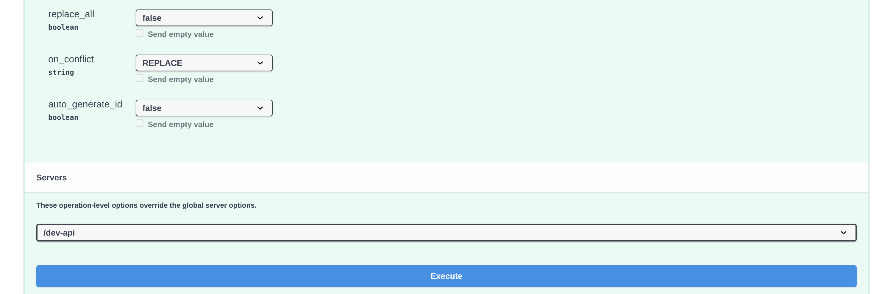

# Importazione dei Dati di Fornitori e Ordini di Acquisto in DocBits da File CSV

## Panoramica

Questa pagina descrive come preparare l'importazione CSV dei dati di fornitori o di ordini di acquisto in DocBits.

**Importante:** prima di importare qualsiasi dato è essenziale **controllare a fondo il file .csv**, per garantire la correttezza dei dati e una configurazione adeguata. L'importazione di dati errati può causare incongruenze. Per i dettagli sui campi obbligatori e su quelli facoltativi consulta le sezioni [**Specifiche CSV per Ordini di Acquisto**](importing-supplier-and-purchase-order-data-into-docbits-from-csv-files.md#specifiche-csv-per-ordini-di-acquisto) e [**Specifiche CSV per Fornitori**](importing-supplier-and-purchase-order-data-into-docbits-from-csv-files.md#specifiche-csv-per-fornitori). Verifica le colonne accettate e le regole di validazione della tua versione dell'API prima di usare un insieme di dati di produzione.

**Validazione:** usa gli elenchi seguenti come lista di controllo per la preparazione. Conferma i campi obbligatori, i campi aggiuntivi e alcune righe rappresentative per la tua installazione; questi elenchi non garantiscono che ogni riga non valida faccia rifiutare l'intero file. Controlla la risposta e verifica in modo autonomo i record previsti.

## Requisiti generali:

**Formato della data:**

Tutte le date nel file .csv **devono** rispettare il seguente formato:

YYYY-MM-DD HH:MM:SS

**Campi obbligatori:**

Prepara e verifica gli identificatori di base elencati qui sotto. Non fare affidamento su una richiesta di importazione per verificare al posto tuo la completezza o la correttezza aziendale del tuo CSV.

### Specifiche CSV per Ordini di Acquisto

**Campi di base da preparare e verificare**

* `purchase_order_number`

**Campi che possono essere inclusi**

* `warehouse_id`
* `location_id`
* `supplier_id`
* `supplier_name`
* `header_total_amount`
* `order_date`
* `requested_shipment_date`
* `promised_delivery_date`
* `payment_terms_code`
* `total_amount`
* `buyer_contact_id`
* `buyer_contact_name`
* `order_last_modified_by`
* `order_last_modified_on`
* `ship_to_party_id`
* `ship_to_party_name`
* `ship_to_address_id`
* `disponent_id`
* `disponent_name`
* `extended_amount`
* `extended_base_amount`
* `extended_report_amount`
* `canceled_amount`
* `canceled_base_amount`
* `canceled_reporting_amount`
* `geo_code`
* `preview_path`
* `type_code`
* `type_description`
* `custom_field_1`
* `custom_field_2`
* `custom_field_3`
* `custom_field_4`
* `custom_field_5`
* `status`
* `line_number`
* `sub_line_number`
* `item_id`
* `supplier_item_id`
* `description`
* `note`
* `quantity`
* `open_quantity`
* `confirmed_quantity`
* `received_quantity`
* `received_base_mou_quantity`
* `promised_delivery_date`
* `requested_ship_date`
* `unit_of_measure`
* `unit_code_price`
* `unit_price`
* `unit_price_per`
* `extended_amount`
* `total_amount`
* `currency`
* `status`
* `buyer_id`
* `buyer_name`
* `geo_code`
* `delivery_method`

### Specifiche CSV per Fornitori

**Campi di base da preparare e verificare**

* `customer_number`
* `supplier_number`
* `supplier_name`
* `country_code`

**Campi che possono essere inclusi**

* `address_id`
* `address_1`
* `address_2`
* `address_3`
* `address_4`
* `country_main_division`
* `town_city`
* `zip_code`
* `supplier_phone`
* `supplier_vat`
* `payment_term_id`
* `payment_method_code`
* `buyer_person_reference_id`
* `buyer_person_reference`
* `supplier_category`
* `supplier_group`
* `discount_term`
* `discount_term_description`
* `bank_id`
* `custom_field_1`
* `custom_field_2`
* `custom_field_3`
* `custom_field_4`
* `custom_field_5`
* `custom_field_6`
* `custom_field_7`
* `custom_field_8`
* `custom_field_9`
* `custom_field_10`
* `status`
* `account_id`
* `financial_partner_id`
* `financial_partner_name`
* `iban`
* `currency`

## Endpoint di accesso

### Scegliere l'ambiente e l'organizzazione

1. Apri il riferimento API dell'ambiente che vuoi usare. Il riferimento di produzione è [https://api.docbits.com/](https://api.docbits.com/); per i dati di test usa il tuo ambiente di test approvato. Controlla la versione dell'API e il valore in **Servers** prima di preparare una richiesta.
2. Per un'importazione autorizzata fai clic su **Authorize** e usa la chiave API fornita per l'organizzazione e l'utente previsti. Non copiare mai una chiave in uno screenshot, in un file CSV o in un esempio condiviso. Per la configurazione delle credenziali vedi [Integrazione e SSO](https://docs.docbits.com/italian/administration-and-setup/settings/global-settings/integration).

Le quattro immagini seguenti sono riprese proprie del riferimento API Dev, versione **12.83.642**, server **/dev-api**, realizzate il 13.11.2026. La console API di DocBits è attualmente disponibile solo in inglese, quindi le immagini mostrano le etichette inglesi della console. Non sono stati inseriti né una chiave API né un file CSV e **Execute** non è stato cliccato. I valori `string` visibili sono esempi generati da Swagger, non ID di organizzazione validi e non dati di importazione preparati.

<figure><figcaption>
Controlla per prima cosa la versione e il server del riferimento. Questo è il riferimento Dev senza credenziali autorizzate.
</figcaption></figure>

### Aprire l'operazione di importazione

1. Cerca **POST /master_data_lookup/import_data** e apri la voce.
2. Fai clic su **Try it out** per attivare il modulo di richiesta locale. Questo passaggio da solo non esegue alcuna importazione. Con **Cancel** esci dalla modalità di modifica senza inviare l'importazione.

<figure><figcaption>
L'operazione di importazione richiede un corpo della richiesta in formato multipart/form-data. Try it out attiva il modulo; l'importazione non viene inviata.
</figcaption></figure>

### Preparare il corpo della richiesta

* **sub_org_id:** inserisci l'ID previsto e autorizzato della sotto-organizzazione, se l'importazione appartiene a una sotto-organizzazione. In caso contrario rimuovi l'esempio generato `string` e lascia il campo vuoto in modo consapevole, se serve con il controllo **Send empty value** del modulo. Un campo vuoto non identifica un'organizzazione di test e non limita una sostituzione estesa all'intera organizzazione.
* **data_type:** inserisci `supplier` o `purchase_order` per i flussi descritti in questa pagina. Sostituisci l'esempio generato `string`; il campo è obbligatorio.
* **file / csv_data:** questa guida usa un file CSV. Cancella l'esempio generato in **csv_data** prima di scegliere il file: un `csv_data` non vuoto viene elaborato prima del file nell'importer verificato. Seleziona il tuo CSV controllato in **file** e conferma che il nome del file venga visualizzato. Non usare i valori di esempio delle immagini come tua richiesta.
* **delimiter:** scegli esplicitamente il separatore effettivo del tuo CSV: virgola (`,`) o punto e virgola (`;`). Controlla le prime righe in un editor di testo semplice. Non dare per scontato che il punto e virgola impostato inizialmente nel modulo corrisponda al tuo file o al valore predefinito del server.

<figure><figcaption>
I campi superiori della richiesta prima di ogni inserimento e prima del caricamento di un file. Gli esempi string visibili devono essere sostituiti o cancellati per una richiesta reale; qui non è selezionato alcun file.
</figcaption></figure>

### Verificare le opzioni di sostituzione e di conflitto

Queste descrizioni delle opzioni si riferiscono all'importer verificato. Conferma l'ambito della sostituzione e il comportamento in caso di conflitto per la versione dell'API che userai; le viste del riferimento non dimostrano questi effetti.

* **replace_all:** il valore predefinito dichiarato è `false`. Con `true` i record esistenti del tipo di dato selezionato vengono rimossi prima del caricamento del CSV. L'ambito della sostituzione è l'organizzazione, con un filtro sulla sotto-organizzazione quando ne viene indicata una. Verifica esplicitamente questo ambito prima di usare la sostituzione; un sub_org_id vuoto può riguardare il tipo di dato selezionato in tutta l'organizzazione. Con `false` i record esistenti vengono gestiti secondo **on_conflict**.
* **on_conflict:** scegli `IGNORE` per lasciare invariati i record di fornitori o di ordini di acquisto esistenti che corrispondono, oppure `REPLACE` per aggiornarli dal CSV. Il valore predefinito dichiarato è `REPLACE`. Questa opzione non protegge i record dal passaggio di rimozione precedente di **replace_all**.
* **auto_generate_id:** lascia questo valore su `false` e indica nel CSV gli identificatori aziendali obbligatori. La generazione automatica facoltativa non viene usata dagli importer verificati di fornitori e ordini di acquisto; non contare su di essa per creare numeri di fornitore o di ordine mancanti.

<figure><figcaption>
Il modulo inferiore e il pulsante Execute nello stato visualizzato esistente. Nessuna opzione è stata modificata ed Execute non è stato cliccato; questa immagine non è il risultato di un'importazione.
</figcaption></figure>

Fai clic su **Execute** solo dopo aver verificato ambiente di destinazione, organizzazione, ambito della sotto-organizzazione, CSV e opzioni, e solo se l'importazione è autorizzata. Controlla la risposta e verifica i record previsti prima di procedere con altre importazioni. Per gli ordini di acquisto vedi la [Dashboard degli ordini di acquisto](https://docs.docbits.com/italian/end-user-and-partner-section/end-user-section/purchase-order-dashboard). Queste immagini mostrano i controlli; non dimostrano un'importazione eseguita né una verifica completa dei dati del CSV.
