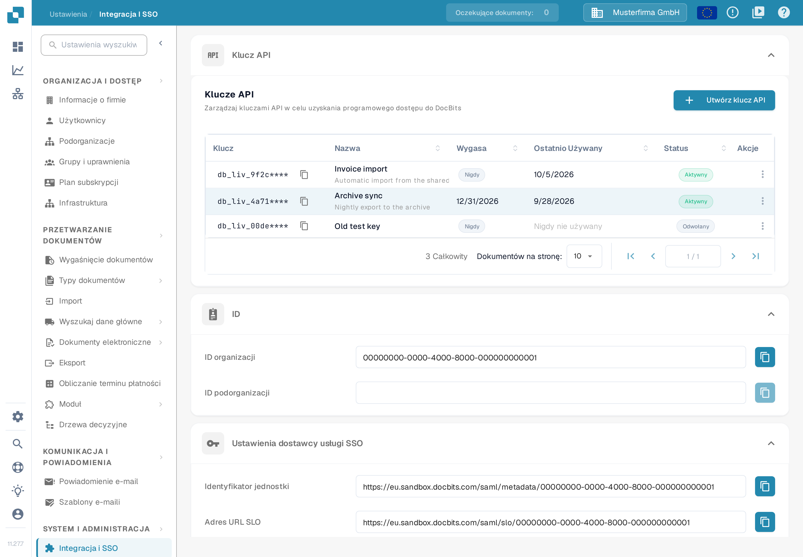

# Importowanie danych dostawcy i zamówień zakupu do DocBits z plików CSV

## Przegląd

Ta strona opisuje, jak przygotować import danych dostawcy lub zamówienia zakupu do DocBits z pliku CSV.

**Ważne:** Przed importem jakichkolwiek danych **dokładnie sprawdź plik .csv**, aby dane były poprawne, a konfiguracja właściwa. Import błędnych danych może prowadzić do niespójności. Szczegóły pól wymaganych i opcjonalnych znajdziesz w sekcjach [**Specyfikacje CSV dla zamówienia zakupu**](importing-supplier-and-purchase-order-data-into-docbits-from-csv-files.md#specyfikacje-csv-dla-zamowienia-zakupu) oraz [**Specyfikacje CSV dla dostawcy**](importing-supplier-and-purchase-order-data-into-docbits-from-csv-files.md#specyfikacje-csv-dla-dostawcy). Sprawdź akceptowane kolumny i reguły walidacji dla swojej wersji API, zanim użyjesz produkcyjnego zbioru danych.

**Walidacja:** Traktuj poniższe listy jako listę kontrolną do przygotowania importu. Potwierdź pola wymagane, pola dodatkowe i kilka reprezentatywnych wierszy dla swojego wdrożenia; listy te nie gwarantują, że każdy nieprawidłowy wiersz odrzuci cały plik. Sprawdź odpowiedź importu i dodatkowo zweryfikuj zamierzone rekordy.

## Ogólne wymagania:

**Format daty:**

Wszystkie daty podane w pliku .csv **muszą** być zgodne z następującym formatem:

YYYY-MM-DD HH:MM:SS

**Wymagane pola:**

Przygotuj i sprawdź identyfikatory bazowe wymienione poniżej. Nie zakładaj, że żądanie importu sprawdzi za Ciebie kompletność lub poprawność biznesową Twojego pliku CSV.

### Specyfikacje CSV dla zamówienia zakupu

**Pola bazowe, które przygotowujesz i sprawdzasz**

* `purchase_order_number`

**Pola, które można uwzględnić**

* `warehouse_id`
* `location_id`
* `supplier_id`
* `supplier_name`
* `header_total_amount`
* `order_date`
* `requested_shipment_date`
* `promised_delivery_date`
* `payment_terms_code`
* `total_amount`
* `buyer_contact_id`
* `buyer_contact_name`
* `order_last_modified_by`
* `order_last_modified_on`
* `ship_to_party_id`
* `ship_to_party_name`
* `ship_to_address_id`
* `disponent_id`
* `disponent_name`
* `extended_amount`
* `extended_base_amount`
* `extended_report_amount`
* `canceled_amount`
* `canceled_base_amount`
* `canceled_reporting_amount`
* `geo_code`
* `preview_path`
* `type_code`
* `type_description`
* `custom_field_1`
* `custom_field_2`
* `custom_field_3`
* `custom_field_4`
* `custom_field_5`
* `status`
* `line_number`
* `sub_line_number`
* `item_id`
* `supplier_item_id`
* `description`
* `note`
* `quantity`
* `open_quantity`
* `confirmed_quantity`
* `received_quantity`
* `received_base_mou_quantity`
* `promised_delivery_date`
* `requested_ship_date`
* `unit_of_measure`
* `unit_code_price`
* `unit_price`
* `unit_price_per`
* `extended_amount`
* `total_amount`
* `currency`
* `status`
* `buyer_id`
* `buyer_name`
* `geo_code`
* `delivery_method`

### Specyfikacje CSV dla dostawcy

**Pola bazowe, które przygotowujesz i sprawdzasz**

* `customer_number`
* `supplier_number`
* `supplier_name`
* `country_code`

**Pola, które można uwzględnić**

* `address_id`
* `address_1`
* `address_2`
* `address_3`
* `address_4`
* `country_main_division`
* `town_city`
* `zip_code`
* `supplier_phone`
* `supplier_vat`
* `payment_term_id`
* `payment_method_code`
* `buyer_person_reference_id`
* `buyer_person_reference`
* `supplier_category`
* `supplier_group`
* `discount_term`
* `discount_term_description`
* `bank_id`
* `custom_field_1`
* `custom_field_2`
* `custom_field_3`
* `custom_field_4`
* `custom_field_5`
* `custom_field_6`
* `custom_field_7`
* `custom_field_8`
* `custom_field_9`
* `custom_field_10`
* `status`
* `account_id`
* `financial_partner_id`
* `financial_partner_name`
* `iban`
* `currency`

## Punkt dostępu

### Wybór środowiska i organizacji

1. Otwórz dokumentację API dla środowiska, którego chcesz użyć. Dokumentacja produkcyjna to [https://api.docbits.com/](https://api.docbits.com/); do danych testowych używaj środowiska testowego zatwierdzonego w Twojej organizacji. Przed przygotowaniem żądania sprawdź wersję API i wartość w polu **Servers**.
2. Aby wykonać autoryzowany import, kliknij **Authorize** i użyj klucza API wydanego dla właściwej organizacji i użytkownika. Nigdy nie kopiuj klucza do zrzutu ekranu, pliku CSV ani udostępnianego przykładu. Klucz API utworzysz i sprawdzisz na stronie [Integracja i SSO](https://docs.docbits.com/polish/administration-and-setup/settings/global-settings/integration), w sekcji [Klucz API](https://docs.docbits.com/polish/administration-and-setup/settings/global-settings/integration#klucz-api).

Konsola API DocBits jest dostępna wyłącznie w języku angielskim. Dlatego nazwy przycisków i pól w tej sekcji podajemy po angielsku i nie dołączamy zrzutów ekranu konsoli. Poniższy zrzut ekranu pokazuje po polsku, gdzie utworzysz klucz API i gdzie znajdziesz identyfikatory swojej organizacji. Nie podano w nim klucza API ani pliku CSV i nie kliknięto **Execute**. Widoczne nazwy kluczy są wymyślonymi danymi przykładu.

<figure><figcaption>
W Ustawieniach otwórz <strong>Integracja i SSO</strong>. W karcie <strong>Klucz API</strong> przycisk <strong>Utwórz klucz API</strong> tworzy nowy klucz, a tabela <strong>Klucze API</strong> pokazuje istniejące klucze. W karcie <strong>ID</strong> znajdziesz wartości <strong>ID organizacji</strong> i <strong>ID podorganizacji</strong>, których użyjesz w żądaniu importu. Widoczne klucze, nazwy i identyfikatory są wymyślonymi danymi przykładu.
</figcaption></figure>

### Otwieranie operacji importu

1. Znajdź **POST /master_data_lookup/import_data** i rozwiń ten wpis.
2. Kliknij **Try it out**, aby włączyć formularz żądania w konsoli. Ten krok sam w sobie nie wykonuje importu. Przyciskiem **Cancel** opuścisz tryb edycji bez wysyłania importu.

### Przygotowanie treści żądania

* **sub_org_id:** Wpisz zamierzony, autoryzowany identyfikator podorganizacji, jeśli import należy do podorganizacji. W przeciwnym razie usuń wygenerowany przykład `string` i świadomie pozostaw pole puste, w razie potrzeby przyciskiem **Send empty value**. Puste pole nie wskazuje organizacji testowej i nie ogranicza zastąpienia do jednej podorganizacji: zakresem pozostaje cała organizacja. Identyfikator podorganizacji odczytasz na stronie [Integracja i SSO](https://docs.docbits.com/polish/administration-and-setup/settings/global-settings/integration#id).
* **data_type:** Wpisz `supplier` lub `purchase_order` dla opisanych na tej stronie procesów. Zastąp wygenerowany przykład `string`; to pole jest wymagane.
* **file / csv_data:** Ten przewodnik korzysta z pliku CSV. Wyczyść wygenerowany przykład w polu **csv_data**, zanim wybierzesz plik: niepuste `csv_data` jest w sprawdzonym importerze przetwarzane przed plikiem. Wybierz sprawdzony plik CSV w polu **file** i potwierdź, że wyświetlana jest jego nazwa. Nie zostawiaj wartości przykładu z formularza jako treści swojego żądania.
* **delimiter:** Wybierz faktyczny separator swojego pliku CSV: przecinek (`,`) lub średnik (`;`). Sprawdź pierwsze wiersze w prostym edytorze tekstu. Nie zakładaj, że średnik ustawiony wstępnie w formularzu odpowiada Twojemu plikowi albo wartości domyślnej serwera.

### Sprawdzenie opcji zastępowania i obsługi konfliktów

Te opisy dotyczą sprawdzonej funkcji importu. Potwierdź zakres zastępowania i zachowanie przy konfliktach dla używanej wersji API; widoki dokumentacji API nie potwierdzają tych efektów.

* **replace_all:** Podana wartość domyślna to `false`. Wartość `true` usuwa istniejące rekordy wybranego typu danych przed wczytaniem pliku CSV. Zakres zastępowania to organizacja, z filtrem podorganizacji, jeśli ją podano. Sprawdź ten zakres świadomie przed użyciem zastępowania; puste `sub_org_id` może objąć wybrany typ danych w całej organizacji. Wartość `false` oznacza, że istniejące rekordy są obsługiwane zgodnie z **on_conflict**.
* **on_conflict:** Wybierz `IGNORE`, aby pozostawić bez zmian pasujące istniejące rekordy dostawcy lub zamówienia zakupu, albo `REPLACE`, aby zaktualizować je z pliku CSV. Podana wartość domyślna to `REPLACE`. Ta opcja nie chroni rekordów przed wcześniejszym usunięciem przez **replace_all**.
* **auto_generate_id:** Pozostaw tę wartość na `false` i podaj wymagane identyfikatory biznesowe w pliku CSV. Opcjonalne automatyczne generowanie identyfikatorów nie jest używane przez sprawdzone importy dostawców i zamówień zakupu; nie licz na to, że utworzy brakujące numery dostawcy lub zamówienia zakupu.

Kliknij **Execute** dopiero wtedy, gdy sprawdzisz środowisko docelowe, organizację, zakres podorganizacji, plik CSV i opcje oraz gdy import jest autoryzowany. Sprawdź odpowiedź i zweryfikuj zamierzone rekordy, zanim wykonasz kolejne importy. Dla zamówień zakupu zobacz [Pulpit zamówień zakupu](https://docs.docbits.com/polish/end-user-and-partner-section/end-user-section/purchase-order-dashboard). Zrzut ekranu na tej stronie pokazuje tylko, gdzie znajdziesz klucz API i identyfikatory organizacji; nie dowodzi wykonanego importu ani pełnej walidacji danych CSV.
