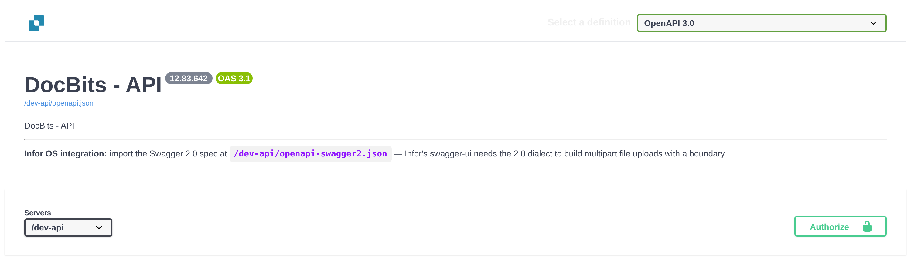
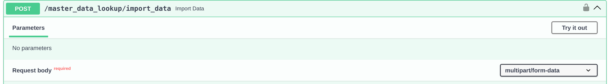
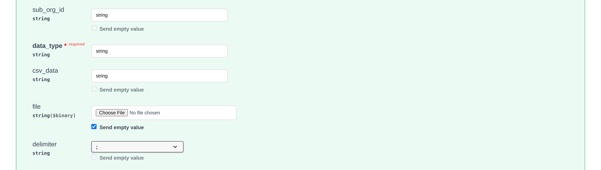

# Importer les données de fournisseurs et de commandes d'achat dans DocBits à partir de fichiers CSV

## Aperçu

Cette page décrit comment préparer un import CSV de données de fournisseurs ou de commandes d'achat dans DocBits.

**Important :** avant d'importer des données, il est indispensable de **contrôler entièrement le fichier .csv** pour garantir l'exactitude des données et une configuration correcte. L'importation de données erronées peut créer des incohérences. Consultez les sections [**Spécifications CSV pour la commande d'achat**](importing-supplier-and-purchase-order-data-into-docbits-from-csv-files.md#specifications-csv-pour-la-commande-dachat) ou [**Spécifications CSV pour le fournisseur**](importing-supplier-and-purchase-order-data-into-docbits-from-csv-files.md#specifications-csv-pour-le-fournisseur) pour le détail des champs obligatoires et facultatifs. Vérifiez les colonnes acceptées et les règles de validation de votre version d'API avant d'utiliser un jeu de données de production.

**Validation :** utilisez les listes ci-dessous comme une liste de contrôle de préparation. Vérifiez les champs obligatoires, les champs supplémentaires et des lignes représentatives pour votre installation ; ces listes ne garantissent pas que chaque ligne invalide fasse échouer tout le fichier. Contrôlez la réponse et vérifiez vous-même les enregistrements souhaités.

## Exigences générales

**Format de date :**

Toutes les dates indiquées dans la feuille .csv **doivent** respecter le format suivant :

YYYY-MM-DD HH:MM:SS

**Champs obligatoires :**

Préparez et vérifiez les identifiants de base listés ci-dessous. Ne comptez pas sur une requête d'importation pour vérifier à votre place que votre fichier CSV est complet et correct sur le plan métier.

### Spécifications CSV pour la commande d'achat

**Champs de base à préparer et à vérifier**

* `purchase_order_number`

**Champs pouvant être inclus**

* `warehouse_id`
* `location_id`
* `supplier_id`
* `supplier_name`
* `header_total_amount`
* `order_date`
* `requested_shipment_date`
* `promised_delivery_date`
* `payment_terms_code`
* `total_amount`
* `buyer_contact_id`
* `buyer_contact_name`
* `order_last_modified_by`
* `order_last_modified_on`
* `ship_to_party_id`
* `ship_to_party_name`
* `ship_to_address_id`
* `disponent_id`
* `disponent_name`
* `extended_amount`
* `extended_base_amount`
* `extended_report_amount`
* `canceled_amount`
* `canceled_base_amount`
* `canceled_reporting_amount`
* `geo_code`
* `preview_path`
* `type_code`
* `type_description`
* `custom_field_1`
* `custom_field_2`
* `custom_field_3`
* `custom_field_4`
* `custom_field_5`
* `status`
* `line_number`
* `sub_line_number`
* `item_id`
* `supplier_item_id`
* `description`
* `note`
* `quantity`
* `open_quantity`
* `confirmed_quantity`
* `received_quantity`
* `received_base_mou_quantity`
* `promised_delivery_date`
* `requested_ship_date`
* `unit_of_measure`
* `unit_code_price`
* `unit_price`
* `unit_price_per`
* `extended_amount`
* `total_amount`
* `currency`
* `status`
* `buyer_id`
* `buyer_name`
* `geo_code`
* `delivery_method`

### Spécifications CSV pour le fournisseur

**Champs de base à préparer et à vérifier**

* `customer_number`
* `supplier_number`
* `supplier_name`
* `country_code`

**Champs pouvant être inclus**

* `address_id`
* `address_1`
* `address_2`
* `address_3`
* `address_4`
* `country_main_division`
* `town_city`
* `zip_code`
* `supplier_phone`
* `supplier_vat`
* `payment_term_id`
* `payment_method_code`
* `buyer_person_reference_id`
* `buyer_person_reference`
* `supplier_category`
* `supplier_group`
* `discount_term`
* `discount_term_description`
* `bank_id`
* `custom_field_1`
* `custom_field_2`
* `custom_field_3`
* `custom_field_4`
* `custom_field_5`
* `custom_field_6`
* `custom_field_7`
* `custom_field_8`
* `custom_field_9`
* `custom_field_10`
* `status`
* `account_id`
* `financial_partner_id`
* `financial_partner_name`
* `iban`
* `currency`

## Point d'accès

### Choisir l'environnement et l'organisation

1. Ouvrez la référence d'API de l'environnement que vous voulez utiliser. La référence de production est [https://api.docbits.com/](https://api.docbits.com/) ; pour des données de test, utilisez votre environnement de test autorisé. Vérifiez la version d'API et la valeur **Servers** avant de préparer une requête.
2. Pour un import autorisé, cliquez sur **Authorize** et utilisez la clé d'API fournie pour l'organisation et l'utilisateur prévus. Ne recopiez jamais une clé dans une capture d'écran, un fichier CSV ou un exemple partagé. Pour la configuration des identifiants, consultez [Intégration et SSO](https://docs.docbits.com/french/administration-and-setup/settings/global-settings/integration).

Les quatre images ci-dessous sont de vraies vues de la référence d'API Dev, version **12.83.642**, avec le serveur **/dev-api**. Aucune clé d'API et aucun fichier CSV n'ont été fournis, et **Execute** n'a pas été cliqué. Les valeurs `string` visibles sont des exemples générés par Swagger : ce ne sont ni des identifiants d'organisation valides ni des données d'import préparées. La console d'API de DocBits n'existe actuellement qu'en anglais : les images ci-dessous montrent donc les libellés anglais de la console, alors que ce guide est en français.

<figure><figcaption>
Contrôlez d'abord la version de la référence et le serveur. C'est la référence Dev, avec un bouton Authorize verrouillé, donc sans identifiants autorisés.
</figcaption></figure>

### Ouvrir l'opération d'importation

1. Recherchez **POST /master_data_lookup/import_data** et dépliez-la.
2. Cliquez sur **Try it out** pour activer le formulaire de requête local. Cette étape n'exécute aucun import. Utilisez **Cancel** pour quitter le mode édition sans envoyer l'import.

<figure><figcaption>
L'opération d'importation attend un corps de requête multipart/form-data. Try it out active le formulaire ; l'import n'est pas envoyé.
</figcaption></figure>

### Préparer le corps de la requête

* **sub_org_id :** saisissez l'identifiant de sous-organisation prévu et autorisé lorsque l'import concerne une sous-organisation. Sinon, supprimez l'exemple `string` généré et laissez volontairement le champ vide avec le contrôle **Send empty value** du formulaire. Un champ vide n'identifie pas une organisation de test et ne limite pas un remplacement à l'échelle de l'organisation.
* **data_type :** saisissez `supplier` ou `purchase_order` pour les cas décrits sur cette page. Remplacez l'exemple `string` généré ; ce champ est obligatoire.
* **file / csv_data :** ce guide utilise un fichier CSV. Videz l'exemple généré de **csv_data** avant de choisir le fichier : dans l'importateur vérifié, un `csv_data` non vide est traité avant le fichier. Sélectionnez votre CSV contrôlé dans **file** et vérifiez que son nom de fichier s'affiche. Ne reprenez pas les valeurs d'exemple de la capture comme requête.
* **delimiter :** choisissez explicitement le séparateur réel de votre CSV : virgule (`,`) ou point-virgule (`;`). Contrôlez les premières lignes dans un éditeur de texte brut. Ne partez pas du principe que le point-virgule présélectionné dans le formulaire correspond à votre fichier ou au comportement par défaut du serveur.

<figure><figcaption>
Les champs supérieurs de la requête, avant toute saisie et tout envoi de fichier. Les valeurs string visibles sont des exemples Swagger à remplacer ou à vider ; aucun fichier n'est choisi.
</figcaption></figure>

### Vérifier les options de remplacement et de conflit

Ces descriptions d'options correspondent à l'importateur vérifié. Confirmez la portée du remplacement et le comportement en cas de conflit pour la version d'API que vous utiliserez ; les vues de la référence ne prouvent pas ces effets.

* **replace_all :** la valeur par défaut déclarée est `false`. Avec `true`, les enregistrements existants du type de données choisi sont supprimés avant le chargement du CSV. La portée du remplacement est l'organisation, avec un filtre sur la sous-organisation lorsqu'une sous-organisation est fournie. Vérifiez explicitement cette portée avant d'utiliser le remplacement : un sub_org_id vide peut couvrir le type de données choisi dans toute l'organisation. Avec `false`, les enregistrements existants sont traités selon **on_conflict**.
* **on_conflict :** choisissez `IGNORE` pour laisser inchangés les enregistrements fournisseur ou commande d'achat correspondants, ou `REPLACE` pour les mettre à jour à partir du CSV. La valeur par défaut déclarée est `REPLACE`. Cette option ne protège pas les enregistrements de l'étape de suppression **replace_all** décrite plus haut.
* **auto_generate_id :** laissez cette option à `false` et indiquez dans votre CSV les identifiants métier obligatoires. L'option facultative de génération automatique n'est pas utilisée par les importateurs fournisseur et commande d'achat vérifiés ; ne comptez pas sur elle pour créer des numéros de fournisseur ou de commande d'achat manquants.

<figure><figcaption>
Le bas du formulaire et le bouton Execute dans leur état affiché. Aucune option n'a été modifiée et Execute n'a pas été cliqué ; cette image n'est pas le résultat d'un import.
</figcaption></figure>

C'est seulement après avoir vérifié l'environnement cible, l'organisation, la portée de la sous-organisation, le CSV et les options, et lorsque l'import est autorisé, que vous cliquez sur **Execute**. Contrôlez la réponse et vérifiez les enregistrements souhaités avant de poursuivre avec d'autres imports. Pour les commandes d'achat, consultez le [Tableau de bord des bons de commande](https://docs.docbits.com/french/end-user-and-partner-section/end-user-section/purchase-order-dashboard). Ces captures montrent les contrôles ; elles ne prouvent ni un import exécuté ni une validation complète des données CSV.
