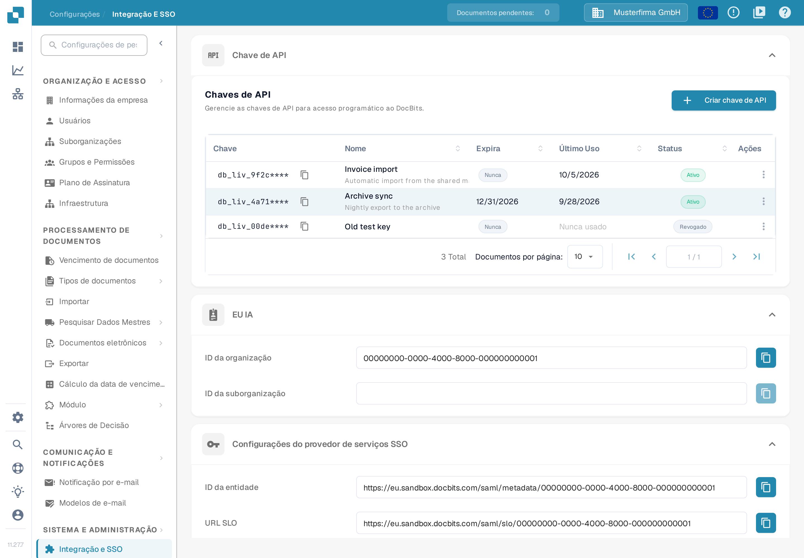

# Importando dados de fornecedor e pedido de compra no DocBits a partir de arquivos CSV

## Visão geral

Esta página descreve como preparar uma importação CSV de dados de fornecedor ou de pedido de compra no DocBits.

**Importante:** Antes de importar qualquer dado, é essencial **revisar o arquivo .csv minuciosamente** para garantir a exatidão dos dados e a configuração correta. A importação de dados incorretos pode causar inconsistências. Consulte as seções [**Especificações CSV para Pedido de Compra**](importing-supplier-and-purchase-order-data-into-docbits-from-csv-files.md#especificacoes-csv-para-pedido-de-compra) ou [**Especificações CSV para Fornecedor**](importing-supplier-and-purchase-order-data-into-docbits-from-csv-files.md#especificacoes-csv-para-fornecedor) para saber quais campos são obrigatórios e quais são opcionais. Confirme as colunas aceitas e as regras de validação da versão da API que você usa antes de trabalhar com um conjunto de dados de produção.

**Validação:** Use as listas abaixo como lista de verificação no preparo. Confirme os campos obrigatórios, os campos adicionais e linhas representativas para a sua instalação; estas listas não garantem que cada linha inválida rejeite o arquivo inteiro. Revise a resposta e verifique você mesmo os registros pretendidos.

## Requisitos Gerais:

**Formato da data:**

Todas as datas informadas na planilha .csv **devem** seguir o seguinte formato:

YYYY-MM-DD HH:MM:SS

**Campos obrigatórios:**

Prepare e valide os identificadores básicos listados abaixo. Não conte com uma solicitação de importação para validar a integralidade ou a correção comercial do seu CSV.

### Especificações CSV para Pedido de Compra

**Campos de base a preparar e validar**

* `purchase_order_number`

**Campos que podem ser incluídos**

* `warehouse_id`
* `location_id`
* `supplier_id`
* `supplier_name`
* `header_total_amount`
* `order_date`
* `requested_shipment_date`
* `promised_delivery_date`
* `payment_terms_code`
* `total_amount`
* `buyer_contact_id`
* `buyer_contact_name`
* `order_last_modified_by`
* `order_last_modified_on`
* `ship_to_party_id`
* `ship_to_party_name`
* `ship_to_address_id`
* `disponent_id`
* `disponent_name`
* `extended_amount`
* `extended_base_amount`
* `extended_report_amount`
* `canceled_amount`
* `canceled_base_amount`
* `canceled_reporting_amount`
* `geo_code`
* `preview_path`
* `type_code`
* `type_description`
* `custom_field_1`
* `custom_field_2`
* `custom_field_3`
* `custom_field_4`
* `custom_field_5`
* `status`
* `line_number`
* `sub_line_number`
* `item_id`
* `supplier_item_id`
* `description`
* `note`
* `quantity`
* `open_quantity`
* `confirmed_quantity`
* `received_quantity`
* `received_base_mou_quantity`
* `promised_delivery_date`
* `requested_ship_date`
* `unit_of_measure`
* `unit_code_price`
* `unit_price`
* `unit_price_per`
* `extended_amount`
* `total_amount`
* `currency`
* `status`
* `buyer_id`
* `buyer_name`
* `geo_code`
* `delivery_method`

### Especificações CSV para Fornecedor

**Campos de base a preparar e validar**

* `customer_number`
* `supplier_number`
* `supplier_name`
* `country_code`

**Campos que podem ser incluídos**

* `address_id`
* `address_1`
* `address_2`
* `address_3`
* `address_4`
* `country_main_division`
* `town_city`
* `zip_code`
* `supplier_phone`
* `supplier_vat`
* `payment_term_id`
* `payment_method_code`
* `buyer_person_reference_id`
* `buyer_person_reference`
* `supplier_category`
* `supplier_group`
* `discount_term`
* `discount_term_description`
* `bank_id`
* `custom_field_1`
* `custom_field_2`
* `custom_field_3`
* `custom_field_4`
* `custom_field_5`
* `custom_field_6`
* `custom_field_7`
* `custom_field_8`
* `custom_field_9`
* `custom_field_10`
* `status`
* `account_id`
* `financial_partner_id`
* `financial_partner_name`
* `iban`
* `currency`

## Endpoint de acesso

### Escolher o ambiente e a organização

1. Abra a referência da API do ambiente que você pretende usar. A referência de produção é [https://api.docbits.com/](https://api.docbits.com/); para dados de teste, use o ambiente de teste aprovado na sua organização. Verifique a versão da API e o valor em **Servers** antes de preparar uma solicitação.
2. Para uma importação autorizada, clique em **Authorize** e use a chave de API fornecida para a organização e o usuário pretendidos. Nunca copie uma chave para uma captura de tela, um arquivo CSV ou um exemplo compartilhado. Para criar e administrar as credenciais, consulte [Integração e SSO](../administration-and-setup/settings/global-settings/integration/README.md).

O DocBits oferece a interface da referência da API apenas em inglês. Por isso, os nomes dos controles nesta página aparecem em inglês e a página não traz capturas de tela da referência; no formulário **Try it out**, os valores `string` visíveis são exemplos gerados pelo Swagger, não IDs de organização válidos nem dados de importação preparados.

A imagem abaixo é uma captura em português do build 11.27.7 do DocBits. Ela mostra onde criar a chave de API e onde ficam o ID da organização e o ID da suborganização; as chaves, os nomes e os identificadores nela visíveis são exemplos inventados e nenhuma importação foi executada.

<figure><figcaption>
Em Configurações → Integração e SSO você cria a chave de API: a seção Chaves de API mostra as chaves existentes e o botão Criar chave de API. Na mesma página estão os valores ID da organização e ID da suborganização da sua organização. As chaves, os nomes e os identificadores mostrados são exemplos inventados.
</figcaption></figure>

### Abrir a operação de importação

1. Localize **POST /master_data_lookup/import_data** e expanda a operação.
2. Clique em **Try it out** para ativar o formulário de solicitação local. Esta etapa sozinha não executa uma importação. Use **Cancel** para sair do modo de edição sem enviar a importação.

### Preparar o corpo da solicitação

* **sub_org_id:** Informe o ID da suborganização pretendida e autorizada quando a importação pertencer a uma suborganização. Caso contrário, remova o exemplo `string` gerado e deixe o campo deliberadamente vazio com o controle **Send empty value** do formulário, conforme o caso. Um campo vazio não identifica uma organização de teste nem limita uma substituição a uma suborganização.
* **data_type:** Informe `supplier` ou `purchase_order` para os fluxos descritos nesta página. Substitua o exemplo `string` gerado; o campo é obrigatório.
* **file / csv_data:** Este guia usa um arquivo CSV. Limpe o exemplo gerado em **csv_data** antes de escolher o arquivo: um `csv_data` não vazio é processado antes do arquivo no importador revisado. Selecione o seu CSV verificado em **file** e confirme que o nome do arquivo aparece. Não deixe os valores de exemplo da captura de tela como conteúdo da sua solicitação.
* **delimiter:** Selecione explicitamente o delimitador real do seu CSV: vírgula (`,`) ou ponto e vírgula (`;`). Inspecione as primeiras linhas em um editor de texto simples. Não presuma que a seleção inicial de ponto e vírgula no formulário corresponda ao arquivo ou ao padrão do servidor.

### Revisar as opções de substituição e de conflito

As descrições das opções refletem o importador revisado. Confirme o escopo da substituição e o comportamento em caso de conflito na versão da API que você vai usar; as telas da referência não comprovam esses efeitos.

* **replace_all:** O valor padrão declarado é `false`. Com `true`, os registros existentes do tipo de dados selecionado são removidos antes do carregamento do CSV. O escopo da substituição é a organização, com um filtro de suborganização quando um é informado. Verifique esse escopo explicitamente antes de usar a substituição; um campo sub_org_id vazio pode abranger o tipo de dados selecionado em toda a organização. Com `false`, os registros existentes são tratados conforme **on_conflict**.
* **on_conflict:** Escolha `IGNORE` para manter inalterados os registros existentes de fornecedor ou de pedido de compra que correspondam, ou `REPLACE` para atualizá-los a partir do CSV. O valor padrão declarado é `REPLACE`. Esta opção não protege os registros da etapa anterior de remoção de **replace_all**.
* **auto_generate_id:** Mantenha este campo em `false` e informe no seu CSV os identificadores comerciais obrigatórios. O sinalizador opcional de geração automática não é usado pelos importadores revisados de fornecedor e de pedido de compra; não conte com ele para criar números de fornecedor ou de pedido de compra que estejam ausentes.

Clique em **Execute** somente depois de verificar o ambiente de destino, a organização, o escopo da suborganização, o CSV e as opções, e de a importação estar autorizada. Revise a resposta e verifique os registros pretendidos antes de continuar com outras importações. Para pedidos de compra, consulte o [Painel de ordens de compra](../end-user-and-partner-section/end-user-section/purchase-order-dashboard.md). A captura de tela mostra os controles; ela não comprova uma importação executada nem uma validação completa dos dados do CSV.
