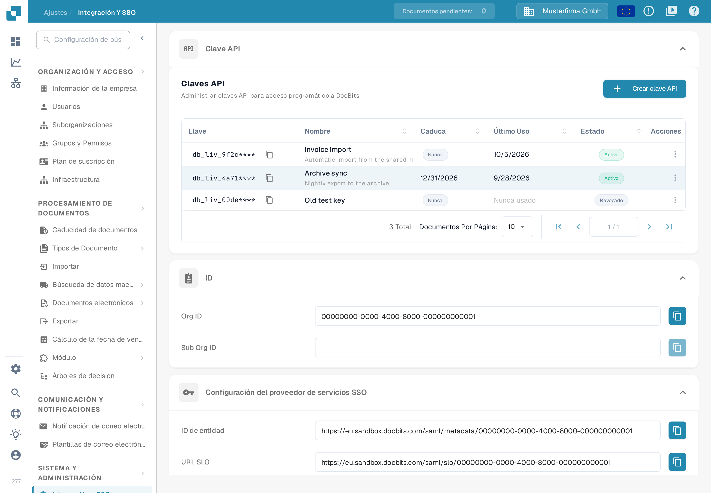

# Importando Datos de Proveedores y Órdenes de Compra en DocBits desde Archivos CSV

## Resumen

Esta página describe cómo preparar en DocBits una importación de datos de proveedores u órdenes de compra a partir de un archivo CSV.

**Importante:** Antes de importar cualquier dato, es fundamental **revisar el archivo .csv completo** para asegurar la exactitud de los datos y una configuración correcta. Importar datos incorrectos puede provocar inconsistencias. Consulte las secciones [**Especificaciones CSV para órdenes de compra**](importing-supplier-and-purchase-order-data-into-docbits-from-csv-files.md#especificaciones-csv-para-ordenes-de-compra) y [**Especificaciones CSV para proveedores**](importing-supplier-and-purchase-order-data-into-docbits-from-csv-files.md#especificaciones-csv-para-proveedores) para conocer los campos obligatorios y opcionales. Confirme las columnas aceptadas y las reglas de validación de su versión de la API antes de utilizar un conjunto de datos de producción.

**Validación:** Utilice las listas siguientes como lista de comprobación para la preparación. Confirme los campos obligatorios, los campos adicionales y algunas filas representativas para su instalación; estas listas no garantizan que toda fila no válida rechace el archivo completo. Revise la respuesta y verifique por su cuenta los registros previstos.

## Requisitos generales

**Formato de fecha:**

Todas las fechas del archivo .csv **deben** respetar el siguiente formato:

YYYY-MM-DD HH:MM:SS

**Campos obligatorios:**

Prepare y valide los identificadores básicos que se indican a continuación. No dependa de una solicitud de importación para que valide por usted la integridad ni la corrección de negocio de su CSV.

### Especificaciones CSV para órdenes de compra

**Campos básicos que debe preparar y validar**

* `purchase_order_number`

**Campos que puede incluir**

* `warehouse_id`
* `location_id`
* `supplier_id`
* `supplier_name`
* `header_total_amount`
* `order_date`
* `requested_shipment_date`
* `promised_delivery_date`
* `payment_terms_code`
* `total_amount`
* `buyer_contact_id`
* `buyer_contact_name`
* `order_last_modified_by`
* `order_last_modified_on`
* `ship_to_party_id`
* `ship_to_party_name`
* `ship_to_address_id`
* `disponent_id`
* `disponent_name`
* `extended_amount`
* `extended_base_amount`
* `extended_report_amount`
* `canceled_amount`
* `canceled_base_amount`
* `canceled_reporting_amount`
* `geo_code`
* `preview_path`
* `type_code`
* `type_description`
* `custom_field_1`
* `custom_field_2`
* `custom_field_3`
* `custom_field_4`
* `custom_field_5`
* `status`
* `line_number`
* `sub_line_number`
* `item_id`
* `supplier_item_id`
* `description`
* `note`
* `quantity`
* `open_quantity`
* `confirmed_quantity`
* `received_quantity`
* `received_base_mou_quantity`
* `promised_delivery_date`
* `requested_ship_date`
* `unit_of_measure`
* `unit_code_price`
* `unit_price`
* `unit_price_per`
* `extended_amount`
* `total_amount`
* `currency`
* `status`
* `buyer_id`
* `buyer_name`
* `geo_code`
* `delivery_method`

### Especificaciones CSV para proveedores

**Campos básicos que debe preparar y validar**

* `customer_number`
* `supplier_number`
* `supplier_name`
* `country_code`

**Campos que puede incluir**

* `address_id`
* `address_1`
* `address_2`
* `address_3`
* `address_4`
* `country_main_division`
* `town_city`
* `zip_code`
* `supplier_phone`
* `supplier_vat`
* `payment_term_id`
* `payment_method_code`
* `buyer_person_reference_id`
* `buyer_person_reference`
* `supplier_category`
* `supplier_group`
* `discount_term`
* `discount_term_description`
* `bank_id`
* `custom_field_1`
* `custom_field_2`
* `custom_field_3`
* `custom_field_4`
* `custom_field_5`
* `custom_field_6`
* `custom_field_7`
* `custom_field_8`
* `custom_field_9`
* `custom_field_10`
* `status`
* `account_id`
* `financial_partner_id`
* `financial_partner_name`
* `iban`
* `currency`

## Punto de acceso

### Elegir el entorno y la organización

1. Abra la referencia de la API del entorno que desea utilizar. La referencia de producción es [https://api.docbits.com/](https://api.docbits.com/); para los datos de prueba utilice el entorno de prueba aprobado. Compruebe la versión de la API y el valor de **Servers** antes de preparar una solicitud.
2. Para una importación autorizada, haga clic en **Authorize** y utilice la clave de API facilitada para la organización y el usuario previstos. Nunca copie una clave en una captura de pantalla, en un archivo CSV ni en un ejemplo compartido. Para configurar las credenciales, consulte [Integración y SSO](../administration-and-setup/settings/global-settings/integration/README.md).

La interfaz de la referencia de la API solo está disponible en inglés. Por ese motivo, en esta página los nombres de sus controles se indican en inglés y no se incluyen capturas de la referencia. La imagen siguiente muestra en español dónde se encuentra la clave de API y dónde están los identificadores de la organización.

<figure><figcaption>
La clave de API se crea en Ajustes → Integración y SSO: la sección Claves API muestra las claves existentes y el botón Crear clave API. En la misma página encontrará los valores de su organización y de su suborganización. Los datos de la captura son ejemplos inventados.
</figcaption></figure>

### Abrir la operación de importación

1. Busque **POST /master_data_lookup/import_data** y despliéguela.
2. Haga clic en **Try it out** para habilitar el formulario de solicitud local. Este paso por sí solo no ejecuta ninguna importación. Utilice **Cancel** para salir del modo de edición sin enviar la importación.

### Preparar el cuerpo de la solicitud

* **sub_org_id:** Introduzca el ID de la suborganización prevista y autorizada cuando la importación pertenezca a una suborganización. En caso contrario, elimine el ejemplo generado `string` y deje el campo deliberadamente vacío con el control **Send empty value** del formulario cuando corresponda. Un campo vacío no identifica ninguna organización de prueba ni limita un reemplazo a toda la organización.
* **data_type:** Introduzca `supplier` o `purchase_order` para los flujos descritos en esta página. Sustituya el ejemplo generado `string`; el campo es obligatorio.
* **file / csv_data:** Esta guía utiliza un archivo CSV. Borre el ejemplo generado en **csv_data** antes de elegir el archivo: según el importador revisado, un contenido en `csv_data` se procesa antes que el archivo. Seleccione en **file** su CSV comprobado y confirme que se muestra su nombre de archivo. No deje los valores de ejemplo de la captura como contenido de su solicitud.
* **delimiter:** Seleccione explícitamente el delimitador real de su CSV: coma (`,`) o punto y coma (`;`). Inspeccione las primeras filas en un editor de texto sin formato. No suponga que la selección inicial de punto y coma del formulario coincide con el archivo ni con el valor de reserva del servidor.

### Revisar las opciones de reemplazo y conflicto

Estas descripciones de las opciones reflejan el importador revisado. Confirme el alcance del reemplazo y el comportamiento ante conflictos para la versión de la API que va a utilizar; las vistas de la referencia no verifican esos efectos.

* **replace_all:** El valor predeterminado declarado es `false`. Con `true`, los registros existentes del tipo de datos seleccionado se eliminan antes de cargar el CSV. El alcance del reemplazo es la organización, con un filtro de suborganización cuando se indica uno. Compruebe ese alcance de forma explícita antes de utilizar el reemplazo; un `sub_org_id` vacío puede abarcar el tipo de datos seleccionado en toda la organización. Con `false`, los registros existentes se tratan según **on_conflict**.
* **on_conflict:** Elija `IGNORE` para dejar sin cambios los registros de proveedor u orden de compra existentes que coincidan, o `REPLACE` para actualizarlos desde el CSV. El valor predeterminado declarado es `REPLACE`. Esta opción no protege los registros del paso previo de eliminación de **replace_all**.
* **auto_generate_id:** Déjelo en `false` y proporcione los identificadores de negocio obligatorios en su CSV. Los importadores de proveedores y órdenes de compra revisados no utilizan la marca opcional de generación automática; no confíe en ella para crear números de proveedor u orden de compra que falten.

Solo cuando haya comprobado el entorno de destino, la organización, el alcance de la suborganización, el CSV y las opciones, y la importación esté autorizada, haga clic en **Execute**. Revise la respuesta y verifique los registros previstos antes de continuar con otras importaciones. Para las órdenes de compra, consulte el [Panel de órdenes de compra](../end-user-and-partner-section/end-user-section/purchase-order-dashboard.md). Las vistas de la referencia muestran los controles; no demuestran una importación ejecutada ni una validación completa de los datos del CSV.
