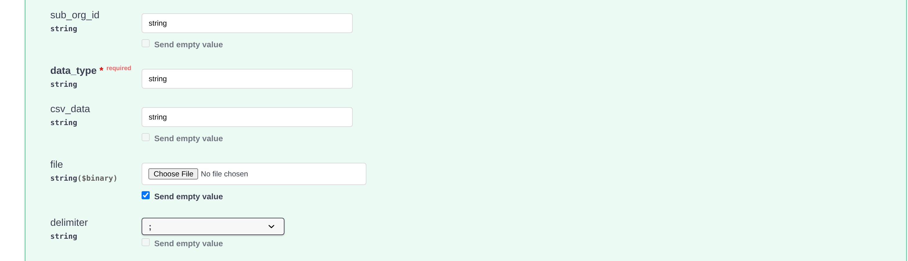
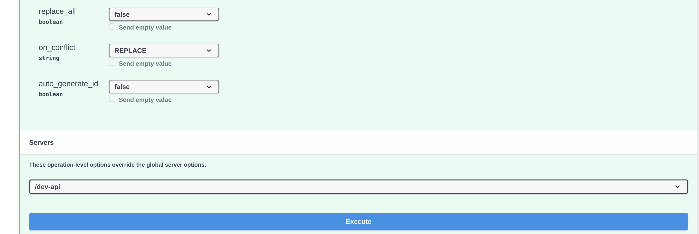

# Lieferanten- und Bestelldaten aus CSV-Dateien in DocBits importieren

## Übersicht

Diese Seite beschreibt, wie Sie einen CSV-Import von Lieferanten- oder Bestelldaten in DocBits vorbereiten.

**Wichtig:** Bevor Sie Daten importieren, **prüfen Sie die CSV-Datei vollständig**, damit die Daten korrekt sind und die Konfiguration passt. Ein Import fehlerhafter Daten kann zu Inkonsistenzen führen. Details zu Pflichtfeldern und optionalen Feldern finden Sie in den Abschnitten [**CSV-Spezifikationen für Bestellungen**](importing-supplier-and-purchase-order-data-into-docbits-from-csv-files.md#csv-spezifikationen-fur-bestellungen) und [**CSV-Spezifikationen für Lieferanten**](importing-supplier-and-purchase-order-data-into-docbits-from-csv-files.md#csv-spezifikationen-fur-lieferanten). Prüfen Sie die akzeptierten Spalten und Validierungsregeln Ihrer API-Version, bevor Sie einen produktiven Datenbestand verwenden.

**Prüfung:** Verwenden Sie die folgenden Listen als Checkliste für die Vorbereitung. Bestätigen Sie die Pflichtfelder, die zusätzlichen Felder und einige repräsentative Zeilen für Ihre Installation; diese Listen sind keine Garantie dafür, dass jede ungültige Zeile die gesamte Datei zurückweist. Prüfen Sie die Antwort des Imports und verifizieren Sie die vorgesehenen Datensätze zusätzlich selbst.

## Allgemeine Anforderungen:

**Datumsformat:**

Alle Datumsangaben in der CSV-Datei **müssen** dem folgenden Format entsprechen:

YYYY-MM-DD HH:MM:SS

**Pflichtfelder:**

Bereiten Sie die unten aufgeführten Basis-Identifikatoren vor und prüfen Sie sie. Verlassen Sie sich nicht darauf, dass eine Importanfrage die Vollständigkeit oder fachliche Korrektheit Ihrer CSV für Sie prüft.

### CSV-Spezifikationen für Bestellungen

**Basisfelder, die Sie vorbereiten und prüfen**

* `purchase_order_number`

**Felder, die enthalten sein können**

* `warehouse_id`
* `location_id`
* `supplier_id`
* `supplier_name`
* `header_total_amount`
* `order_date`
* `requested_shipment_date`
* `promised_delivery_date`
* `payment_terms_code`
* `total_amount`
* `buyer_contact_id`
* `buyer_contact_name`
* `order_last_modified_by`
* `order_last_modified_on`
* `ship_to_party_id`
* `ship_to_party_name`
* `ship_to_address_id`
* `disponent_id`
* `disponent_name`
* `extended_amount`
* `extended_base_amount`
* `extended_report_amount`
* `canceled_amount`
* `canceled_base_amount`
* `canceled_reporting_amount`
* `geo_code`
* `preview_path`
* `type_code`
* `type_description`
* `custom_field_1`
* `custom_field_2`
* `custom_field_3`
* `custom_field_4`
* `custom_field_5`
* `status`
* `line_number`
* `sub_line_number`
* `item_id`
* `supplier_item_id`
* `description`
* `note`
* `quantity`
* `open_quantity`
* `confirmed_quantity`
* `received_quantity`
* `received_base_mou_quantity`
* `promised_delivery_date`
* `requested_ship_date`
* `unit_of_measure`
* `unit_code_price`
* `unit_price`
* `unit_price_per`
* `extended_amount`
* `total_amount`
* `currency`
* `status`
* `buyer_id`
* `buyer_name`
* `geo_code`
* `delivery_method`

### CSV-Spezifikationen für Lieferanten

**Basisfelder, die Sie vorbereiten und prüfen**

* `customer_number`
* `supplier_number`
* `supplier_name`
* `country_code`

**Felder, die enthalten sein können**

* `address_id`
* `address_1`
* `address_2`
* `address_3`
* `address_4`
* `country_main_division`
* `town_city`
* `zip_code`
* `supplier_phone`
* `supplier_vat`
* `payment_term_id`
* `payment_method_code`
* `buyer_person_reference_id`
* `buyer_person_reference`
* `supplier_category`
* `supplier_group`
* `discount_term`
* `discount_term_description`
* `bank_id`
* `custom_field_1`
* `custom_field_2`
* `custom_field_3`
* `custom_field_4`
* `custom_field_5`
* `custom_field_6`
* `custom_field_7`
* `custom_field_8`
* `custom_field_9`
* `custom_field_10`
* `status`
* `account_id`
* `financial_partner_id`
* `financial_partner_name`
* `iban`
* `currency`

## Zugriffsendpunkt

### Umgebung und Organisation wählen

1. Öffnen Sie die API-Referenz für die Umgebung, die Sie verwenden möchten. Die Produktionsreferenz ist [https://api.docbits.com/](https://api.docbits.com/); für Testdaten verwenden Sie Ihre freigegebene Testumgebung. Prüfen Sie die API-Version und den Wert unter **Servers**, bevor Sie eine Anfrage vorbereiten.
2. Für einen autorisierten Import klicken Sie auf **Authorize** und verwenden den API-Schlüssel, der für die vorgesehene Organisation und den vorgesehenen Benutzer bereitgestellt wurde. Kopieren Sie einen Schlüssel niemals in einen Screenshot, in eine CSV-Datei oder in ein geteiltes Beispiel. Zur Einrichtung der Zugangsdaten siehe [Integration und SSO](https://docs.docbits.com/deutsch/administration-and-setup/settings/global-settings/integration).

Die vier Bilder unten sind eigene Aufnahmen der Dev-API-Referenz, Version **12.83.642**, Server **/dev-api**, aufgenommen am 13.11.2026. Die API-Konsole von DocBits ist derzeit nur auf Englisch verfügbar; die Bilder zeigen deshalb die englischen Beschriftungen der Konsole. Es wurde kein API-Schlüssel und keine CSV-Datei eingegeben, und **Execute** wurde nicht angeklickt. Die sichtbaren Werte `string` sind von Swagger erzeugte Beispiele, keine gültigen Organisations-IDs und keine vorbereiteten Importdaten.

<figure><figcaption>
Prüfen Sie zuerst Version und Server der Referenz. Dies ist die Dev-Referenz ohne autorisierte Zugangsdaten.
</figcaption></figure>

### Die Import-Operation öffnen

1. Suchen Sie **POST /master_data_lookup/import_data** und klappen Sie den Eintrag auf.
2. Klicken Sie auf **Try it out**, um das lokale Anfrageformular zu aktivieren. Dieser Schritt allein führt keinen Import aus. Mit **Cancel** verlassen Sie den Bearbeitungsmodus, ohne den Import zu senden.

<figure><figcaption>
Die Import-Operation erwartet einen Anfragekörper im Format multipart/form-data. Try it out aktiviert das Formular; der Import wird dabei nicht gesendet.
</figcaption></figure>

### Anfragekörper vorbereiten

* **sub_org_id:** Geben Sie die vorgesehene, autorisierte ID der Unterorganisation ein, wenn der Import zu einer Unterorganisation gehört. Entfernen Sie andernfalls das erzeugte Beispiel `string` und lassen Sie das Feld bewusst leer, gegebenenfalls über die Schaltfläche **Send empty value**. Ein leeres Feld kennzeichnet keine Testorganisation und begrenzt keine organisationsweite Ersetzung.
* **data_type:** Geben Sie `supplier` oder `purchase_order` für die auf dieser Seite beschriebenen Abläufe ein. Ersetzen Sie das erzeugte Beispiel `string`; das Feld ist ein Pflichtfeld.
* **file / csv_data:** Diese Anleitung verwendet eine CSV-Datei. Löschen Sie das erzeugte Beispiel in **csv_data**, bevor Sie die Datei auswählen: Ein nicht leeres `csv_data` wird im geprüften Importer vor der Datei verarbeitet. Wählen Sie Ihre geprüfte CSV unter **file** und bestätigen Sie, dass der Dateiname angezeigt wird. Übernehmen Sie die Beispielwerte der Bilder nicht als Ihre Anfrage.
* **delimiter:** Wählen Sie das tatsächliche Trennzeichen Ihrer CSV ausdrücklich: Komma (`,`) oder Semikolon (`;`). Prüfen Sie die ersten Zeilen in einem reinen Texteditor. Gehen Sie nicht davon aus, dass das im Formular zunächst gesetzte Semikolon zu Ihrer Datei oder zum Standardwert des Servers passt.

<figure><figcaption>
Die oberen Anfragefelder vor jeder Eingabe und vor dem Hochladen einer Datei. Die sichtbaren Beispiele string müssen für eine echte Anfrage ersetzt oder geleert werden; hier ist keine Datei ausgewählt.
</figcaption></figure>

### Ersetzungs- und Konfliktoptionen prüfen

Diese Beschreibungen der Optionen beziehen sich auf den geprüften Importer. Bestätigen Sie Ersetzungsumfang und Konfliktverhalten für die API-Version, die Sie verwenden; die Ansichten der Referenz belegen diese Wirkungen nicht.

* **replace_all:** Der angegebene Standardwert ist `false`. Mit `true` werden vorhandene Datensätze des gewählten Datentyps entfernt, bevor die CSV geladen wird. Der Ersetzungsumfang ist die Organisation, mit einem Filter auf die Unterorganisation, wenn eine angegeben ist. Prüfen Sie diesen Umfang ausdrücklich, bevor Sie die Ersetzung verwenden; ein leeres sub_org_id kann den gewählten Datentyp in der gesamten Organisation betreffen. Mit `false` werden vorhandene Datensätze gemäß **on_conflict** behandelt.
* **on_conflict:** Wählen Sie `IGNORE`, um passende vorhandene Lieferanten- oder Bestelldatensätze unverändert zu lassen, oder `REPLACE`, um sie aus der CSV zu aktualisieren. Der angegebene Standardwert ist `REPLACE`. Diese Option schützt Datensätze nicht vor dem vorherigen Entfernungsschritt durch **replace_all**.
* **auto_generate_id:** Lassen Sie diesen Wert auf `false` und geben Sie die erforderlichen fachlichen Identifikatoren in Ihrer CSV an. Die optionale automatische Vergabe wird von den geprüften Importvorgängen für Lieferanten und Bestellungen nicht verwendet; verlassen Sie sich nicht darauf, fehlende Lieferanten- oder Bestellnummern erzeugen zu lassen.

<figure><figcaption>
Das untere Formular und die Schaltfläche Execute im vorhandenen Anzeigezustand. Es wurde keine Option geändert und Execute nicht angeklickt; dieses Bild ist kein Importergebnis.
</figcaption></figure>

Klicken Sie erst dann auf **Execute**, wenn Zielumgebung, Organisation, Umfang der Unterorganisation, CSV und Optionen geprüft sind und der Import autorisiert ist. Prüfen Sie die Antwort und verifizieren Sie die vorgesehenen Datensätze, bevor Sie weitere Importe durchführen. Für Bestellungen siehe [Bestellung](https://docs.docbits.com/deutsch/end-user-and-partner-section/end-user-section/purchase-order-dashboard). Diese Bilder zeigen die Bedienelemente; sie belegen keinen ausgeführten Import und keine vollständige Prüfung der CSV-Daten.
