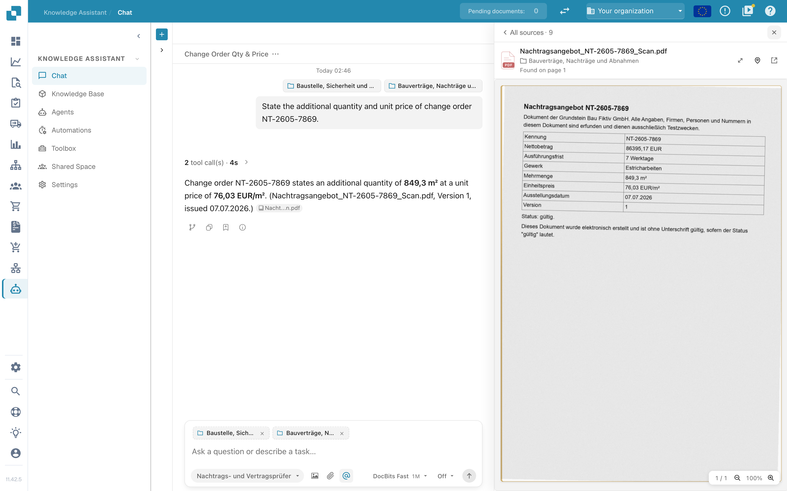

# Knowledge Assistant

The Knowledge Assistant answers questions from **your own documents**, inside the DocBits client. Every answer names the document it comes from, and one click opens that document next to the answer at the place where the information was found. You do not have to trust the answer: you open the source and check it.

<!-- VIDEO: rag/overview/v1/en.mp4 noch nicht veröffentlicht -->

<figure><figcaption>
An answer with its source: the document opens next to the chat.
</figcaption></figure>


All examples in this section use **invented demo data**: fictitious companies, document numbers, amounts and values. They only show how the assistant works. They are not customer data and not a promise of results with your documents.


## What you can do with it

* **Ask in plain sentences.** For example: "Which payment term and notice period apply to supply contract LV-2607-9239?" You get the value and the document it was read from.
* **Work with the valid version.** If a document exists in two versions, the assistant gives the value of the newer one and tells you which version it replaced. If two documents contradict each other, it names both values with their sources instead of choosing one.
* **Get "not in the documents" instead of an invented number.** If the information is not in your uploaded documents, the assistant says so. That is an answer you can act on: the document is missing.
* **Read scans and photos of documents.** Scanned PDFs are read by text recognition and can then be searched and queried.
* **Ask in your language.** In our tests the answer followed the language of the question (German, English and French were tested), even when the document was written in another language.
* **Start from an industry template.** An administrator switches on a template for eight industries and gets ready-made knowledge bases and assistants. See [Industry templates](industry-templates/README.md).

## How it works in four steps

1. **An administrator switches the Knowledge Assistant on** for your organization and, if wanted, an industry template. See [Tasks and where to find them](tasks-and-where-to-find-them.md#switch-on-the-knowledge-assistant-administrator).
2. **You upload documents** into a knowledge base (PDF, scanned PDF, Word, Excel, Markdown, text, photos).
3. **You ask a question in Chat** and choose an assistant.
4. **You open the source** below the answer and confirm the value in the document.

## What it is not

The Knowledge Assistant is a **research aid with sources**. It does not replace checking the original, and it does not decide for you.

* It gives **no legal advice** and makes no approval, payment or compliance decision.
* It is **not an archive**. Your archive or document management system stays the place for originals.
* It does **not replace reports and dashboards in DocBits**. Totals, lists and filters across many documents ("all open invoices above EUR 10,000") come from the DocBits dashboard and the extracted fields.
* It is **not a validated system**. In regulated areas such as life sciences, use it as a lookup aid only.

Read [What it can and cannot do](what-it-can-and-cannot-do.md) before you rely on it for important decisions.

## In this section

| Page | Use it to |
| --- | --- |
| [Tasks and where to find them](tasks-and-where-to-find-them.md) | Find where to click for each task: set up, upload, ask, check sources, manage knowledge bases |
| [Troubleshooting](troubleshooting.md) | Look up a symptom and the action that helps |
| [What it can and cannot do](what-it-can-and-cannot-do.md) | Understand the limits and what has been tested |
| [Industry templates](industry-templates/README.md) | See what the template for your industry provides, with example questions |


The demo documents we tested with are short and clean. How well the assistant works with your documents, for example long contracts, handwriting or poor copies, only a pilot with your own documents can show.

