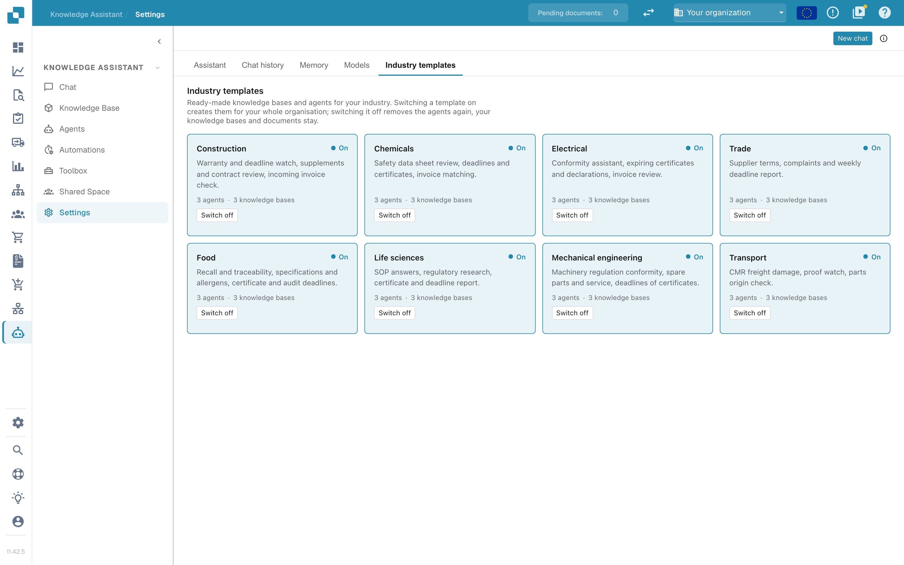

# Industry templates

An industry template gives you a starting point: three knowledge bases and three assistants that fit typical tasks in your industry. An administrator switches it on with one click under **Knowledge Assistant** → **Settings** → **Industry templates**. You then upload your documents and start asking. See [Tasks and where to find them](../tasks-and-where-to-find-them.md#switch-on-an-industry-template-administrator).

<!-- VIDEO: rag/industry-templates/v1/en.mp4 noch nicht veröffentlicht -->


All examples on the industry pages use **invented demo data**: 30 short, clean fictitious documents per industry. Companies, document numbers, amounts and values are made up. Each page also says what we did not test.


<figure><figcaption>
The eight industry templates under Knowledge Assistant, Settings.
</figcaption></figure>

| Industry | Typical documents |
| --- | --- |
| [Construction, Buildings and Energy](construction.md) | Construction contracts, change orders, site diaries, energy certificates |
| [Trade and Wholesale](trade.md) | Supply contracts, article records, complaints, supplier certificates |
| [Food and Beverage](food.md) | Supplier certificates, specifications, CCP records, goods receipts |
| [Transport, Customs and Aviation Parts](transport.md) | Consignment notes, customs declarations, release certificates |
| [Mechanical and Plant Engineering](mechanical-engineering.md) | Maintenance plans, spare parts lists, supplier agreements |
| [Electrical and Industrial Goods](electrical.md) | Test certificates, warranty terms, service reports |
| [Chemicals](chemicals.md) | Safety data sheets, batch certificates, inspection reports, specifications |
| [Life Sciences](life-sciences.md) | Audit reports, quality agreements, guideline excerpts, supplier documents |

## What every template has in common

* **Off until you switch it on.** Only administrators see the **Industry templates** tab. Switching a template off removes the assistants; knowledge bases and documents stay, and switching it on again creates no duplicates.
* **Answers with evidence.** Every answer names its document, and the preview shows the passage. If information is missing, the answer is "not in the documents".
* **Your own documents.** Templates come with empty knowledge bases. Nothing is filled in for you.
* **Weekly overview.** One assistant per template can compile what is about to expire. It is off by default and delivers its result into the assistant's history, not by e-mail. See [Tasks and where to find them](../tasks-and-where-to-find-them.md#weekly-overview-automations).

## Plan a pilot

To find out how well a template works for you, load 30 to 50 of your own documents for one process where a missing or wrong record costs money, a deadline or an audit. Ask ten questions whose answers you know, and two about information that does not exist. Then compare how long it takes to get an answer with evidence, and how many answers you confirm after opening the source.
