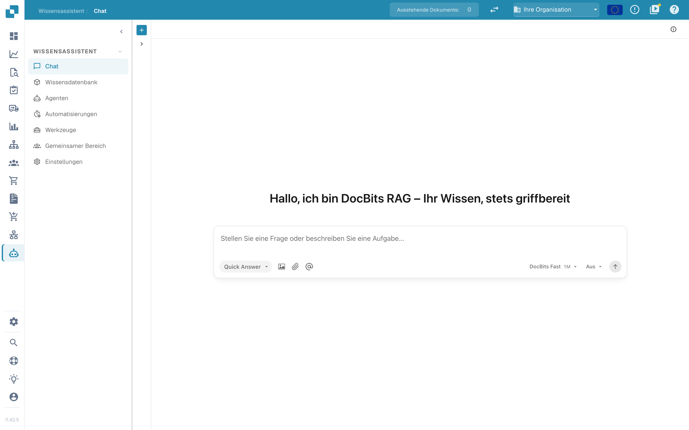
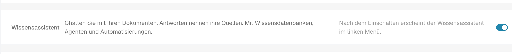
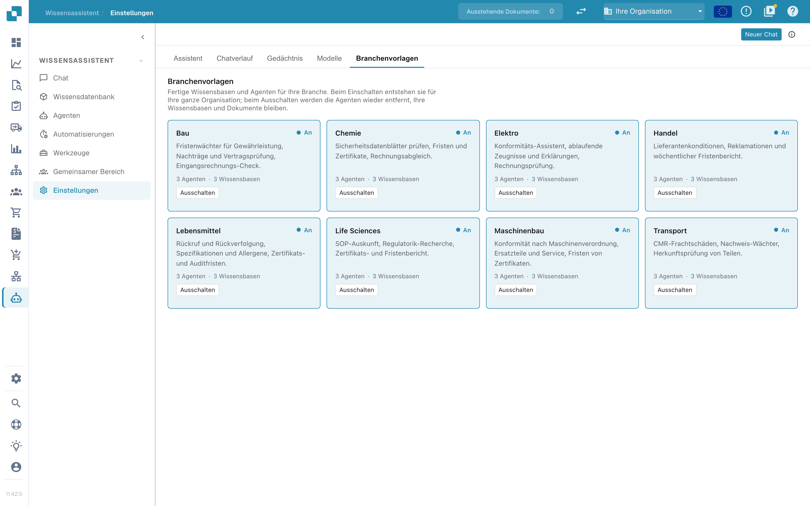
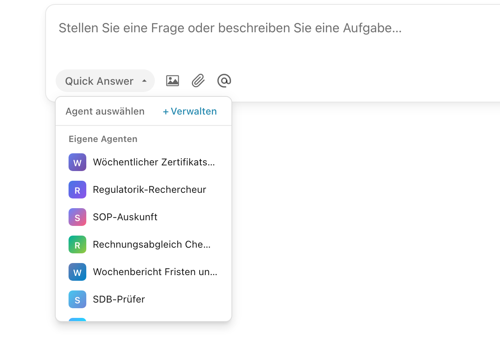
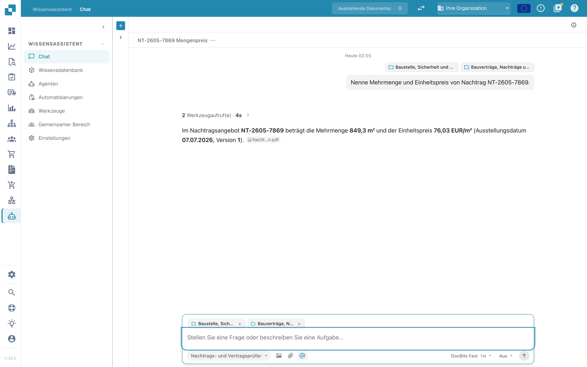
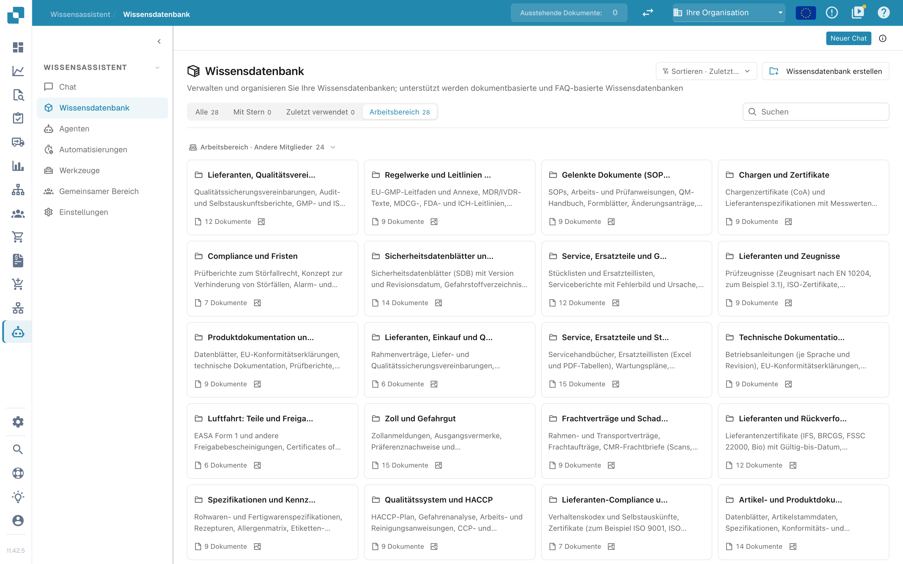
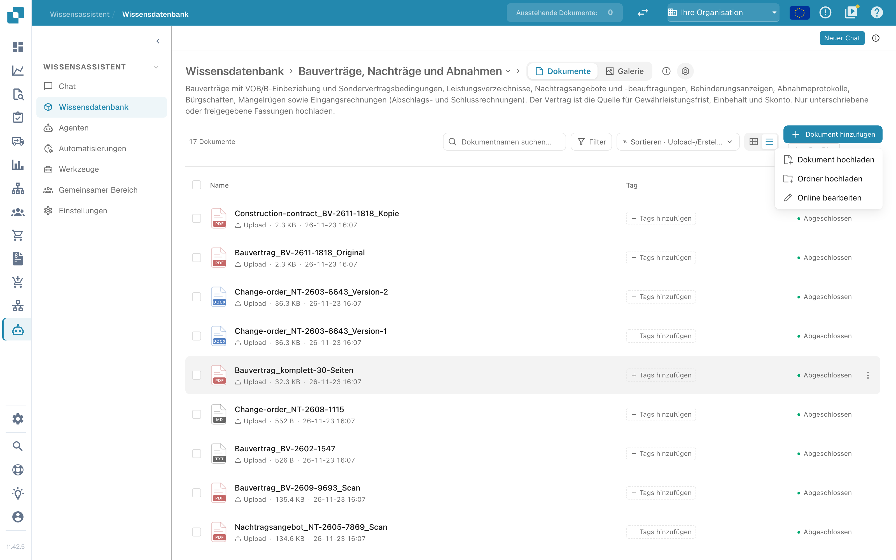
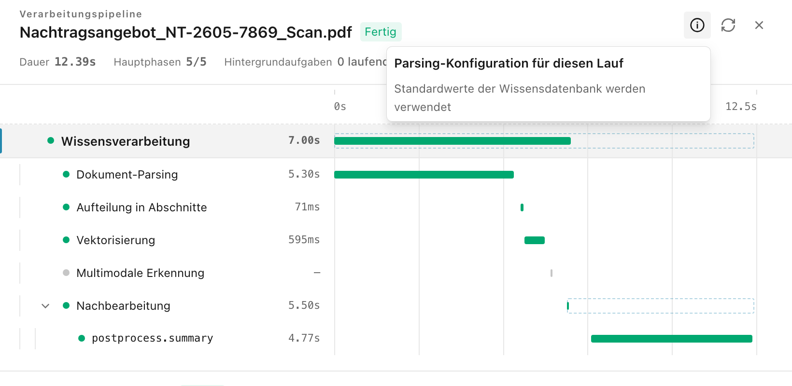
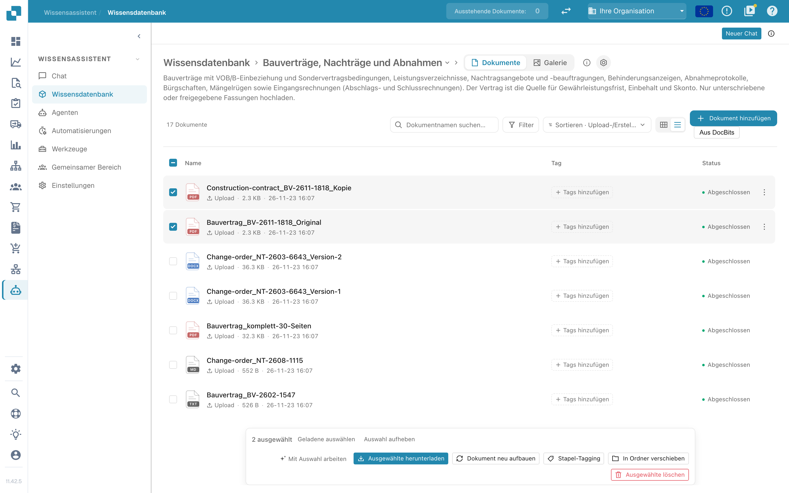
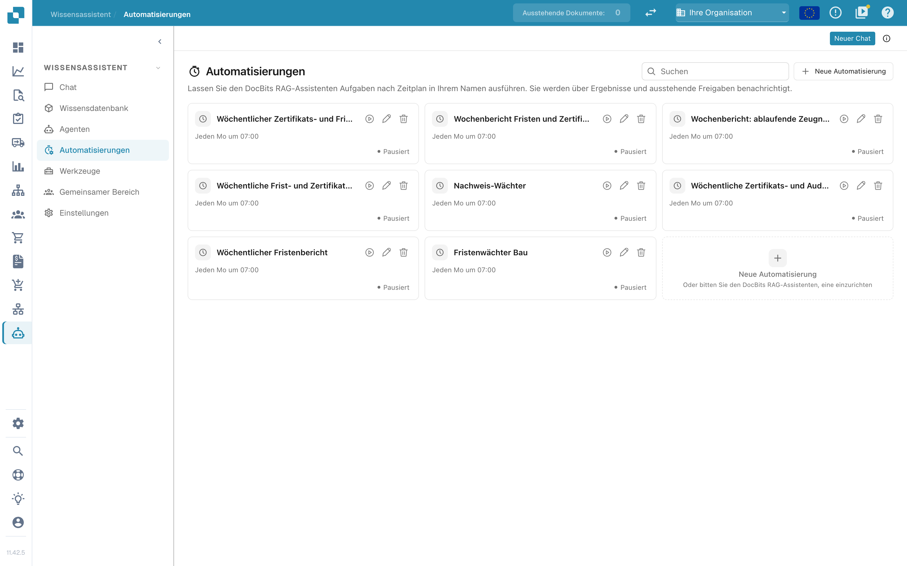

# Aufgaben und wo Sie sie finden

Alles beginnt im DocBits-Client unter **Wissensassistent**. Das Menü links zeigt **Chat**, **Wissensdatenbank**, **Agenten**, **Automatisierungen**, **Werkzeuge**, **Gemeinsamer Bereich** und **Einstellungen**. Im **Chat** stellen Sie Fragen, in der **Wissensdatenbank** verwalten Sie Dokumente, und ein Administrator schaltet unter **Einstellungen** Branchenvorlagen ein. **Werkzeuge** und **Gemeinsamer Bereich** werden in dieser Dokumentation nicht behandelt.

Die Oberfläche folgt der Sprache Ihres DocBits-Benutzers. Wir haben Englisch und Deutsch geprüft; die Bezeichnungen unten sind die deutschen, genau so, wie sie auf dem Bildschirm erscheinen. Die Namen der Wissensdatenbanken und Assistenten, die mit einer Branchenvorlage kommen, sind derzeit deutsch, auch in der englischen Oberfläche.

<figure><figcaption>
Das Menü des Wissensassistenten und ein leerer Chat.
</figcaption></figure>

Spalte Status: **Verfügbar** funktioniert in unseren Tests. **Eingeschränkt** funktioniert mit der genannten Einschränkung. **Nicht verfügbar** ist bewusst abgeschaltet oder wird nicht angeboten.

## Aufgabe und Klickweg

| Aufgabe | Klickweg | Was passiert | Status |
| --- | --- | --- | --- |
| Wissensassistent einschalten | Einstellungen → Module → Dokumentenintegration → Karte **Wissensassistent** (Administrator) | Der Eintrag **Wissensassistent** erscheint im linken Menü. | Verfügbar |
| Websuche einschalten (optional) | Einstellungen → Module → Dokumentenintegration → Karte **Wissensassistent** → **Funktionen** → **Websuche** (Administrator) | Der Assistent darf im öffentlichen Internet suchen; jeder Suchtext braucht standardmäßig Ihre Bestätigung. Siehe [Websuche](web-search.md). | Eingeschränkt: Best Effort |
| Branchenvorlage einschalten | Wissensassistent → Einstellungen → **Branchenvorlagen** (Administrator) | Drei Wissensdatenbanken und drei Assistenten werden angelegt. | Verfügbar |
| Eine Frage stellen | Wissensassistent → Chat → unter dem Eingabefeld einen Agenten wählen → Frage eintippen | Sie erhalten eine Antwort mit Quellenhinweis. | Verfügbar |
| Eine Quelle öffnen | Chat → Quellenhinweis unter der Antwort anklicken | Das Dokument öffnet sich rechts, mit der Seite, auf der die Antwort gefunden wurde. | Verfügbar; eingeschränkt bei Excel und Bildern |
| Neues Gespräch beginnen | **Neuer Chat** (die **+**-Schaltfläche neben der Chatliste) | Ein leeres Gespräch ohne den früheren Verlauf. | Verfügbar |
| Wissensdatenbank anlegen | Wissensdatenbank → **Wissensdatenbank erstellen** | Sie wählen Typ und Indexierung und geben einen Namen ein. | Verfügbar |
| Dokumente hochladen | Wissensdatenbank → Wissensdatenbank öffnen → **Dokument hinzufügen** → **Dokument hochladen** | Die Dateien werden gelesen und durchsuchbar gemacht. | Verfügbar; Fotos nicht erneut geprüft |
| Ganzen Ordner hochladen | **Dokument hinzufügen** → **Ordner hochladen** | Die Ordnerstruktur bleibt erhalten. | Eingeschränkt: Die Struktur wurde getestet, der Auswahldialog nicht |
| Text direkt schreiben | **Dokument hinzufügen** → **Online bearbeiten** | Sie schreiben ein Markdown-Dokument und geben es frei. | Verfügbar |
| Dokumente aus DocBits hinzufügen | Wissensdatenbank öffnen → **Aus DocBits** | Sie wählen DocBits-Dokumente aus und fügen sie der Wissensdatenbank hinzu. | Eingeschränkt: siehe unten |
| Verarbeitungsstatus lesen | Wissensdatenbank → Dokumentliste, Spalte **Status** | Ein Klick auf das Dokument zeigt seine Details und seine Verarbeitungspipeline. | Verfügbar |
| Dokument erneut verarbeiten | Dokument auswählen → **Dokument neu aufbauen** | Das Dokument wird erneut gelesen. | Verfügbar |
| Ordner und Tags | Wissensdatenbank → Ordnerbaum links; **Tags hinzufügen** in der Dokumentzeile | Dokumente lassen sich sortieren und filtern. | Verfügbar |
| Dokumente zwischen Ordnern verschieben | Dokumente auswählen → **In Ordner verschieben** | Das Dokument wechselt den Ordner, ohne neu gelesen zu werden. | Verfügbar |
| Mehrere Dokumente herunterladen | Dokumente auswählen → **Ausgewählte herunterladen** | Sie erhalten eine ZIP-Datei mit den Originalen. | Verfügbar |
| Textabschnitte bearbeiten | Dokument öffnen → **Abschnitte anzeigen** → Stift am Abschnitt | Der geänderte Text wird sofort für Antworten genutzt. | Verfügbar |
| Metadaten pflegen | Dokument öffnen → **Benutzerdefinierte Metadaten** → Stift | Bis zu 20 eigene Felder je Dokument. | Verfügbar |
| Änderungen nachvollziehen | Wissensdatenbank → Zahnradsymbol → Bereich für Verwaltung und Audit → Aktivität | Eine Liste von Anlage, Upload und Änderungen mit Zeit und Person. | Verfügbar |
| Bilder aus Dokumenten ansehen | Wissensdatenbank → Reiter **Galerie** | Zeigt in Dokumente eingebettete Bilder. | Eingeschränkt |
| Wochenübersicht | Wissensassistent → **Automatisierungen** | Ein Assistent stellt eine Übersicht ablaufender Dokumente zusammen. | Eingeschränkt |
| Wissensdatenbank kopieren | Funktion zum Kopieren der Wissensdatenbank | Die Kopie entsteht im Hintergrund, samt Ordnern. | Eingeschränkt: Der Weg in der Oberfläche wurde nicht gesondert geprüft |
| Dokumente zwischen Wissensdatenbanken verschieben | – | In der Mehrfachauswahl nicht angeboten. | Nicht verfügbar |
| Dokument über Web-Adresse holen | – | Der Import über Web-Adresse ist abgeschaltet. | Nicht verfügbar |

## Den Wissensassistenten einschalten (Administrator)

1. Öffnen Sie **Einstellungen** → **Module** → **Dokumentenintegration**.
2. Suchen Sie die Karte **Wissensassistent** und schalten Sie sie ein. Die Karte lautet: „Chatten Sie mit Ihren Dokumenten. Antworten nennen ihre Quellen. Mit Wissensdatenbanken, Agenten und Automatisierungen.“ und „Nach dem Einschalten erscheint der Wissensassistent im linken Menü.“

<figure><figcaption>
Die Karte Wissensassistent unter Dokumentenintegration.
</figcaption></figure>


Fehlt der Eintrag **Wissensassistent** im linken Menü, ist das Modul für Ihre Organisation nicht eingeschaltet. Fragen Sie Ihren Administrator.


## Eine Branchenvorlage einschalten (Administrator)

Öffnen Sie **Wissensassistent** → **Einstellungen** → **Branchenvorlagen**. Vorlagen gibt es für Bau, Chemie, Elektro, Handel, Lebensmittel, Life Sciences, Maschinenbau und Transport. Was jede Vorlage bietet, steht unter [Branchenvorlagen](industry-templates/README.md).

<figure><figcaption>
Der Reiter Branchenvorlagen mit allen acht eingeschalteten Vorlagen.
</figcaption></figure>

1. Öffnen Sie die Karte Ihrer Branche und schalten Sie sie ein. Die Karte zeigt dann „An“ und „3 Agenten · 3 Wissensbasen“.
2. Laden Sie Dokumente in die Wissensdatenbanken hoch.
3. Zum Ausschalten wählen Sie **Ausschalten**. Die Assistenten verschwinden; Wissensdatenbanken und Dokumente bleiben. Beim erneuten Einschalten entstehen keine Duplikate.

Nur Administratoren sehen den Reiter **Branchenvorlagen**. Mitglieder ohne Administratorrechte nutzen den Chat und die vorhandenen Assistenten. Die **Einstellungen** enthalten außerdem die Reiter **Assistent**, **Chatverlauf**, **Gedächtnis** und **Modelle**; sie werden hier nicht behandelt.

## Eine Frage stellen und die Quelle öffnen

Öffnen Sie den **Chat**. Unter dem Eingabefeld zeigt die Schaltfläche den gewählten Agenten; **Quick Answer** ist die Voreinstellung. Wählen Sie unter **Eigene Agenten** einen Agenten, um einen Assistenten einer Branchenvorlage zu nutzen. Die Wissensdatenbanken dieses Assistenten erscheinen dann als Chips über dem Eingabefeld. Tippen Sie Ihre Frage und senden Sie sie ab. [Den richtigen Agenten wählen](choose-the-right-agent.md) erklärt, wie sich die integrierten Agenten unterscheiden.

<figure><figcaption>
Agent auswählen: zuerst die integrierten Agenten, dann die eigenen Agenten Ihrer Vorlagen.
</figcaption></figure>

Jede Antwort mit Fundstelle zeigt unter dem Text einen Quellenhinweis. Ein Klick öffnet die Vorschau rechts. Sie zeigt das Dokument, seine Wissensdatenbank und die Seite, auf der die Antwort gefunden wurde („Auf Seite 1 gefunden“). Bei PDF, gescanntem PDF, Word, Markdown und Text zeigte die Vorschau in unseren Tests die Fundstelle.

<figure><figcaption>
Eine Antwort mit ihrem Quellenhinweis.
</figcaption></figure>

* **Excel:** Die Datei öffnet sich, die Zeile wird nicht markiert. Die Vorschau meldet, dass die zitierte Stelle nicht genau bestimmt werden konnte und das Original geöffnet ist.
* **Bilder und Fotos:** Die Vorschau zeigt das Bild. Der darin enthaltene Text ist nicht bestätigt.
* Quellenhinweise können auch neben „nicht in den Unterlagen“ erscheinen. Sie nennen Dokumente, die der Assistent geprüft hat; sie sind kein Beleg für einen Wert.
* **Fragen Sie genau**, zum Beispiel mit der Dokumentnummer. Fragen Sie nach einer Nummer, die es nicht gibt, antwortet der Assistent „nicht in den Unterlagen“, statt den Wert einer ähnlichen Nummer zu nennen.

## Dokumente hochladen und den Status lesen

Die Wissensdatenbank zeigt ihre Dokumente in einer Liste mit Name, Tags und Status. **Dokument hinzufügen** öffnet ein Menü mit **Dokument hochladen**, **Ordner hochladen** und **Online bearbeiten**.

<figure><figcaption>
Die Wissensdatenbanken Ihrer Organisation.
</figcaption></figure>

<figure><figcaption>
Das Menü Dokument hinzufügen.
</figcaption></figure>

1. Wissensdatenbank → Wissensdatenbank öffnen → **Dokument hinzufügen** → **Dokument hochladen**.
2. Wählen Sie Dateien. Auf der Bestätigungsseite können Sie Tags und Optionen setzen, zum Beispiel ob eine Zusammenfassung erstellt wird. Starten Sie dann die Verarbeitung.
3. Das Upload-Panel zeigt Zähler und Zwischenstände. Sie können die Seite verlassen; die Verarbeitung läuft weiter.

Hinweise zu Dateien:

* Die Oberfläche nennt höchstens **50 MB je Datei** für PDF, Office-Formate, Text und Markdown. Dateien dieser Größe haben wir nicht getestet.
* In unseren Tests wurden PDF, gescanntes PDF, Word, Excel, Markdown, Text und Fotos gelesen. E-Mail-Dateien (.eml) und XML-Dateien werden abgewiesen, ebenso leere Dateien.
* Dieselbe Datei erneut hochzuladen wird abgewiesen; die vorhandene bleibt unverändert.
* **Fotos:** Das Lesen eines Fotos als Text funktionierte in unseren Tests. Das Hochladen eines Fotos in der Oberfläche war in früheren Testständen gesperrt, bis die Bildverarbeitung („Multimodal“) eingeschaltet und ein Modell gewählt war. Für die aktuelle Version haben wir das nicht erneut geprüft.

### Status

| Anzeige (sinngemäß) | Bedeutung | Was zu tun ist |
| --- | --- | --- |
| Abgeschlossen | Gelesen und durchsuchbar. | Nichts. |
| Fehlgeschlagen | Die Verarbeitung ist fehlgeschlagen; die Meldung steht auf der Karte. | Dokument auswählen → **Dokument neu aufbauen**. Schlägt es erneut fehl, siehe [Fehlerbehebung](troubleshooting.md). |
| Stillstand-Hinweis | Seit einer Weile kein Fortschritt. | Verarbeitungspipeline öffnen, die Verarbeitung stoppen, dann **Dokument neu aufbauen**. Ohne Eingriff wird das Dokument nach einer Weile automatisch auf fehlgeschlagen gesetzt. |

Die Bezeichnungen der beiden letzten Zeilen haben wir in der deutschen Oberfläche nicht gesondert nachgesehen; auf dem Bildschirm kann der Wortlaut abweichen.

Klicken Sie ein Dokument an, um seine Details zu sehen: **Grundinformationen**, **Benutzerdefinierte Metadaten**, **Zusammenfassung** und **Dateiinhalt** mit **Vorschau** und **Abschnitte anzeigen**. Das Pipeline-Symbol oben in den Details öffnet die **Verarbeitungspipeline**. Sie zeigt die Dauer, die Hauptphasen und die Phasen auf einer Zeitleiste: **Dokument-Parsing**, **Aufteilung in Abschnitte**, **Vektorisierung**, **Multimodale Erkennung** und **Nachbearbeitung**. Das Informationssymbol zeigt, welche Parsing-Konfiguration der Lauf nutzte, zum Beispiel „Standardwerte der Wissensdatenbank werden verwendet“.

<figure><figcaption>
Die Verarbeitungspipeline eines abgeschlossenen Dokuments.
</figcaption></figure>

Wird ein Stillstand erkannt, erscheint ein Hinweis, dass seit N Minuten kein Fortschritt zu sehen ist. Endet ein Stillstand automatisch, lautet die Fehlermeldung „task stuck in processing…“. Versuchen Sie es mit **Dokument neu aufbauen** erneut. Diese Meldungen haben wir in früheren Testständen gesehen.

## Dokumente aus DocBits hinzufügen

Mit **Aus DocBits** neben **Dokument hinzufügen** fügen Sie Dokumente hinzu, die DocBits bereits hält, zum Beispiel Rechnungen, ohne sie erneut hochzuladen. Das Panel „Dokumente aus DocBits hinzufügen“ listet Ihre DocBits-Dokumente mit Suchfeld und einem Zähler („0 von 20 gewählt“). Mit einer Schaltfläche fügen Sie die gewählten Dokumente hinzu; darunter steht, was Sie schon hinzugefügt haben.


Alle, die diese Wissensbasis öffnen dürfen, können den Inhalt der hinzugefügten Dokumente lesen, auch wenn sie sie in DocBits nicht öffnen dürfen. Fügen Sie nur Dokumente hinzu, die alle Leser der Wissensdatenbank sehen dürfen.


Status: Die Übernahme von DocBits-Dokumenten haben wir über die Schnittstelle für Entwickler (API) geprüft und das Auswahlpanel auf dem Bildschirm gesehen. Dokumente über das Panel hinzugefügt haben wir bei unseren Prüfungen nicht.

## Wissensdatenbank anlegen

Wissensdatenbank → **Wissensdatenbank erstellen**. Sie wählen:

* **Inhaltstyp:** Dokumente oder FAQ.
* **Indexierung:** „RAG Search“ zum Durchsuchen von Dokumenten, „Wiki“ für verknüpfte Wiki-Seiten. Der Wissensgraph ist eine eigene Einstellung.
* **Bilder:** Die Bildverarbeitung steuert, wie Bilder in Dokumenten verarbeitet werden.

Die Einstellungen einer vorhandenen Wissensdatenbank öffnen Sie mit dem Zahnradsymbol neben den Reitern **Dokumente** und **Galerie**. Sie sind gegliedert in Grundinformationen, Indexierung und Parsing (Parser-Engine, Abschnittseinstellungen, Bildverarbeitung, Wissensgraph, erweiterte Einstellungen), Veröffentlichung (Freigabe) sowie Verwaltung und Audit (Aktivität). Die genauen deutschen Bezeichnungen haben wir nicht gesondert nachgesehen.

Die Modelle für Embedding, Zusammenfassung und Bildverarbeitung sind vorgegeben; ein Embedding-Modell wählen Sie nicht. Die Indexierung können Sie ändern, solange die Wissensdatenbank leer ist, danach nicht mehr.


**Abschnittsgröße speichern:** In unseren Tests funktionierte das Speichern der Abschnittsgröße nicht zuverlässig: Die Änderung blieb wirkungslos, und vorhandene Einstellungen konnten zurückgesetzt werden. Für die aktuelle Version haben wir das nicht erneut geprüft. Prüfen Sie die Werte nach dem Speichern und ändern Sie sie nicht ohne Bedarf.


## Ordner und Tags

* Der **Ordnerbaum** steht links in der Wissensdatenbank. Dokumente verschieben Sie mit **In Ordner verschieben**; sie werden nicht neu gelesen.
* Einen Ordner in seinen eigenen Unterordner zu verschieben wird abgewiesen. Umbenennen, Verschieben und Zusammenführen von Ordnern haben wir über die Schnittstelle für Entwickler (API) getestet, nicht gesondert in der Oberfläche.
* **Tags:** Nutzen Sie **Tags hinzufügen** in der Dokumentzeile, oder wählen Sie mehrere Dokumente und dann **Stapel-Tagging**. Vorsicht: **Stapel-Tagging ersetzt die vorhandenen Tags** der gewählten Dokumente.
* Filtern Sie nach mehreren Tags, erscheinen Dokumente, die irgendeinen dieser Tags tragen (ODER).
* Automatische Tags (Auto-Tag, höchstens 3 je Dokument) sind optional, standardmäßig aus und wirken nur auf Dokumente, die nach dem Einschalten verarbeitet werden.

## Mehrere Dokumente auswählen

Wählen Sie Dokumente mit den Kontrollkästchen. Eine Leiste am unteren Rand zeigt, wie viele ausgewählt sind, und die Aktionen **Ausgewählte herunterladen**, **Dokument neu aufbauen**, **Stapel-Tagging**, **In Ordner verschieben** und **Ausgewählte löschen**.

<figure><figcaption>
Die Aktionsleiste für ausgewählte Dokumente.
</figcaption></figure>


**Ausgewählte löschen** entfernt die ausgewählten Dokumente. Prüfen Sie die Auswahl, bevor Sie bestätigen.


## Textabschnitte bearbeiten

In einem Dokument zeigt **Abschnitte anzeigen** die Textabschnitte. Jeder Abschnitt hat einen Stift, den Verlauf und einen Schalter. Nach dem Speichern wird der Abschnitt neu indexiert, und Antworten nutzen den neuen Text. Frühere Fassungen bleiben im Verlauf und lassen sich wiederherstellen. Bearbeiten zwei Personen gleichzeitig denselben Abschnitt, erhält die zweite eine Konfliktmeldung („Chunk was modified by another user“) und muss neu laden. Nach einer Änderung können Sie die Zusammenfassung des Dokuments neu erzeugen oder von Hand eintragen.

## Metadaten

Jedes Dokument kann bis zu 20 eigene Felder haben. Ein 21. Feld wird abgewiesen.

## Kopieren, verschieben und herunterladen

* **Wissensdatenbank kopieren** läuft im Hintergrund und übernimmt Dokumente und Ordner. Die Kopie hat denselben Namen wie das Original; benennen Sie sie um, damit Sie beide unterscheiden können.
* **Mehrfach-Download:** Nur Rollen mit Bearbeitungsrecht (Contributor und höher) dürfen herunterladen; Viewer nicht. Die ZIP-Datei behält die Originaldateinamen.
* Den Download von mehr als 200 Dokumenten oder sehr großen Mengen haben wir nicht getestet.

## Wiki, Wissensgraph und Galerie

* **Galerie** (Reiter neben **Dokumente**): zeigt **in Dokumente eingebettete** Bilder (zum Beispiel in PDF oder Word), sofern die Bildverarbeitung eingeschaltet ist. Einzeln hochgeladene Fotos erscheinen dort nicht; sie werden per Texterkennung gelesen und stehen für Fragen bereit. Die Beschreibungen der Bilder waren in unseren Tests leer.
* **Wiki und Wissensgraph:** Ein Graph-Assistent nennt zu einem Dokument die zugehörigen Dokumente mit Quellen, zum Beispiel welche Berichte auf einen Frachtbrief verweisen. Wir haben das an einer eigenen Demo-Wissensdatenbank getestet, noch nicht an den Branchenvorlagen. Betrachten Sie es als gebaut, aber noch nicht durchgängig getestet.

## Wochenübersicht (Automatisierungen)

**Automatisierungen** listet je Branchenvorlage einen Wochenplan („Jeden Mo um 07:00“). Jeder Plan beginnt als **Pausiert**. Der Assistent dahinter stellt zusammen, was laut Ihren Dokumenten bald abläuft, mit Fundstelle und einem Hinweis, wo ein Datum fehlt. In unseren Tests lief die Übersicht bei manuellem Start in allen acht Branchen erfolgreich.

<figure><figcaption>
Die Wochenpläne der Branchenvorlagen, alle pausiert.
</figcaption></figure>

Einschränkungen: Das Ergebnis erscheint im Verlauf des Assistenten; es gibt keinen E-Mail-Versand. Den Start über die Oberfläche **Automatisierungen** haben wir nicht gesondert getestet. Wir haben das Ergebnis auf Erfolg und Form geprüft, nicht jede Zeile auf Richtigkeit.

## Rollen

* **Administrator:** schaltet das Modul und die Branchenvorlagen ein und aus.
* **Contributor (Standardrolle für Mitglieder):** lädt hoch, bearbeitet und löscht eigene Wissensdatenbanken und legt neue an.
* **Viewer:** liest und fragt. Hochladen, Bearbeiten, Löschen, Anlegen und Herunterladen sind für Viewer gesperrt und werden in der Oberfläche nicht angeboten.

Diese Rollenregeln stammen aus unseren Tests auf einer separaten Testinstallation; auf der aktuellen Entwicklungsumgebung haben wir sie nicht erneut getestet.

Siehe auch: [Fehlerbehebung](troubleshooting.md) und [Was er kann und was nicht](what-it-can-and-cannot-do.md).
