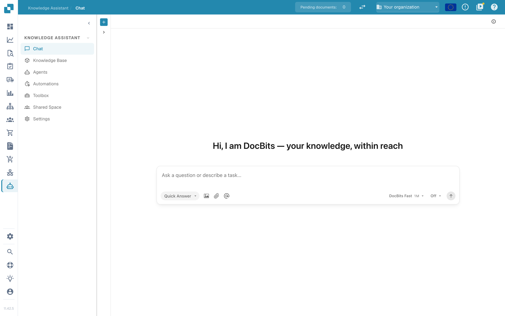
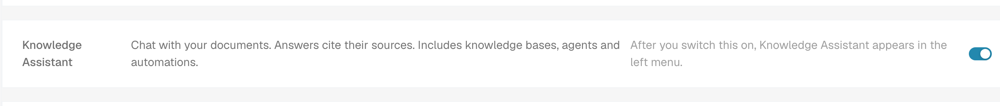
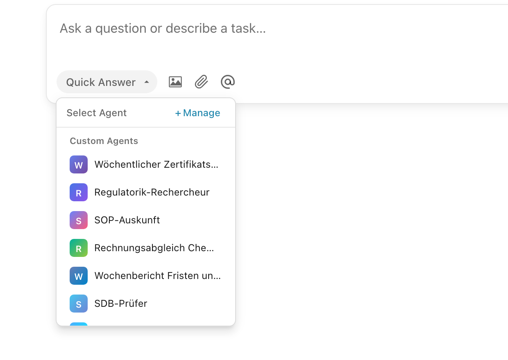
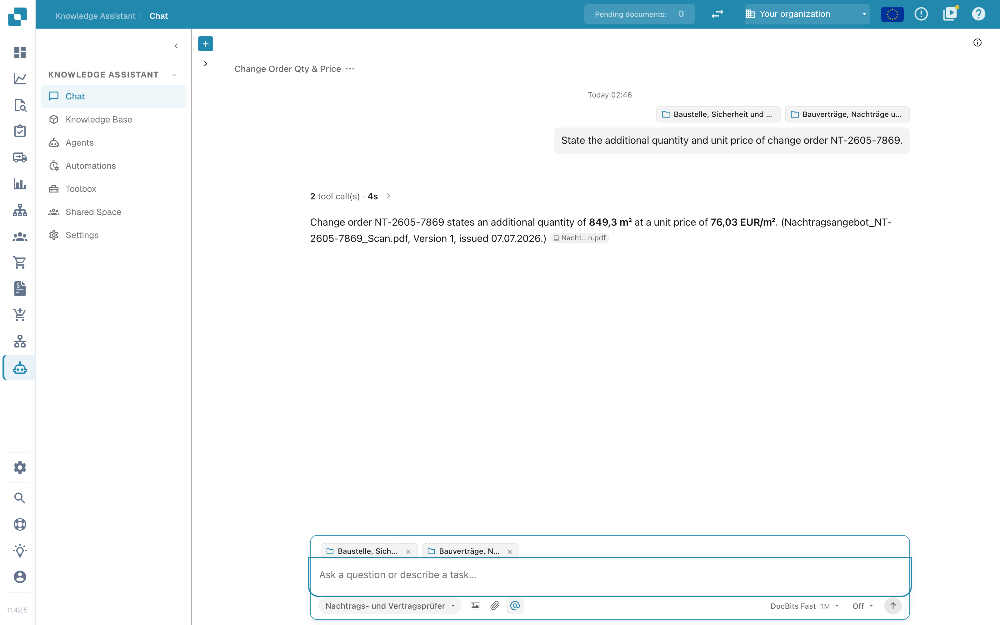
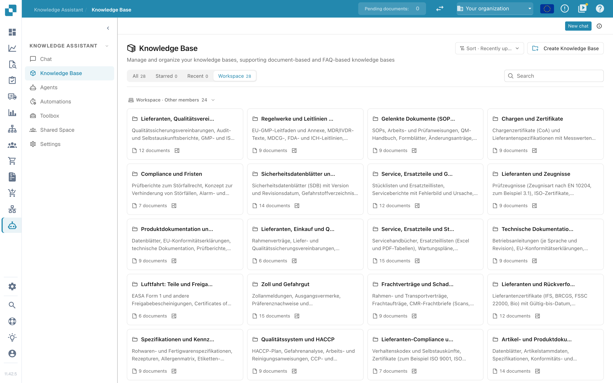
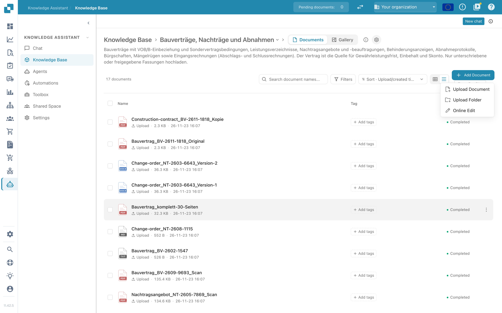
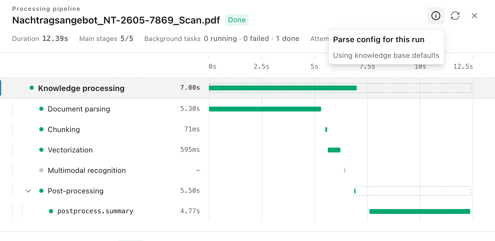
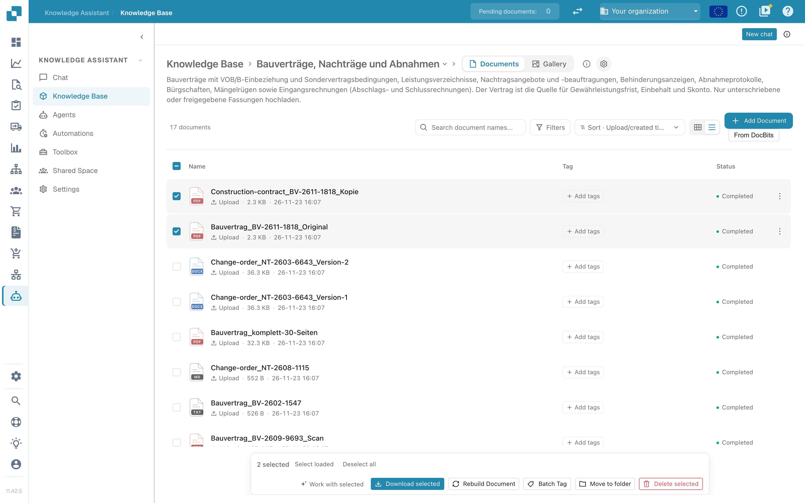
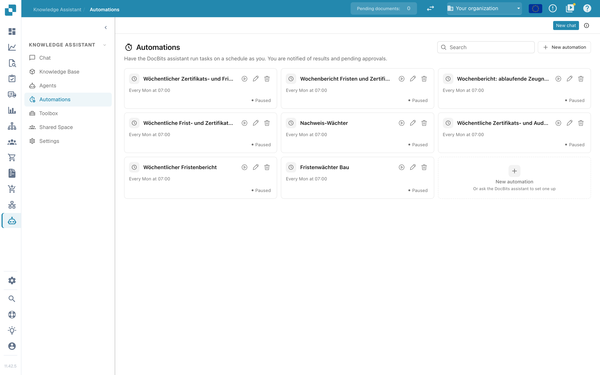

# Tasks and where to find them

Everything starts in the DocBits client under **Knowledge Assistant**. The menu on the left shows **Chat**, **Knowledge Base**, **Agents**, **Automations**, **Toolbox**, **Shared Space** and **Settings**. You ask questions in **Chat**, manage documents in the **Knowledge Base**, and an administrator switches on industry templates under **Settings**. **Toolbox** and **Shared Space** are not covered in this documentation.

The screens follow the language of your DocBits user. We checked English and German; the names below are the English ones, exactly as they appear on screen. The names of the knowledge bases and assistants that come with an industry template are currently in German, also in the English interface.

<figure><figcaption>
The Knowledge Assistant menu and an empty chat.
</figcaption></figure>

Status column: **Available** works in our tests. **Limited** works with the stated limitation. **Not available** is deliberately switched off or not offered.

## Task and click path

| Task | Click path | What happens | Status |
| --- | --- | --- | --- |
| Switch on the Knowledge Assistant | Settings → Module → Document Integration → card **Knowledge Assistant** (administrator) | The **Knowledge Assistant** entry appears in the left menu. | Available |
| Switch on an industry template | Knowledge Assistant → Settings → **Industry templates** (administrator) | Three knowledge bases and three assistants are created. | Available |
| Ask a question | Knowledge Assistant → Chat → choose an agent below the input field → type the question | You get an answer with a source reference. | Available |
| Open a source | Chat → click the source reference below the answer | The document opens on the right, with the page where the answer was found. | Available; limited for Excel and images |
| Start a new conversation | **New chat** (the **+** button next to the chat list) | An empty conversation without the earlier history. | Available |
| Create a knowledge base | Knowledge Base → **Create Knowledge Base** | You choose type and indexing and enter a name. | Available |
| Upload documents | Knowledge Base → open a knowledge base → **Add Document** → **Upload Document** | The files are read and made searchable. | Available; photos not re-checked |
| Upload a whole folder | **Add Document** → **Upload Folder** | The folder structure is kept. | Limited: the structure was tested, the selection dialog was not |
| Write text directly | **Add Document** → **Online Edit** | You write a Markdown document and release it with **Publish**. | Available |
| Add documents from DocBits | Open a knowledge base → **From DocBits** | You select DocBits documents and add them to the knowledge base. | Limited: see below |
| Read the processing status | Knowledge base → document list, **Status** column | Completed, Failed or May be stuck; a click on the document shows its details and its processing pipeline. | Available |
| Process a document again | Select a document → **Rebuild Document** | The document is read again. | Available |
| Folders and tags | Knowledge base → folder tree on the left; **Add tags** in the document row | Documents can be sorted and filtered. | Available |
| Move documents between folders | Select documents → **Move to folder** | The document changes folder without being read again. | Available |
| Download several documents | Select documents → **Download selected** | You get a ZIP file with the originals. | Available |
| Edit text sections | Open a document → **View Chunks** → pencil on the section | The changed text is used for answers right away. | Available |
| Maintain metadata | Open a document → **Custom metadata** → pencil | Up to 20 custom fields per document. | Available |
| Trace changes | Knowledge base → gear symbol → **Management & Audit** → **Activity** | A list of creation, upload and changes with time and person. | Available |
| View images from documents | Knowledge base → **Gallery** tab | Shows images embedded in documents. | Limited |
| Weekly overview | Knowledge Assistant → **Automations** | An assistant compiles an overview of expiring documents. | Limited |
| Copy a knowledge base | **Copy** function of the knowledge base | The copy is created in the background, including folders. | Limited: the path on screen was not checked separately |
| Move documents between knowledge bases | – | Not offered in the multi-selection. | Not available |
| Fetch a document by web address | – | Import by web address is switched off. | Not available |

## Switch on the Knowledge Assistant (administrator)

1. Open **Settings** → **Module** → **Document Integration**.
2. Find the card **Knowledge Assistant** and switch it on. The card reads: "Chat with your documents. Answers cite their sources. Includes knowledge bases, agents and automations." and "After you switch this on, Knowledge Assistant appears in the left menu."

<figure><figcaption>
The Knowledge Assistant card under Document Integration.
</figcaption></figure>


If the **Knowledge Assistant** entry is missing in the left menu, the module is not switched on for your organization. Ask your administrator.


## Switch on an industry template (administrator)

Open **Knowledge Assistant** → **Settings** → **Industry templates**. Templates exist for Construction, Chemicals, Electrical, Trade, Food, Life sciences, Mechanical engineering and Transport. See [Industry templates](industry-templates/README.md) for what each one provides.

<figure><figcaption>
The Industry templates tab with all eight templates switched on.
</figcaption></figure>

1. Open the card of your industry and switch it on. The card then shows "On" and "3 agents · 3 knowledge bases".
2. Upload documents to the knowledge bases.
3. To switch it off, choose **Switch off**. The assistants disappear; knowledge bases and documents stay. Switching it on again creates no duplicates.

Only administrators see the **Industry templates** tab. Members without administrator rights use Chat and the existing assistants. **Settings** also contains the tabs **Assistant**, **Chat history**, **Memory** and **Models**; they are not covered here.

## Ask a question and open the source

Open **Chat**. Below the input field the button shows the selected agent; **Quick Answer** is the default. Choose an agent under **Custom Agents** to use an assistant of an industry template. The knowledge bases of that assistant then appear as chips above the input field. Type your question and send it.

<figure><figcaption>
Choose an agent: built-in agents first, then the custom agents of your templates.
</figcaption></figure>

Every answer with a place of origin shows a source reference below the text. A click opens the preview on the right. It shows the document, its knowledge base and the page where the answer was found. PDF, scanned PDF, Word, Markdown and text showed the place where the answer was found in our tests.

<figure><figcaption>
An answer with its source reference.
</figcaption></figure>

* **Excel:** The file opens, but the row is not highlighted. The preview says "Could not pinpoint the cited passage; the original is open".
* **Images and photos:** The preview shows the image. The text inside is not confirmed ("exact text not confirmed").
* Source references can also appear next to "not in the documents". They list documents the assistant checked; they are not proof of a value.
* **Be precise**, for example by using the document number. If you ask about a number that does not exist, the assistant answers "not in the documents" instead of giving the value of a similar number.

## Upload documents and read the status

The knowledge base shows its documents in a list with name, tags and status. **Add Document** opens a menu with **Upload Document**, **Upload Folder** and **Online Edit**.

<figure><figcaption>
The knowledge bases of your organization.
</figcaption></figure>

<figure><figcaption>
The Add Document menu.
</figcaption></figure>

1. Knowledge Base → open a knowledge base → **Add Document** → **Upload Document**.
2. Choose files. On the confirmation page you can set tags and options, for example whether a summary is created. Then choose **Upload and parse**.
3. The upload panel shows counters ("Parsing 0 of 7") and intermediate states ("Waiting to parse", "Generating summary...", "Searchable, still optimizing", "Done"). You can leave the page; processing continues.

Notes on files:

* The screen states a maximum of **50 MB per file** for PDF, office formats, text and Markdown. We have not tested files of that size.
* In our tests PDF, scanned PDF, Word, Excel, Markdown, text and photos were read. E-mail files (.eml) and XML files are rejected, and so are empty files.
* Uploading the same file again is rejected; the existing one stays unchanged.
* **Photos:** reading a photo as text worked in our tests. Uploading a photo on screen was blocked in earlier test builds until image processing ("Multimodal") was switched on and a model was chosen. We have not re-checked this on the current version.

### Status

| Display | Meaning | What to do |
| --- | --- | --- |
| Completed | Read and searchable. | Nothing. |
| Failed | Processing failed; the message is shown on the card. | Select the document → **Rebuild Document**. If it fails again, see [Troubleshooting](troubleshooting.md). |
| May be stuck | No progress for a while. | Open the processing pipeline, choose **Stop parsing**, then **Rebuild Document**. Without action the document is set to Failed automatically after a while. |

Click a document to see its details: **Basic info**, **Custom metadata**, **Summary** and **File Content** with **Preview** and **View Chunks**. The pipeline symbol at the top of the details opens the **Processing pipeline**. It shows the duration, the main stages and the stages in a timeline: **Document parsing**, **Chunking**, **Vectorization**, **Multimodal recognition** and **Post-processing**. The information symbol shows which parse configuration the run used, for example "Using knowledge base defaults".

<figure><figcaption>
The processing pipeline of a completed document.
</figcaption></figure>

When a stall is detected, a notice appears: "No progress for N minutes; this may be stuck". When a stall ends automatically, the error message reads "task stuck in processing…". Use **Rebuild Document** to try again. We saw these messages in earlier test builds.

## Add documents from DocBits

Use **From DocBits** next to **Add Document** to add documents that DocBits already holds, such as invoices, without uploading them again. The panel "Add documents from DocBits" lists your DocBits documents with a search field, a counter ("0 of 20 selected") and the button **Add N documents**. Below it, "Copies from DocBits in this knowledge base" lists what you added before.


Everyone who can open this knowledge base can read the content of the documents you add, even if they cannot open them in DocBits. Add only documents that all readers of the knowledge base may see.


Status: we verified the transfer of DocBits documents through the interface for developers (API) and saw the selection panel on screen. We did not add documents through the panel in our checks.

## Create a knowledge base

Knowledge Base → **Create Knowledge Base**. You choose:

* **Content type:** Documents or FAQ.
* **Indexing (Indexing Strategy):** "RAG Search" for searching documents, "Wiki" for linked wiki pages. The knowledge graph is a separate setting (**Knowledge Graph**).
* **Images:** **Image Processing** controls how images inside documents are processed.

To open the settings of an existing knowledge base, use the gear symbol next to the **Documents** and **Gallery** tabs. The settings are grouped as **Basic Information**, **Indexing & Parsing** (Parser Engine, Chunking Settings, Image Processing, Knowledge Graph, Advanced Settings), **Publishing** (Sharing) and **Management & Audit** (Activity).

The models for embedding, summary and image processing are predefined; you do not choose an embedding model. You can change the indexing while the knowledge base is empty, but not afterwards ("The indexing strategy cannot be changed once the knowledge base contains content").


**Saving the section size:** In our tests, saving the section size (**Chunking Settings**) with **Save and Close** did not work reliably: the change did not take effect and existing settings could be reset. We have not re-checked this on the current version. Check the values after you save, and do not change them without a need.


## Folders and tags

* The **folder tree** is on the left in the knowledge base. Move documents with **Move to folder**; they are not read again.
* Moving a folder into its own subfolder is rejected. We tested renaming, moving and merging folders through the interface for developers (API), not separately on screen.
* **Tags:** use **Add tags** in the document row, or select several documents and choose **Batch Tag**. Caution: **Batch Tag replaces the existing tags** of the selected documents.
* Filtering by several tags shows documents that have any one of the tags (OR).
* Automatic tags (Auto-Tag, at most 3 per document) are optional, off by default and only affect documents processed after you switch them on.

## Select several documents

Select documents with the check boxes. A bar at the bottom shows how many are selected and the actions **Download selected**, **Rebuild Document**, **Batch Tag**, **Move to folder** and **Delete selected**.

<figure><figcaption>
The action bar for selected documents.
</figcaption></figure>


**Delete selected** removes the selected documents. Check the selection before you confirm.


## Edit text sections

In a document, **View Chunks** shows the text sections. Each section has a pencil, the history and a switch. After you save, the section is indexed again and answers use the new text. Earlier versions stay in the history and can be restored. If two people edit the same section at the same time, the second person gets a conflict message ("Chunk was modified by another user") and has to reload. After a change you can regenerate the document summary or enter it by hand.

## Metadata

Each document can have up to 20 custom fields (shown as "20/20"). A 21st field is rejected.

## Copy, move and download

* **Copying a knowledge base** runs in the background and takes over documents and folders. The copy has the same name as the original; rename it so you can tell them apart.
* **Bulk download:** only roles with edit rights (Contributor and above) may download; Viewers may not. The ZIP file keeps the original file names.
* We did not test downloading more than 200 documents or very large volumes.

## Wiki, knowledge graph and gallery

* **Gallery** (tab next to **Documents**): shows images **embedded in documents** (for example in PDF or Word), provided image processing is on. Photos uploaded on their own do not appear there; they are read by text recognition and are available for questions. The descriptions of the images were empty in our tests ("No caption").
* **Wiki and knowledge graph:** a graph assistant names, for a document, the related documents with sources, for example which reports refer to a consignment note. We tested this on a separate demo knowledge base, not yet on the industry templates. Treat it as built, but not yet tested end to end.

## Weekly overview (Automations)

**Automations** lists one weekly schedule per industry template ("Every Mon at 07:00"). Each schedule starts as **Paused**. The assistant behind it compiles what is about to expire according to your documents, with the place of origin and a note where a date is missing. In our tests the overview ran successfully on manual start in all eight industries.

<figure><figcaption>
The weekly schedules of the industry templates, all paused.
</figcaption></figure>

Limitations: the result appears in the assistant's history; there is no e-mail delivery. We did not separately test starting it from the **Automations** screen. We checked the result for success and form, not every line for correctness.

## Roles

* **Administrator:** switches the module and the industry templates on and off.
* **Contributor (default role for members):** uploads, edits and deletes their own knowledge bases and creates new ones.
* **Viewer:** reads and asks. Uploading, editing, deleting, creating and downloading are blocked for Viewers and not offered on screen.

These role rules come from our tests on a separate test installation; we did not re-test them on the current development environment.

See also: [Troubleshooting](troubleshooting.md) and [What it can and cannot do](what-it-can-and-cannot-do.md).
