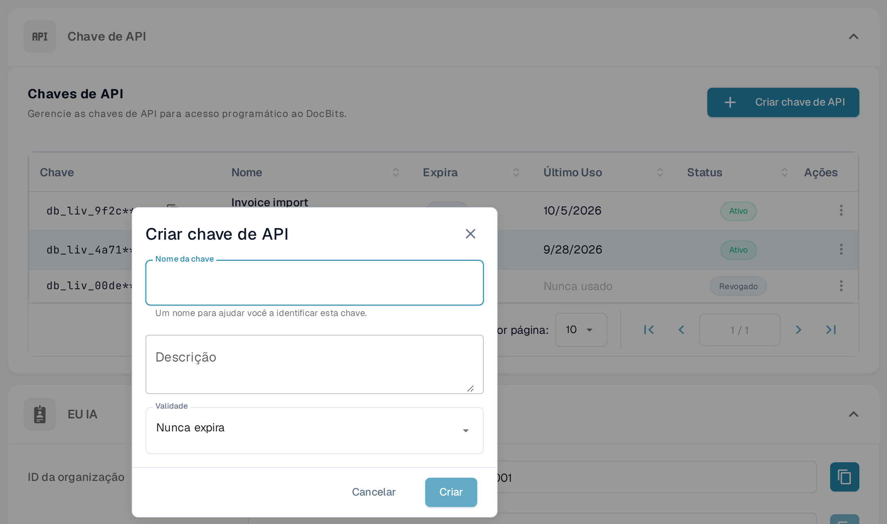

# Postman para o DocBits

O Postman permite enviar pedidos HTTP para a API do DocBits. Comece por um pedido apenas de leitura num ambiente para o qual tem autorização. Guarde as credenciais em variáveis privadas ou num cofre de segredos e utilize ambientes do Postman separados para os testes e para a produção.

## 1. Escolher o ambiente da API e o URL base

Abra a documentação interativa da API do ambiente da sua organização, por exemplo a [documentação da API Sandbox](https://sandbox.api.docbits.com/docs) ou a [documentação da API de produção](https://api.docbits.com/docs). Utilize os caminhos de operação atuais e o valor **Servers** aí apresentado. Essa documentação é uma vista do próprio ambiente do DocBits e não uma captura da aplicação Postman.

Um caminho de servidor relativo é acrescentado à origem da API. Na [documentação Dev usada aqui como exemplo](https://eu.dev.api.docbits.com/docs), o servidor é `/dev-api`, pelo que o URL base correspondente é `https://eu.dev.api.docbits.com/dev-api`. Outros ambientes podem utilizar um valor de servidor diferente.

Crie uma variável de ambiente do Postman chamada `base_url` e atribua-lhe o URL base completo do ambiente escolhido, incluindo o respetivo caminho de servidor. Selecione esse ambiente antes de enviar um pedido. O [guia de ambientes do Postman](https://learning.postman.com/docs/use/send-requests/variables/managing-environments/) explica como as variáveis de ambiente são selecionadas e utilizadas.

## 2. Enviar um primeiro pedido apenas de leitura

Crie um pedido com o método **GET** e o URL `{{base_url}}/version`. No separador **Authorization** do pedido, selecione **No Auth** e escolha **Send**. Os nomes dos controlos do Postman e da documentação da API aparecem em inglês, tal como na aplicação.

Para o ambiente Dev usado como exemplo, o pedido verificado foi:

```http
GET https://eu.dev.api.docbits.com/dev-api/version
```

Este endpoint devolveu HTTP 200 sem chave de API. Verifica a acessibilidade da API e devolve informações de versão; não comprova o acesso aos documentos ou utilizadores de uma organização. Verifique o estado e o corpo da resposta. Se o pedido falhar, confirme o ambiente selecionado, a origem e o caminho do servidor antes de acrescentar credenciais.

## 3. Utilizar as credenciais exigidas pela operação

Abra a operação que pretende utilizar e leia os respetivos parâmetros e informações de autorização. A especificação da API inclui estes esquemas de cabeçalho distintos:

| Cabeçalho | Finalidade |
| --- | --- |
| `X-ORG-ID` | Identifica a organização de destino quando é necessário. |
| `Authorization` | Contém o valor de autorização exigido pelo mecanismo de autenticação correspondente. |
| `X-API-KEY` | Contém uma chave de API para as operações que utilizam esse esquema. |

Estes cabeçalhos não são intercambiáveis. A caixa de diálogo global **Authorize** mostra os esquemas disponíveis; isso não significa que todas as operações necessitem de todos eles. Alguns esquemas podem ser específicos de operações concretas.

Para uma operação que utilize uma chave de API, selecione **Authorization → API Key** no Postman. Defina **Key** como `X-API-KEY`, utilize um segredo privado em **Value** e selecione **Header** em **Add to**. Consulte as instruções do Postman sobre [autorização por chave de API](https://learning.postman.com/docs/use/send-requests/authorization/authorization-types/#api-key) e o [guia de segredos do cofre](https://learning.postman.com/docs/use/postman-vault/use-vault-secrets/). Acrescente `X-ORG-ID` em **Headers** se a operação o exigir. Peça as credenciais adequadas e o valor da organização ao seu administrador.

As chaves de API são criadas e geridas em **Configurações → Integração e SSO → Chave de API**. O botão **Criar chave de API** abre o formulário; o procedimento passo a passo, com os campos e a apresentação única da chave completa, está em [Gestão de chaves API](../../administration-and-setup/settings/global-settings/integration/api-key-management.md#criar-uma-chave-api).

<figure><figcaption><p>Chaves de API em português, com dados de exemplo inventados. Na lista só se vê o início de cada chave.</p></figcaption></figure>

<figure><figcaption><p>O formulário Criar chave de API antes de preencher. Nenhuma chave foi criada nesta captura.</p></figcaption></figure>

## 4. Criar mais pedidos a partir da especificação atual

Utilize o método HTTP exato da operação, o respetivo caminho, os parâmetros obrigatórios e o esquema do corpo do pedido. Nos carregamentos de ficheiros, selecione o tipo de corpo exigido por essa operação, por exemplo dados de formulário multipart quando assim for indicado. Não deduza os campos atuais a partir de capturas de uma versão anterior da API.

Comece por uma operação **GET** autorizada e apenas de leitura. **POST**, **PUT** e **DELETE** podem alterar dados; utilize-os apenas para a tarefa prevista e autorizada. Uma resposta bem-sucedida de `/version` não demonstra que um pedido autenticado, um carregamento de ficheiros ou uma alteração de dados vá funcionar.

Foram verificadas a documentação Dev atual, os controlos de autorização vazios e a resposta não autenticada de `/version`. Não foi utilizada qualquer chave de API, dado de organização ou documento. Não foram executadas leituras autenticadas, carregamentos, criações de utilizadores, alterações ou eliminações, e não foi testado nenhum pedido na aplicação Postman.
