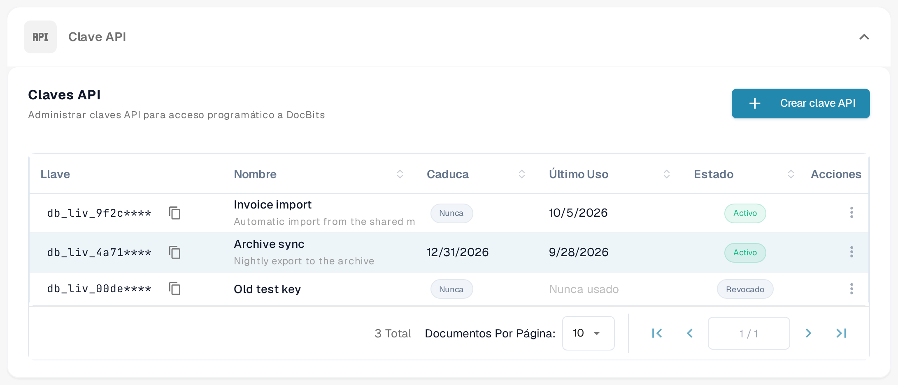

# Postman para DocBits

Con Postman puede enviar solicitudes HTTP a la API de DocBits. Empiece con una solicitud de solo lectura en un entorno para el que tenga autorización. Guarde las credenciales en variables privadas o en una bóveda de secretos y use entornos de Postman distintos para las pruebas y para producción.

## 1. Elegir el entorno de API y la URL base

Abra la documentación interactiva de la API del entorno de su organización, por ejemplo la [documentación de la API de Sandbox](https://sandbox.api.docbits.com/docs) o la [documentación de la API de producción](https://api.docbits.com/docs). Utilice las rutas de operación actuales y el valor **Servers** que se muestra allí. Esa documentación es una vista propia del entorno de DocBits y no una captura de la aplicación Postman.

Una ruta de servidor relativa se añade después del origen de la API. En la [documentación de Dev que aquí se usa como ejemplo](https://eu.dev.api.docbits.com/docs), el servidor es `/dev-api`, por lo que la URL base correspondiente es `https://eu.dev.api.docbits.com/dev-api`. Otros entornos pueden usar un valor de servidor distinto.

Cree una variable de entorno de Postman llamada `base_url` y asígnele la URL base completa del entorno elegido, incluida su ruta de servidor. Seleccione ese entorno antes de enviar una solicitud. La [guía de entornos de Postman](https://learning.postman.com/docs/use/send-requests/variables/managing-environments/) explica cómo se seleccionan y se usan las variables de entorno.

## 2. Enviar una primera solicitud de solo lectura

Cree una solicitud con el método **GET** y la URL `{{base_url}}/version`. En la pestaña **Authorization** de la solicitud, seleccione **No Auth** y elija **Send**.

Para el entorno de Dev usado como ejemplo, la solicitud comprobada fue:

```http
GET https://eu.dev.api.docbits.com/dev-api/version
```

Este endpoint devolvió HTTP 200 sin clave de API. Comprueba la accesibilidad de la API y devuelve información de versión; no verifica el acceso a los documentos ni a los usuarios de una organización. Revise el estado y el cuerpo de la respuesta. Si la solicitud falla, confirme el entorno seleccionado, el origen y la ruta de servidor antes de añadir credenciales.

## 3. Usar las credenciales que requiere la operación

Abra la operación que desea usar y lea sus parámetros y su información de autorización. La especificación de la API incluye estos esquemas de cabecera distintos:

| Cabecera | Finalidad |
| --- | --- |
| `X-ORG-ID` | Identifica la organización de destino cuando es necesario. |
| `Authorization` | Contiene el valor de autorización que exige el mecanismo de autenticación correspondiente. |
| `X-API-KEY` | Contiene una clave de API para las operaciones que usan ese esquema. |

Estas cabeceras no son intercambiables. El diálogo global **Authorize** muestra los esquemas disponibles; eso no significa que todas las operaciones necesiten todos ellos. Algunos esquemas pueden ser específicos de operaciones concretas.

Para una operación que use una clave de API, seleccione **Authorization → API Key** en Postman. Establezca **Key** en `X-API-KEY`, use un secreto privado como **Value** y seleccione **Header** en **Add to**. Consulte las instrucciones de Postman sobre [autorización con clave de API](https://learning.postman.com/docs/use/send-requests/authorization/authorization-types/#api-key) y la [guía de secretos de la bóveda](https://learning.postman.com/docs/use/postman-vault/use-vault-secrets/). Añada `X-ORG-ID` en **Headers** si la operación lo requiere. Solicite las credenciales adecuadas y el valor de la organización a su administrador.

Las claves de API se crean y se administran en **Ajustes → Integración y SSO → Clave API**: en la tarjeta **Claves API**, el botón **Crear clave API** abre el formulario. El procedimiento paso a paso, con los campos del formulario y la presentación única de la clave completa, está en [Administración de claves API](../../administration-and-setup/settings/global-settings/integration/api-key-management.md).

<figure><figcaption><p>Claves API en español, con datos de ejemplo inventados. El botón Crear clave API abre el formulario; en la lista solo se ve el prefijo de cada clave.</p></figcaption></figure>

## 4. Crear más solicitudes a partir de la especificación actual

Use el método HTTP exacto de la operación, su ruta, los parámetros obligatorios y el esquema del cuerpo de la solicitud. En las cargas de archivos, seleccione el tipo de cuerpo que exige esa operación, por ejemplo datos de formulario multipart cuando así se indique. No deduzca los campos actuales a partir de capturas de una versión anterior de la API.

Empiece con una operación **GET** autorizada de solo lectura. **POST**, **PUT** y **DELETE** pueden modificar datos; úselos solo para la tarea prevista y autorizada. Una respuesta correcta de `/version` no demuestra que una solicitud autenticada, una carga de archivos o un cambio de datos vaya a funcionar.

Se comprobaron la documentación actual de Dev, sus controles de autorización vacíos y la respuesta no autenticada de `/version`. No se utilizó ninguna clave de API, ningún dato de organización ni ningún documento. No se ejecutaron lecturas autenticadas, cargas de archivos, altas de usuarios, modificaciones ni eliminaciones, y no se probó ninguna solicitud en la aplicación Postman.
