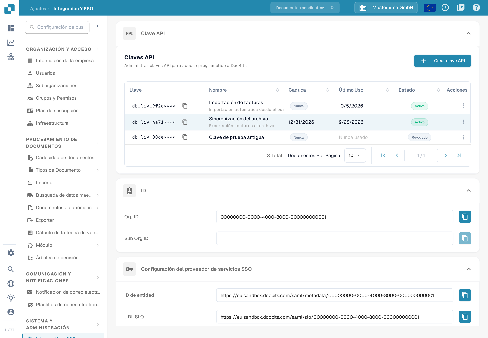
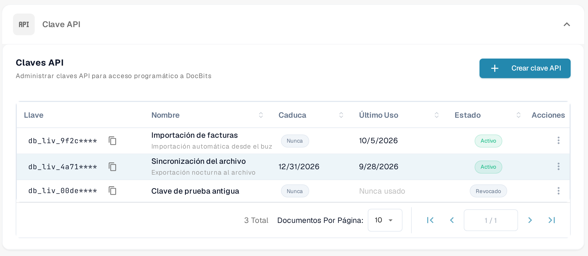
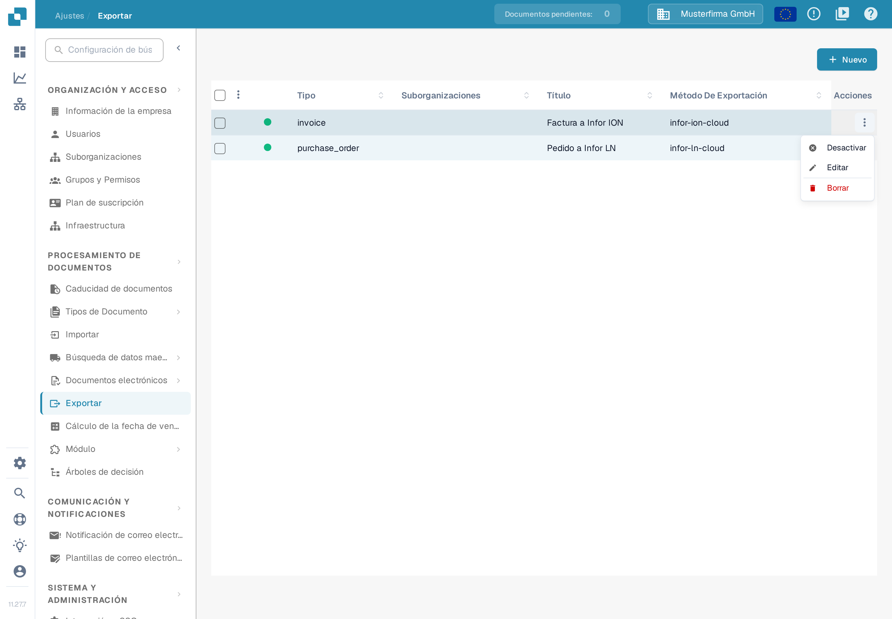
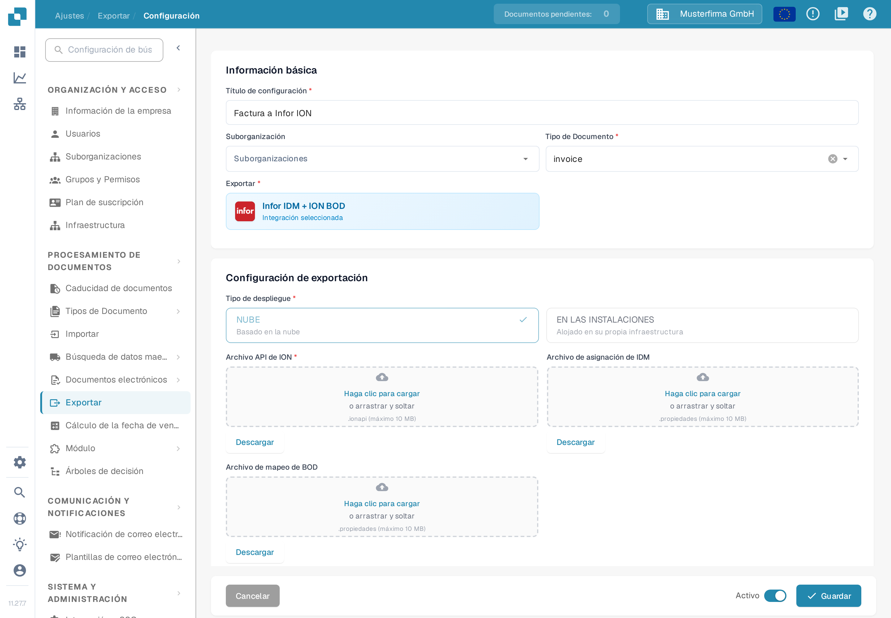

# Prueba tu conexión BOD con Postman

## Visión general

Esta página explica cómo verificar el procesamiento correcto de tu BOD (Business Object Document, documento de objeto de negocio) usando Postman. Probarás el endpoint de API correspondiente enviando una solicitud con tu archivo de mapeo de BOD. Sigue los pasos a continuación para completar el proceso.

## Acceso a tu clave API y a tu archivo de mapeo de BOD

### Recuperar tu clave API

1.  Ve a **Ajustes → Sistema y Administración → Integración y SSO**.

    <figure><figcaption><p>La página <strong>Integración y SSO</strong>. En la sección <strong>Clave API</strong> de la parte superior, el botón <strong>Crear clave API</strong> añade una clave y cada fila de la tabla muestra el prefijo enmascarado de la clave, su nombre, su caducidad, el último uso y el estado. Debajo aparecen la sección <strong>ID</strong> con el Org ID y el Sub Org ID, y la configuración del proveedor de servicios SSO. Los nombres, las descripciones y el Org ID de esta captura son datos de ejemplo.</p></figcaption></figure>
2.  Puedes copiar manualmente tu **clave API** o hacer clic en el botón de copiar para copiarla en tu portapapeles.

    <figure><figcaption><p>Haz clic en el icono de copiar junto a una clave para copiar su valor. Por seguridad, la tabla solo muestra el prefijo de la clave seguido de <code>****</code>; la clave completa se muestra una sola vez, al crearla. Si ya no tienes la clave completa, crea una nueva como se describe en <a href="../../administration-and-setup/settings/global-settings/integration/api-key-management.md">Administración de claves API</a>.</p></figcaption></figure>

    La lista de claves, el icono de copiar y el menú **Acciones** de tres puntos se describen en detalle en la página [Administración de claves API](../../administration-and-setup/settings/global-settings/integration/api-key-management.md).

### **Descargar el archivo de mapeo de BOD**

1.  Ve a **Ajustes → Procesamiento de documentos → Exportar**.

    <figure><figcaption><p>La lista <strong>Exportar</strong>. Cada fila es una configuración de exportación; la columna <strong>Método De Exportación</strong> indica cómo se envían los documentos. Las filas de esta captura son datos de ejemplo.</p></figcaption></figure>
2.  En la columna **Acciones** de la entrada de exportación correspondiente, haz clic en el menú de tres puntos y selecciona **Editar**.

    <figure><figcaption><p>El menú <strong>Acciones</strong> de la fila está abierto y <strong>Editar</strong> está disponible. <strong>Editar</strong> abre la configuración de exportación; la página <a href="../../administration-and-setup/settings/document-processing/export.md">Exportar</a> explica cada columna y cada acción.</p></figcaption></figure>
3.  Localiza el **Archivo de mapeo de BOD** y haz clic en el botón **Descargar** para guardarlo.

    <figure><figcaption><p>La configuración de exportación en modo de edición. En <strong>Configuración de exportación</strong>, el campo <strong>Archivo de mapeo de BOD</strong> tiene un botón <strong>Descargar</strong> que guarda el archivo de mapeo (BOD-Mapping.properties) en tu ordenador. En la misma pantalla, el selector <strong>Tipo de despliegue</strong> y los campos <strong>Archivo API de ION</strong> y <strong>Archivo de asignación de IDM</strong> se describen en <a href="../../administration-and-setup/settings/document-processing/export.md#infor-idm--ion-bod">Infor IDM + ION BOD</a>; para editar el archivo de mapeo, consulta <a href="../../infor-integration-and-configuration/exporting-to-infor/creating-a-bod-mapping-file.md">Crear un archivo de asignación BOD</a>.</p></figcaption></figure>

## Prueba el endpoint en Postman

1.  **Pega el comando cURL en Postman**

    Abre Postman y pega el siguiente comando cURL en la sección **Import**. Postman configurará la solicitud automáticamente.

    ```bash
    curl -X 'POST' \
      'https://api.docbits.com/prod-api/import/purchase_order_bod' \
      -H 'accept: application/json' \
      -H 'X-API-KEY:' \
      -H 'Content-Type: multipart/form-data' \
      -F 'org_id=' \
      -F 'sub_org_id=' \
      -F 'file=@file.xml;type=text/xml' \
      -F 'custom_fields_mapping='
    ```

    <figure><figcaption><p>En Postman, el botón <strong>Import</strong> está en la barra superior de la ventana.</p></figcaption></figure>

    <figure><figcaption><p>En el diálogo <strong>Import</strong>, pega el comando cURL de arriba en el campo <strong>Paste cURL to import</strong>. Postman lo convierte en una solicitud lista para usar.</p></figcaption></figure>
2.  **Configura la clave API**\
    Ve a la pestaña **Headers**, localiza el encabezado `X-API-KEY` y pega tu clave API en la columna **Value**.

    <figure><figcaption><p>La pestaña <strong>Headers</strong> de la solicitud importada. Pega la clave API que copiaste en DocBits en la columna <strong>Value</strong> de la fila <code>X-API-KEY</code>.</p></figcaption></figure>
3.  **Sube el archivo BOD**\
    Ve a la pestaña **Body**, localiza la clave `file`, luego haz clic en **Select Files** en la columna **Value** y sube tu archivo BOD XML.

    <figure><figcaption><p>La pestaña <strong>Body</strong> en modo <strong>form-data</strong>. En la fila <code>file</code>, haz clic en <strong>Select Files</strong> y elige el archivo BOD XML que quieres probar.</p></figcaption></figure>
4.  **Envía la solicitud**\
    Haz clic en **Send** para realizar la llamada a la API.

    <figure><figcaption><p>Con la clave y el archivo configurados, haz clic en <strong>Send</strong> para ejecutar la solicitud contra la API de DocBits.</p></figcaption></figure>
5.  **Verifica la respuesta**\
    Revisa la respuesta para confirmar que tu BOD se procesó correctamente.

    <figure><figcaption><p>Una llamada correcta devuelve <strong>200 OK</strong> y un cuerpo JSON con <code>"success": true</code>: el BOD se procesó.</p></figcaption></figure>
