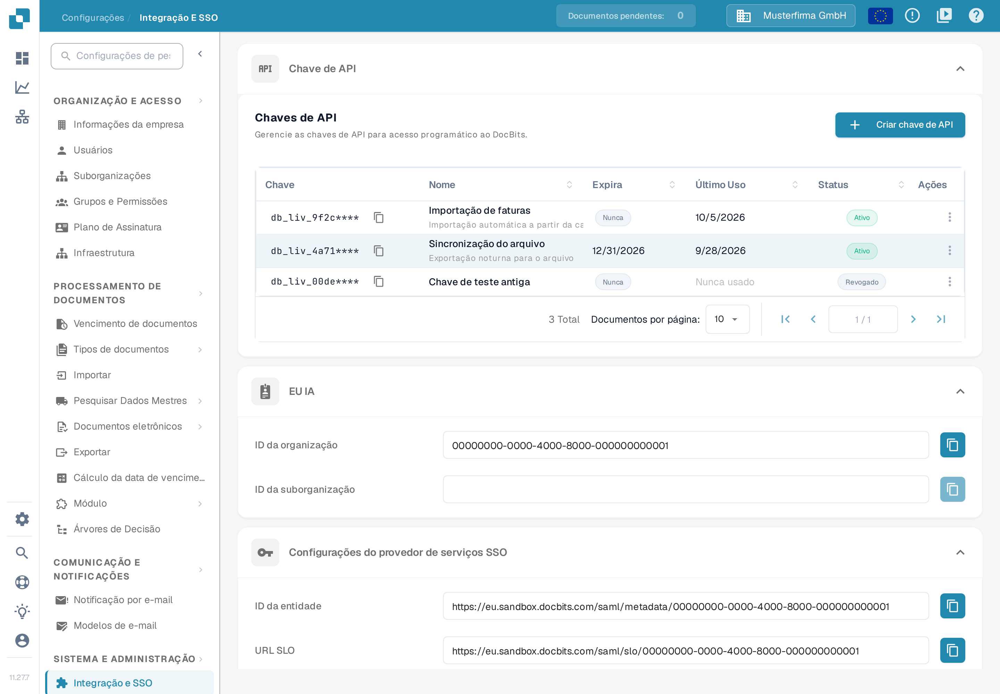
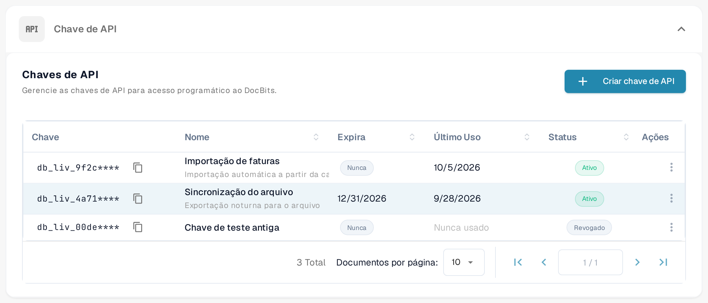
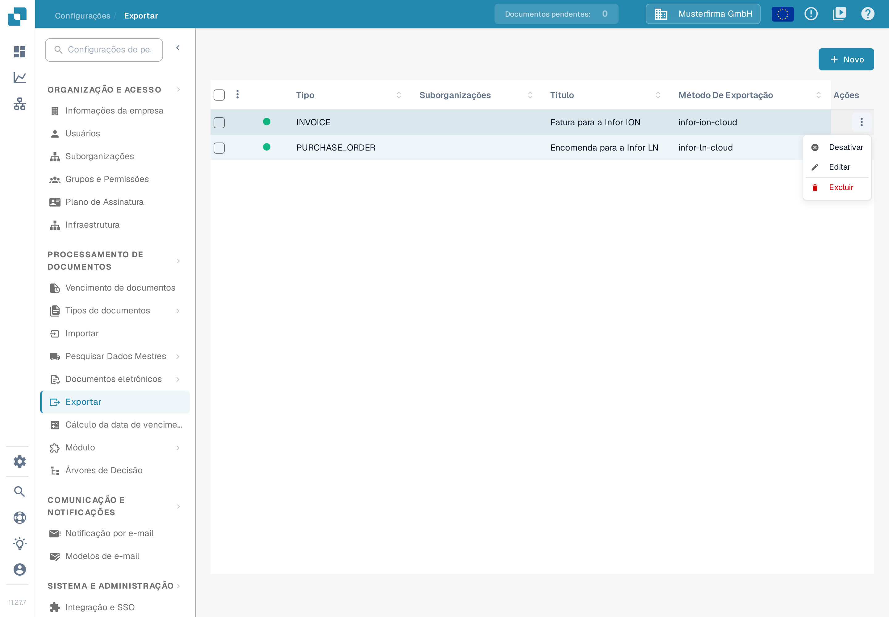
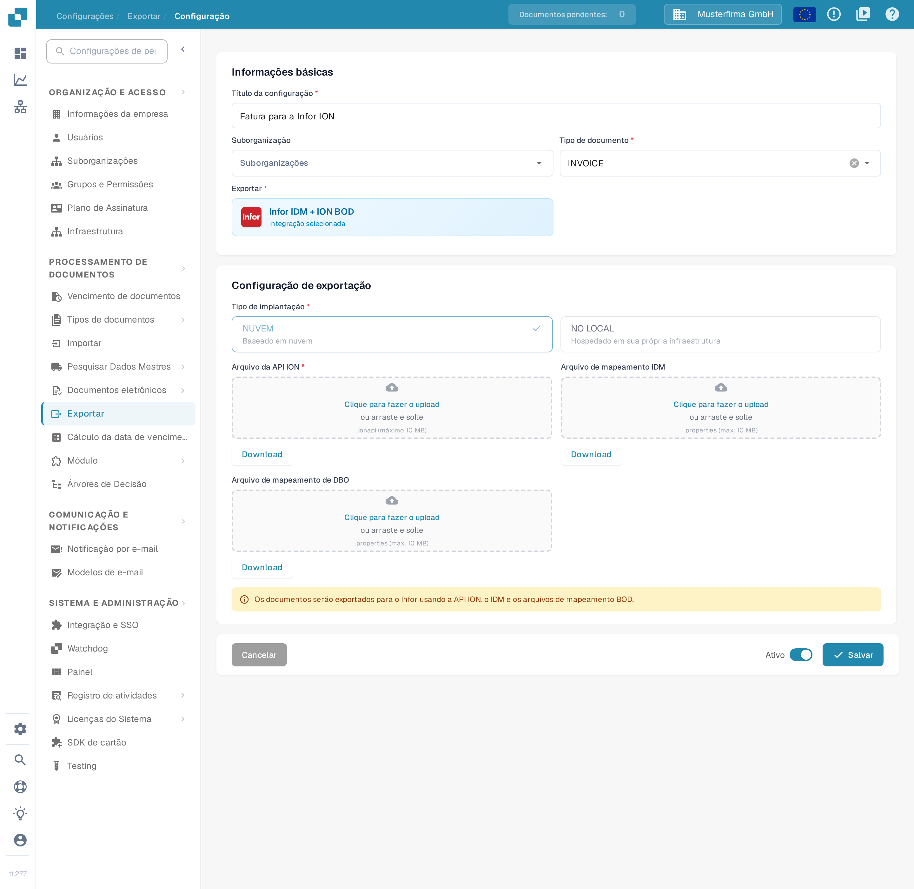
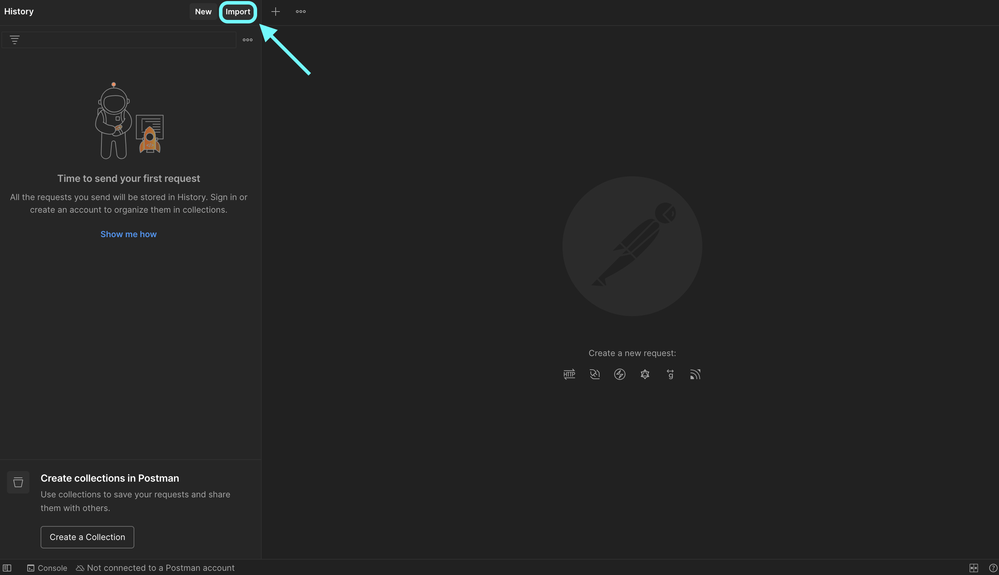
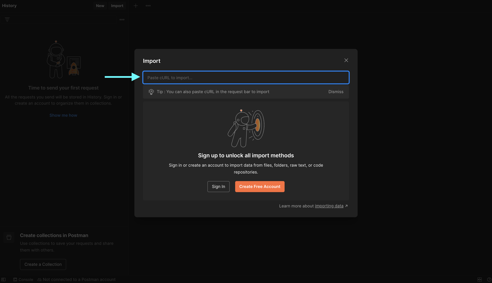
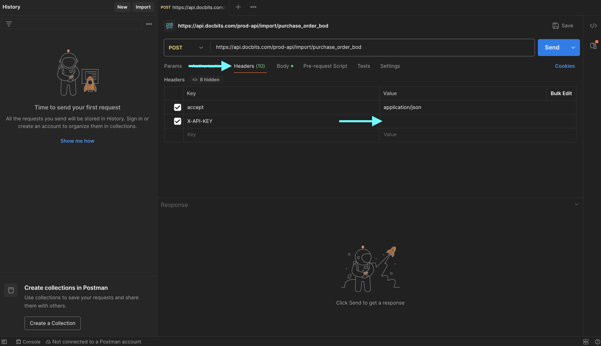
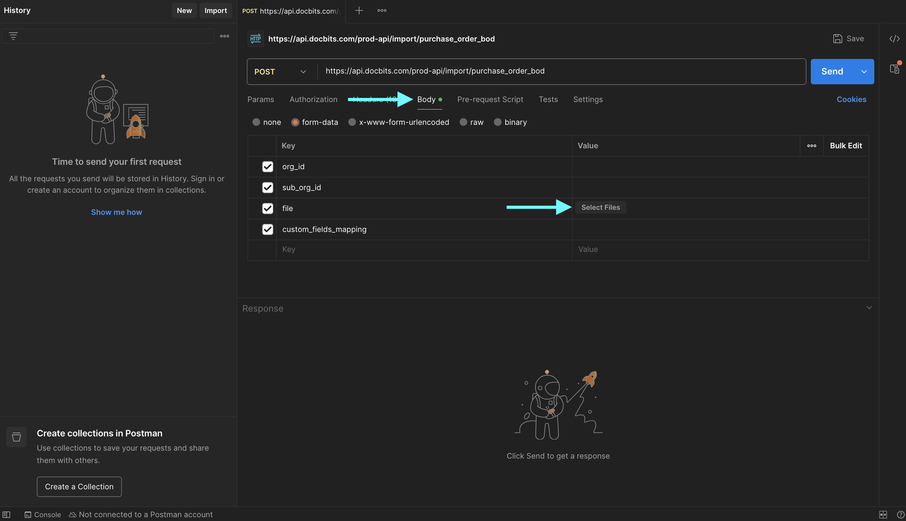
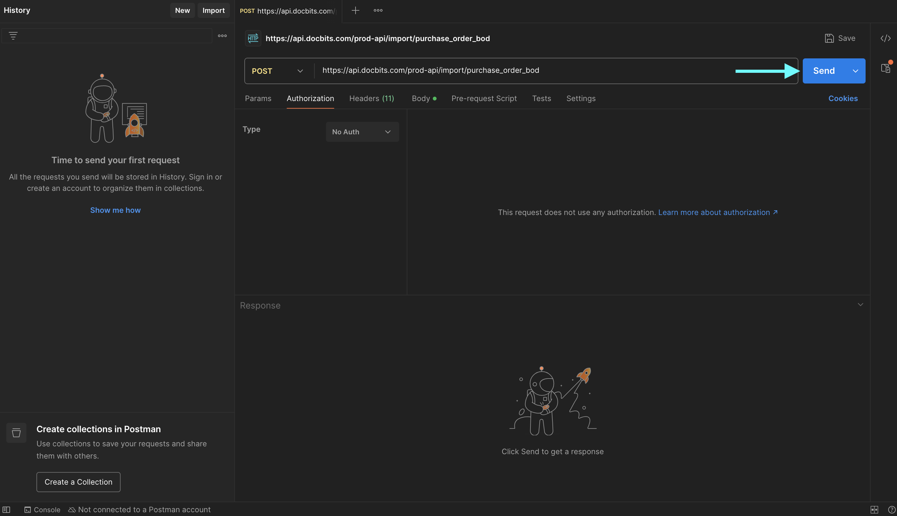
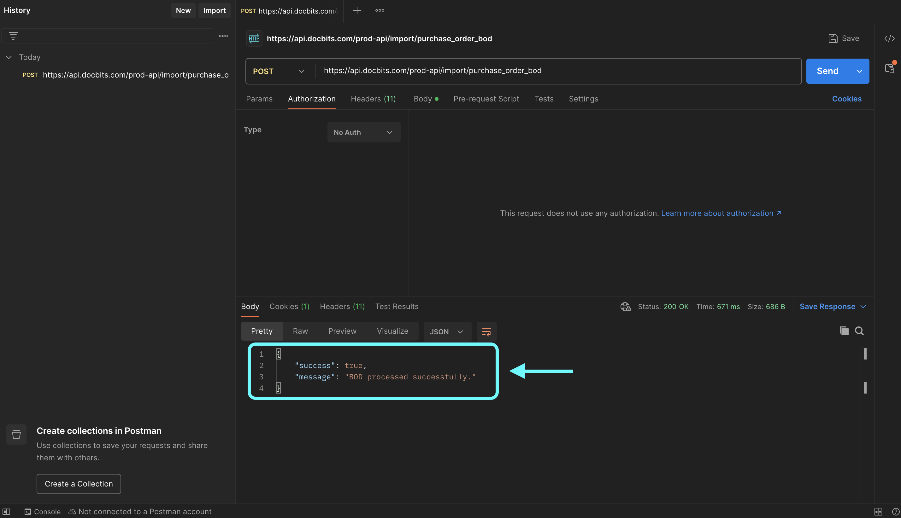

# Teste sua conexão BOD com Postman

## Visão Geral

Esta página explica como verificar o processamento bem-sucedido do seu BOD (Business Object Document) usando o Postman. Você vai testar o endpoint da API correspondente enviando uma solicitação com o seu arquivo de mapeamento BOD. Siga os passos abaixo para concluir o processo.

## Acessando sua Chave de API e o Arquivo de Mapeamento BOD

### Recuperando sua Chave de API

1.  Vá para **Configurações → Sistema e Administração → Integração e SSO**.

    <figure><figcaption><p>A tabela <strong>Chaves de API</strong> na página <strong>Integração e SSO</strong>. Cada linha mostra o prefixo mascarado da chave, o nome, a data de expiração, o último uso e a situação.</p></figcaption></figure>
2.  Você pode copiar sua **chave de API** manualmente ou clicar no ícone de cópia para copiá-la para a área de transferência.

    <figure><figcaption><p>Clique no ícone de cópia ao lado de uma chave para copiar o valor dela. Por segurança, a tabela mostra apenas o prefixo da chave seguido de <code>****</code>; a chave completa é exibida uma única vez, quando a chave é criada. Se você não tiver mais a chave completa, crie uma nova como descrito em <a href="../../administration-and-setup/settings/global-settings/integration/api-key-management.md">Gestão de chaves API</a>.</p></figcaption></figure>

    A lista de chaves, o ícone de cópia e o menu **Ações** de três pontos estão descritos em detalhe na página [Gestão de chaves API](../../administration-and-setup/settings/global-settings/integration/api-key-management.md).

### **Baixando o Arquivo de Mapeamento BOD**

1.  Vá para **Configurações → Processamento de Documentos → Exportar**.

    <figure><figcaption><p>A lista de <strong>Exportar</strong>. Cada linha é uma configuração de exportação; a coluna <strong>Método de Exportação</strong> mostra como os documentos são enviados.</p></figcaption></figure>
2.  Na coluna **Ações** da entrada de exportação relevante, clique no menu de três pontos e selecione **Editar**.

    <figure><figcaption><p>O menu <strong>Ações</strong> da linha está aberto com <strong>Editar</strong> disponível. <strong>Editar</strong> abre a configuração de exportação; a página <a href="../../administration-and-setup/settings/document-processing/export.md">Exportação</a> explica cada coluna e cada ação.</p></figcaption></figure>
3.  Localize o campo **Arquivo de mapeamento de DBO** e clique no botão **Download** para salvá-lo.

    <figure><figcaption><p>A configuração de exportação no modo de edição. Em <strong>Configuração de exportação</strong>, o campo <strong>Arquivo de mapeamento de DBO</strong> tem um botão <strong>Download</strong> que salva o arquivo de mapeamento (BOD-Mapping.properties) no seu computador. A interface em português abrevia o arquivo de mapeamento BOD como “DBO”; os dois nomes designam o mesmo arquivo. Para editar esse arquivo, consulte <a href="../../infor-integration-and-configuration/exporting-to-infor/creating-a-bod-mapping-file.md">Criar um ficheiro de mapeamento BOD</a>.</p></figcaption></figure>

## Teste o Endpoint no Postman

1.  **Cole o Comando cURL no Postman**

    Abra o Postman e cole o seguinte comando cURL na seção **Import**. O Postman vai configurar a solicitação automaticamente.

    ```bash
    curl -X 'POST' \
      'https://api.docbits.com/prod-api/import/purchase_order_bod' \
      -H 'accept: application/json' \
      -H 'X-API-KEY:' \
      -H 'Content-Type: multipart/form-data' \
      -F 'org_id=' \
      -F 'sub_org_id=' \
      -F 'file=@file.xml;type=text/xml' \
      -F 'custom_fields_mapping='
    ```

    <figure><figcaption><p>No Postman, a área <strong>Import</strong> fica na barra superior da janela, ao lado do botão <strong>New</strong>.</p></figcaption></figure>

    <figure><figcaption><p>Na janela <strong>Import</strong>, cole o comando cURL acima no campo <strong>Paste cURL to import</strong>. O Postman transforma o comando em uma solicitação pronta.</p></figcaption></figure>
2.  **Defina a Chave de API**\
    Vá para a aba **Headers**, localize o cabeçalho `X-API-KEY` e cole sua chave de API na coluna **Value**.

    <figure><figcaption><p>A aba <strong>Headers</strong> da solicitação importada. Cole a chave de API que você copiou no DocBits na coluna <strong>Value</strong> da linha <code>X-API-KEY</code>.</p></figcaption></figure>
3.  **Faça o Upload do Arquivo BOD**\
    Vá para a aba **Body**, localize a chave `file`, clique em **Select Files** na coluna **Value** e faça o upload do seu arquivo BOD XML.

    <figure><figcaption><p>A aba <strong>Body</strong> no modo <strong>form-data</strong>. Na linha <code>file</code>, clique em <strong>Select Files</strong> e escolha o arquivo BOD XML que você quer testar.</p></figcaption></figure>
4.  **Envie a Solicitação**\
    Clique em **Send** para fazer a chamada da API.

    <figure><figcaption><p>Com a chave e o arquivo definidos, clique em <strong>Send</strong> para executar a solicitação na API do DocBits.</p></figcaption></figure>
5.  **Verifique a Resposta**\
    Verifique a resposta para confirmar que seu BOD foi processado com sucesso.

    <figure><figcaption><p>Uma chamada bem-sucedida retorna <strong>200 OK</strong> e um corpo JSON com <code>"success": true</code> e a mensagem <code>"BOD processed successfully."</code> — o BOD foi processado.</p></figcaption></figure>
