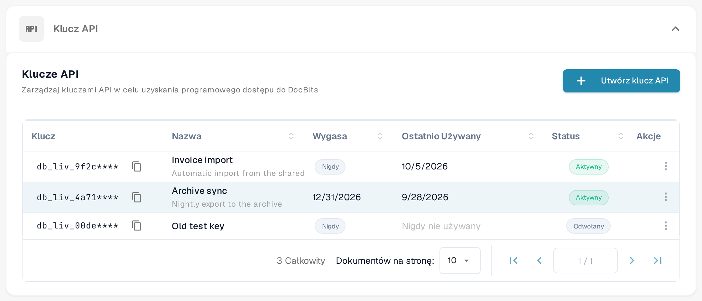
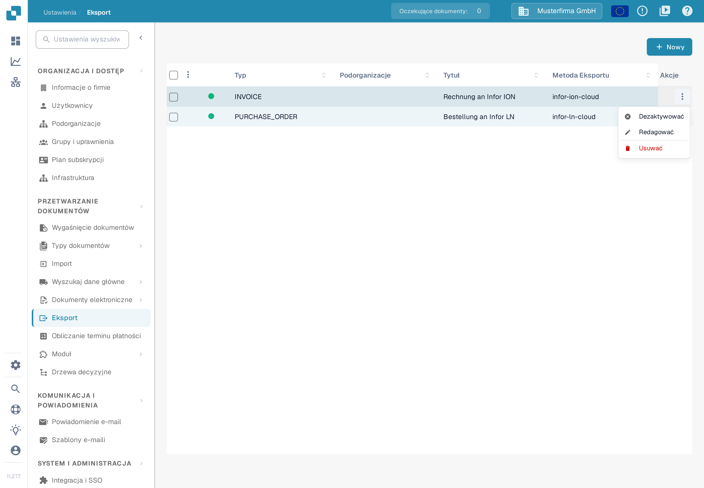
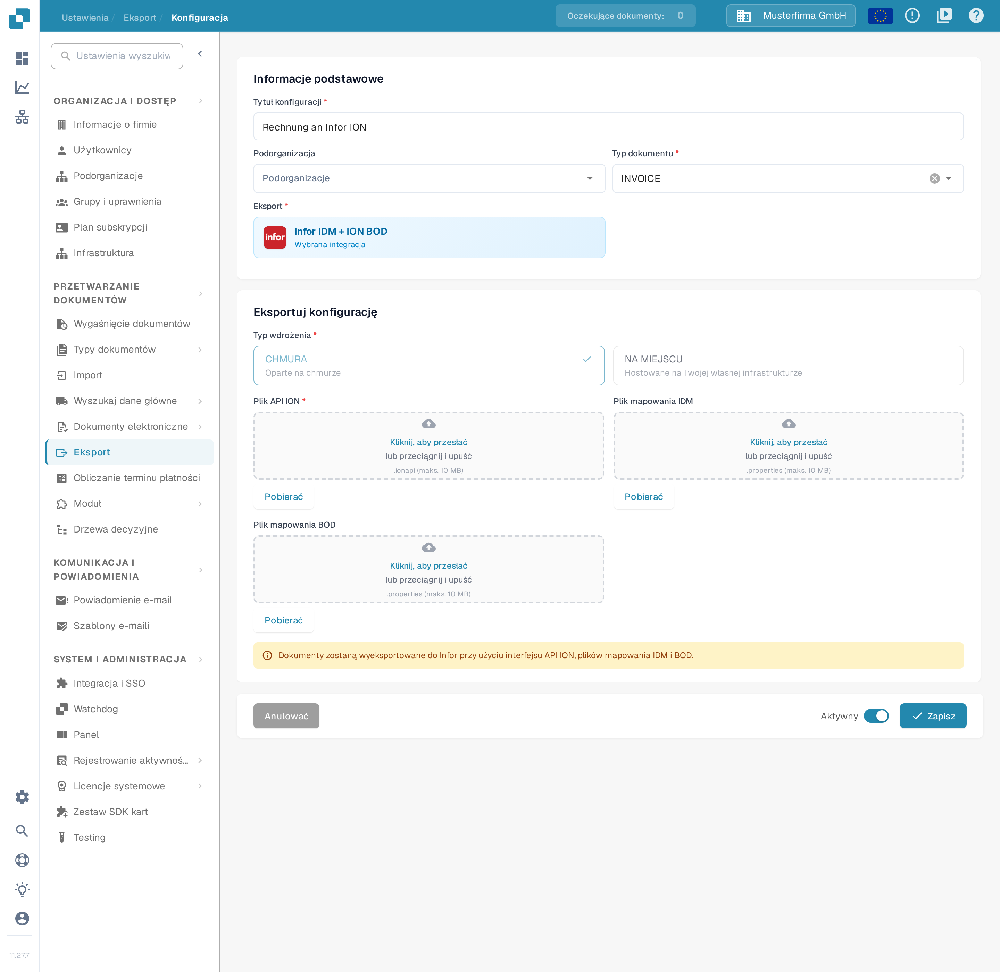

# Przetestuj swoje połączenie BOD za pomocą Postman

## Przegląd

Ta strona wyjaśnia, jak sprawdzić pomyślne przetworzenie dokumentu BOD (Business Object Document) za pomocą Postman. Przetestujesz właściwy punkt końcowy API, wysyłając żądanie z plikiem mapowania BOD. Wykonaj poniższe kroki po kolei.

## Uzyskiwanie dostępu do klucza API i pliku mapowania BOD

### Pobieranie klucza API

1.  Przejdź do **Ustawienia → System i administracja → Integracja i SSO**.

    <figure><figcaption><p>Tabela <strong>Klucze API</strong> na stronie <strong>Integracja i SSO</strong>. Każdy wiersz pokazuje zamaskowany prefiks klucza, nazwę, termin wygaśnięcia (kolumna <strong>Wygasa</strong>), ostatnie użycie (kolumna <strong>Ostatnio Używany</strong>) i status.</p></figcaption></figure>
2.  Możesz skopiować swój **Klucz API** ręcznie albo kliknąć ikonę kopiowania, aby skopiować go do schowka.

    <figure><figcaption><p>Kliknij ikonę kopiowania obok klucza, aby skopiować jego wartość. Ze względów bezpieczeństwa tabela pokazuje tylko prefiks klucza, po którym następuje <code>****</code>; pełny klucz jest wyświetlany jednorazowo, przy tworzeniu klucza. Jeśli nie masz już pełnego klucza, utwórz nowy, jak opisano w sekcji <a href="../../administration-and-setup/settings/global-settings/integration/api-key-management.md">Zarządzanie kluczami API</a>.</p></figcaption></figure>

    Lista kluczy, ikona kopiowania i trzy-kropkowe menu **Akcje** są w pełni opisane na stronie [Zarządzanie kluczami API](../../administration-and-setup/settings/global-settings/integration/api-key-management.md).

### Pobieranie pliku mapowania BOD

1.  Przejdź do **Ustawienia → Przetwarzanie dokumentów → Eksport**.

    <figure><figcaption><p>Lista <strong>Eksport</strong>. Każdy wiersz to jedna konfiguracja eksportu; kolumna <strong>Metoda Eksportu</strong> pokazuje, jak dokumenty są wysyłane.</p></figcaption></figure>
2.  W kolumnie **Akcje** odpowiedniego wpisu eksportu kliknij menu z trzema kropkami i wybierz **Redagować**.

    <figure><figcaption><p>Menu <strong>Akcje</strong> wiersza jest otwarte i pozycja <strong>Redagować</strong> jest dostępna. <strong>Redagować</strong> otwiera konfigurację eksportu; strona <a href="../../administration-and-setup/settings/document-processing/export.md">Eksport</a> opisuje każdą kolumnę i każdą akcję.</p></figcaption></figure>
3.  Znajdź pole **Plik mapowania BOD** i kliknij **Pobierać**, aby zapisać plik.

    <figure><figcaption><p>Konfiguracja eksportu w widoku edycji. W sekcji <strong>Informacje podstawowe</strong> widzisz tytuł konfiguracji, podorganizację i typ dokumentu. W sekcji <strong>Eksportuj konfigurację</strong> wybrany jest typ wdrożenia <strong>CHMURA</strong>, a pole <strong>Plik mapowania BOD</strong> ma przycisk <strong>Pobierać</strong>, który zapisuje plik mapowania (BOD-Mapping.properties) na Twoim komputerze. Jak edytować ten plik, przeczytasz w sekcji <a href="../../infor-integration-and-configuration/exporting-to-infor/creating-a-bod-mapping-file.md">Tworzenie pliku mapowania BOD</a>.</p></figcaption></figure>

## Testowanie punktu końcowego w Postman

1.  **Wklej polecenie cURL w Postman**

    Otwórz Postman i wklej poniższe polecenie cURL w sekcji **Import**. Postman automatycznie skonfiguruje żądanie.

    ```bash
    curl -X 'POST' \
      'https://api.docbits.com/prod-api/import/purchase_order_bod' \
      -H 'accept: application/json' \
      -H 'X-API-KEY:' \
      -H 'Content-Type: multipart/form-data' \
      -F 'org_id=' \
      -F 'sub_org_id=' \
      -F 'file=@file.xml;type=text/xml' \
      -F 'custom_fields_mapping='
    ```

    <figure><figcaption><p>W Postman przycisk <strong>Import</strong> znajduje się w górnym pasku okna.</p></figcaption></figure>

    <figure><figcaption><p>W oknie <strong>Import</strong> wklej polecenie cURL z góry w pole <strong>Paste cURL to import</strong>. Postman utworzy z niego gotowe żądanie.</p></figcaption></figure>
2.  **Ustaw klucz API**\
    Przejdź do zakładki **Headers**, znajdź nagłówek `X-API-KEY` i wklej swój klucz API do kolumny **Value**.

    <figure><figcaption><p>Zakładka <strong>Headers</strong> zaimportowanego żądania. Wklej klucz API skopiowany w DocBits do kolumny <strong>Value</strong> w wierszu <code>X-API-KEY</code>.</p></figcaption></figure>
3.  **Prześlij plik BOD**\
    Przejdź do zakładki **Body**, znajdź klucz `file`, a następnie kliknij **Select Files** w kolumnie **Value** i prześlij swój plik XML BOD.

    <figure><figcaption><p>Zakładka <strong>Body</strong> w trybie <strong>form-data</strong>. W wierszu <code>file</code> kliknij <strong>Select Files</strong> i wybierz plik XML BOD, który chcesz przetestować.</p></figcaption></figure>
4.  **Wyślij żądanie**\
    Kliknij **Send**, aby wykonać wywołanie API.

    <figure><figcaption><p>Gdy klucz i plik są ustawione, kliknij <strong>Send</strong>, aby wykonać żądanie do API DocBits.</p></figcaption></figure>
5.  **Sprawdź odpowiedź**\
    Sprawdź odpowiedź, aby potwierdzić, że Twój BOD został pomyślnie przetworzony.

    <figure><figcaption><p>Udane wywołanie zwraca <strong>200 OK</strong> i treść JSON z <code>"success": true</code> — BOD został przetworzony.</p></figcaption></figure>
