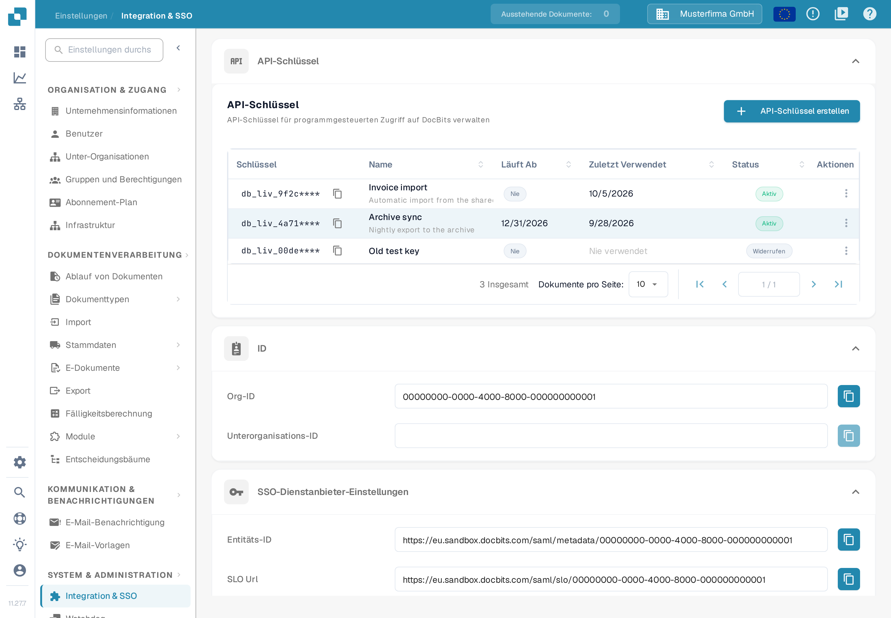
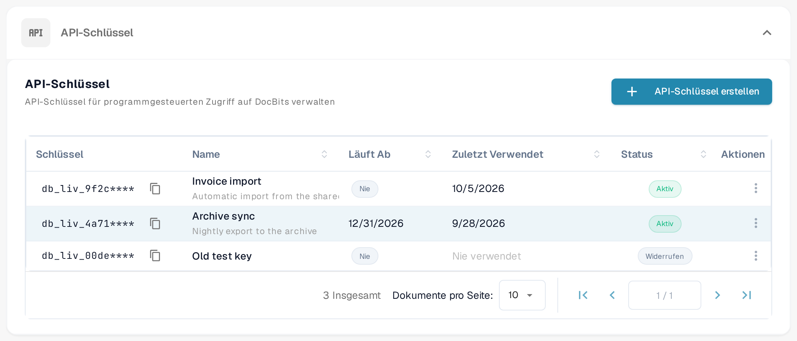
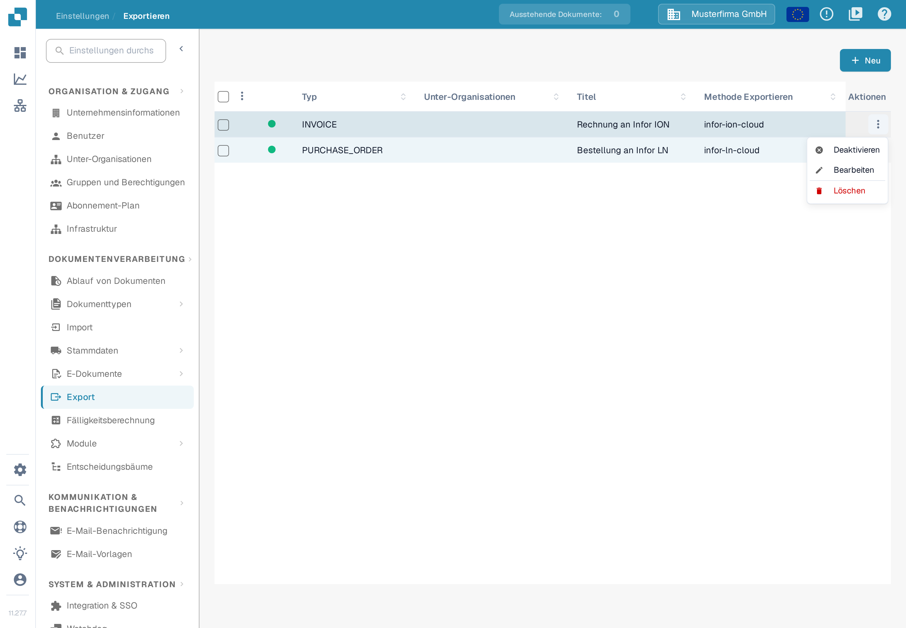
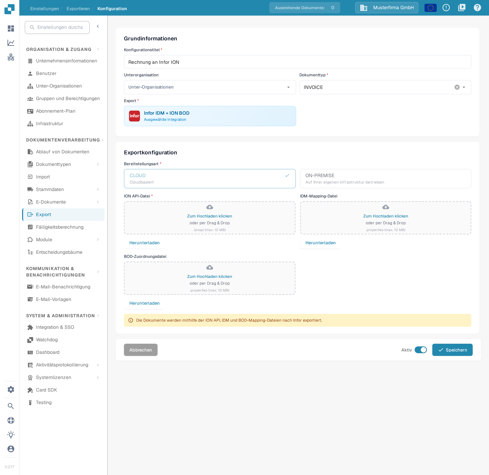

# Testen Sie Ihre BOD-Verbindung mit Postman

## Überblick

Diese Seite erklärt, wie Sie mit Postman prüfen, ob Ihr BOD (Business Object Document) erfolgreich verarbeitet wird. Sie testen den passenden API-Endpunkt, indem Sie eine Anfrage mit Ihrer BOD-Mapping-Datei senden. Führen Sie die folgenden Schritte der Reihe nach aus.

## API-Schlüssel und BOD-Mapping-Datei abrufen

### API-Schlüssel abrufen

1.  Gehen Sie zu **Einstellungen → System & Administration → Integration & SSO**.

    <figure><figcaption><p>Die Tabelle <strong>API-Schlüssel</strong> auf der Seite <strong>Integration &amp; SSO</strong>. Jede Zeile zeigt das maskierte Präfix des Schlüssels, den Namen, das Ablaufdatum (Spalte <strong>Läuft Ab</strong>), die letzte Verwendung (Spalte <strong>Zuletzt Verwendet</strong>) und den Status.</p></figcaption></figure>

2.  Sie können Ihren **API-Schlüssel** manuell kopieren oder auf das Kopiersymbol klicken, um ihn in die Zwischenablage zu kopieren.

    <figure><figcaption><p>Klicken Sie auf das Kopiersymbol neben einem Schlüssel, um seinen Wert zu kopieren. Aus Sicherheitsgründen zeigt die Tabelle nur das Präfix des Schlüssels gefolgt von <code>****</code>; der vollständige Schlüssel wird nur einmal angezeigt, nämlich beim Erstellen des Schlüssels. Wenn Sie den vollständigen Schlüssel nicht mehr haben, erstellen Sie einen neuen, wie unter <a href="../../administration-and-setup/settings/global-settings/integration/api-key-management.md">API-Schlüssel verwalten</a> beschrieben.</p></figcaption></figure>

    Die Schlüsselliste, das Kopiersymbol und das Drei-Punkte-Menü **Aktionen** sind auf der Seite [API-Schlüssel verwalten](../../administration-and-setup/settings/global-settings/integration/api-key-management.md) vollständig beschrieben.

### BOD-Mapping-Datei herunterladen

1.  Gehen Sie zu **Einstellungen → Dokumentenverarbeitung → Export**.

2.  Klicken Sie in der Spalte **Aktionen** des gewünschten Exporteintrags auf das Drei-Punkte-Menü und wählen Sie **Bearbeiten**.

    <figure><figcaption><p>Die Liste <strong>Export</strong>. Jede Zeile ist eine Exportkonfiguration; die Spalte <strong>Methode Exportieren</strong> zeigt, wie die Dokumente gesendet werden. Das Menü <strong>Aktionen</strong> der Zeile ist geöffnet und <strong>Bearbeiten</strong> ist verfügbar. <a href="../../administration-and-setup/settings/document-processing/export.md">Export</a> erklärt jede Spalte und jede Aktion.</p></figcaption></figure>

3.  Suchen Sie das Feld **BOD-Zuordnungsdatei** und klicken Sie auf **Herunterladen**, um die Datei zu speichern.

    <figure><figcaption><p>Die Exportkonfiguration in der Bearbeitungsansicht. Unter <strong>Exportkonfiguration</strong> hat das Feld <strong>BOD-Zuordnungsdatei</strong> die Schaltfläche <strong>Herunterladen</strong>, die die Zuordnungsdatei (BOD-Mapping.properties) auf Ihren Computer speichert. Wie Sie diese Datei bearbeiten, lesen Sie unter <a href="../../infor-integration-and-configuration/exporting-to-infor/creating-a-bod-mapping-file.md">Erstellen einer BOD-Mapping-Datei</a>.</p></figcaption></figure>

## Den Endpunkt in Postman testen

1.  **cURL-Befehl in Postman einfügen**

    Öffnen Sie Postman und fügen Sie den folgenden cURL-Befehl im Bereich **Import** ein. Postman richtet die Anfrage automatisch ein.

    ```bash
    curl -X 'POST' \
      'https://api.docbits.com/prod-api/import/purchase_order_bod' \
      -H 'accept: application/json' \
      -H 'X-API-KEY:' \
      -H 'Content-Type: multipart/form-data' \
      -F 'org_id=' \
      -F 'sub_org_id=' \
      -F 'file=@file.xml;type=text/xml' \
      -F 'custom_fields_mapping='
    ```

    <figure><figcaption><p>In Postman finden Sie die Schaltfläche <strong>Import</strong> in der oberen Leiste des Fensters.</p></figcaption></figure>

    <figure><figcaption><p>Fügen Sie den cURL-Befehl von oben im Dialog <strong>Import</strong> in das Feld <strong>Paste cURL to import</strong> ein. Postman erstellt daraus eine fertige Anfrage.</p></figcaption></figure>

2.  **API-Schlüssel setzen**\
    Wechseln Sie zum Tab **Headers**, suchen Sie die Kopfzeile `X-API-KEY` und fügen Sie Ihren API-Schlüssel in die Spalte **Value** ein.

    <figure><figcaption><p>Der Tab <strong>Headers</strong> der importierten Anfrage. Fügen Sie den in DocBits kopierten API-Schlüssel in der Zeile <code>X-API-KEY</code> in die Spalte <strong>Value</strong> ein.</p></figcaption></figure>

3.  **BOD-Datei hochladen**\
    Wechseln Sie zum Tab **Body**, suchen Sie den Schlüssel `file` und klicken Sie in der Spalte **Value** auf **Select Files**, um Ihre BOD-XML-Datei hochzuladen.

    <figure><figcaption><p>Der Tab <strong>Body</strong> im Modus <strong>form-data</strong>. Klicken Sie in der Zeile <code>file</code> auf <strong>Select Files</strong> und wählen Sie die BOD-XML-Datei aus, die Sie testen möchten.</p></figcaption></figure>

4.  **Anfrage senden**\
    Klicken Sie auf **Send**, um den API-Aufruf auszuführen.

    <figure><figcaption><p>Wenn Schlüssel und Datei gesetzt sind, klicken Sie auf <strong>Send</strong>, um die Anfrage gegen die DocBits-API auszuführen.</p></figcaption></figure>

5.  **Antwort prüfen**\
    Prüfen Sie die Antwort, um zu bestätigen, dass Ihr BOD erfolgreich verarbeitet wurde.

    <figure><figcaption><p>Ein erfolgreicher Aufruf liefert <strong>200 OK</strong> und einen JSON-Body mit <code>"success": true</code> — der BOD wurde verarbeitet.</p></figcaption></figure>
