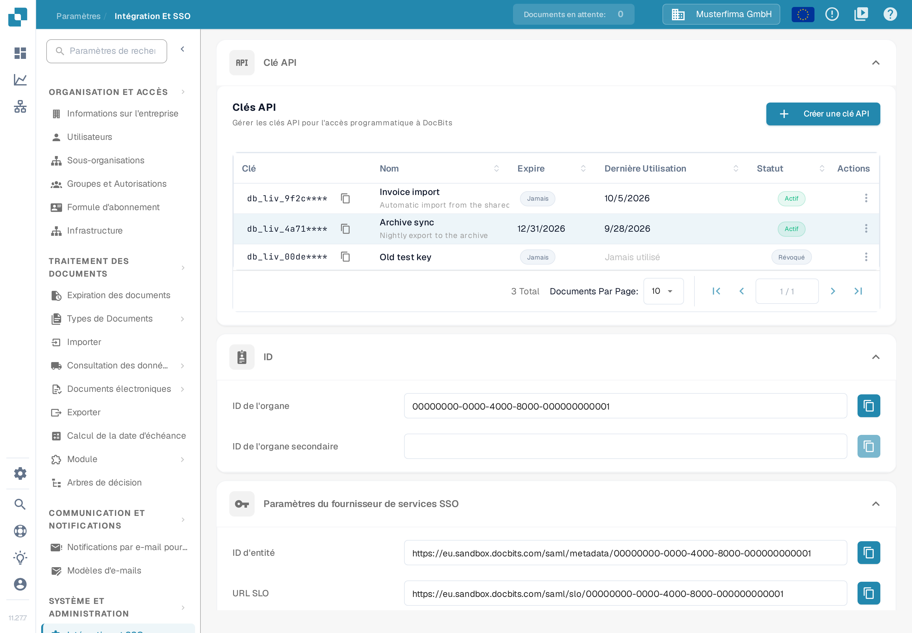
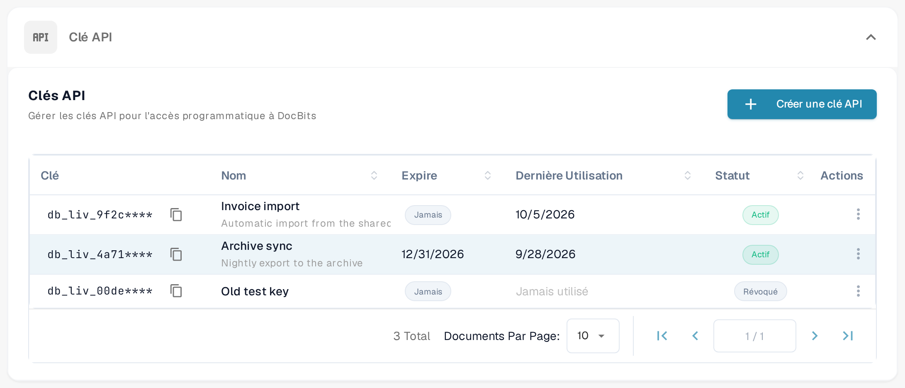
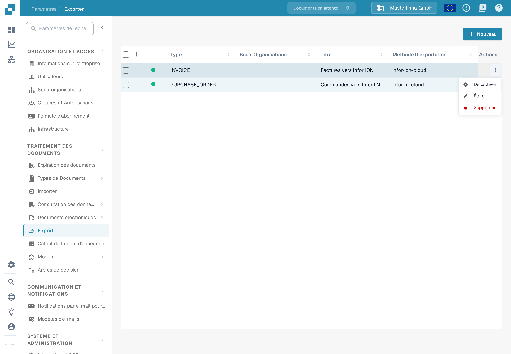
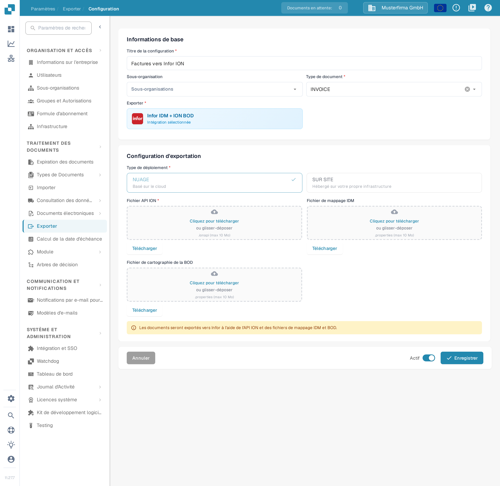

# Testez votre connexion BOD avec Postman

## Aperçu

Cette page explique comment vérifier le traitement réussi de votre BOD (Business Object Document) avec Postman. Vous testez le point de terminaison API correspondant en envoyant une requête accompagnée de votre fichier de mappage BOD. Suivez les étapes ci-dessous pour mener le test jusqu'au bout.

## Accéder à votre clé API et au fichier de mappage BOD

### Récupérer votre clé API

1.  Allez dans **Paramètres → SYSTÈME ET ADMINISTRATION → Intégration et SSO**.

    <figure><figcaption><p>La table <strong>Clés API</strong> de la page <strong>Intégration et SSO</strong>. Chaque ligne affiche le préfixe masqué de la clé, son nom, la date d'expiration (colonne <strong>Expire</strong>), la dernière utilisation (colonne <strong>Dernière Utilisation</strong>) et le statut.</p></figcaption></figure>
2.  Vous pouvez copier votre **clé API** manuellement ou cliquer sur l'icône de copie pour la placer dans le presse-papiers.

    <figure><figcaption><p>Cliquez sur l'icône de copie à côté d'une clé pour copier sa valeur. Pour des raisons de sécurité, la table n'affiche que le préfixe de la clé suivi de <code>****</code> ; la clé complète n'est affichée qu'une seule fois, lors de sa création. Si vous ne disposez plus de la clé complète, créez-en une nouvelle comme décrit dans <a href="../../administration-and-setup/settings/global-settings/integration/api-key-management.md">Gestion des clés API</a>.</p></figcaption></figure>

    La liste des clés, l'icône de copie et le menu **Actions** à trois points sont décrits en détail sur la page [Gestion des clés API](../../administration-and-setup/settings/global-settings/integration/api-key-management.md).

### **Télécharger le fichier de mappage BOD**

1.  Allez dans **Paramètres → TRAITEMENT DES DOCUMENTS → Exporter**.

    <figure><figcaption><p>La liste <strong>Exporter</strong>. Chaque ligne correspond à une configuration d'exportation ; la colonne <strong>Méthode D'exportation</strong> indique comment les documents sont envoyés.</p></figcaption></figure>
2.  Dans la colonne **Actions** de la configuration concernée, cliquez sur le menu à trois points et sélectionnez **Éditer**.

    <figure><figcaption><p>Le menu <strong>Actions</strong> de la ligne est ouvert et <strong>Éditer</strong> est disponible. <strong>Éditer</strong> ouvre la configuration d'exportation ; la page <a href="../../administration-and-setup/settings/document-processing/export.md">Exportation</a> décrit chaque colonne et chaque action.</p></figcaption></figure>
3.  Repérez le champ **Fichier de cartographie de la BOD** et cliquez sur le bouton **Télécharger** pour enregistrer le fichier.

    <figure><figcaption><p>La configuration d'exportation en mode édition. Sous <strong>Configuration d'exportation</strong>, le champ <strong>Fichier de cartographie de la BOD</strong> propose un bouton <strong>Télécharger</strong> qui enregistre le fichier de mappage (BOD-Mapping.properties) sur votre ordinateur. Pour modifier ce fichier, voir <a href="../../infor-integration-and-configuration/exporting-to-infor/creating-a-bod-mapping-file.md">Créer un fichier de mappage BOD</a>.</p></figcaption></figure>

## Tester le point de terminaison dans Postman

1.  **Coller la commande cURL dans Postman**

    Ouvrez Postman et collez la commande cURL suivante dans la section **Import**. Postman configure la requête automatiquement.

    ```bash
    curl -X 'POST' \
      'https://api.docbits.com/prod-api/import/purchase_order_bod' \
      -H 'accept: application/json' \
      -H 'X-API-KEY:' \
      -H 'Content-Type: multipart/form-data' \
      -F 'org_id=' \
      -F 'sub_org_id=' \
      -F 'file=@file.xml;type=text/xml' \
      -F 'custom_fields_mapping='
    ```

    <figure><figcaption><p>Dans Postman, le bouton <strong>Import</strong> se trouve dans la barre supérieure de la fenêtre.</p></figcaption></figure>

    <figure><figcaption><p>Dans la fenêtre <strong>Import</strong>, collez la commande cURL ci-dessus dans le champ <strong>Paste cURL to import</strong>. Postman en fait une requête prête à l'emploi.</p></figcaption></figure>
2.  **Définir la clé API**\
    Allez dans l'onglet **Headers**, repérez l'en-tête `X-API-KEY` et collez votre clé API dans la colonne **Value**.

    <figure><figcaption><p>L'onglet <strong>Headers</strong> de la requête importée. Collez la clé API copiée dans DocBits dans la colonne <strong>Value</strong> de la ligne <code>X-API-KEY</code>.</p></figcaption></figure>
3.  **Téléverser le fichier BOD**\
    Allez dans l'onglet **Body**, repérez la clé `file`, puis cliquez sur **Select Files** dans la colonne **Value** et sélectionnez votre fichier BOD XML.

    <figure><figcaption><p>L'onglet <strong>Body</strong> en mode <strong>form-data</strong>. Sur la ligne <code>file</code>, cliquez sur <strong>Select Files</strong> et choisissez le fichier BOD XML à tester.</p></figcaption></figure>
4.  **Envoyer la requête**\
    Cliquez sur **Send** pour effectuer l'appel API.

    <figure><figcaption><p>Une fois la clé et le fichier renseignés, cliquez sur <strong>Send</strong> pour exécuter la requête sur l'API DocBits.</p></figcaption></figure>
5.  **Vérifier la réponse**\
    Vérifiez la réponse pour confirmer que votre BOD a été traité avec succès.

    <figure><figcaption><p>Un appel réussi renvoie <strong>200 OK</strong> et un corps JSON contenant <code>"success": true</code> — le BOD a été traité.</p></figcaption></figure>
