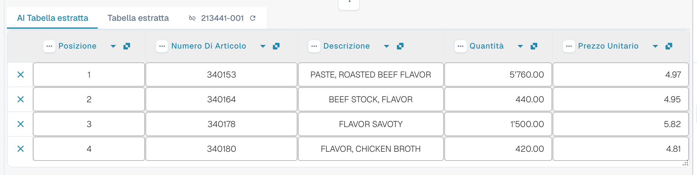

# AI Table

Usa AI Table per verificare le righe estratte, correggere le colonne e salvare istruzioni adatte al layout di un fornitore. Scegli qui sotto la guida per la tua attività. Structured Output ha una propria guida di configurazione, con Default/Yes/No, override, l'anteprima e un esempio pratico.

* [Impostazioni e override](configuration.md)
* [Structured Output per le tabelle](structured-output.md)
* [Colonne e correzioni](columns-and-corrections.md)
* [Istruzioni AI](ai-instructions.md)
* [Tag di AI Table](ai-table-tags.md)
* [Spiegare l'estrazione e risolvere i problemi](explain-extraction.md)
* [Assistente e permessi](assistant-and-permissions.md)
* [Video](videos.md)

<figure><figcaption>
L'AI legge la tabella e restituisce le colonne. Ogni colonna restituita viene mappata a una colonna di tabella configurata (una colonna restituita senza mappatura resta nascosta), ogni colonna configurata ha la propria impostazione Use AI (Default, Yes o No), e le istruzioni AI e <strong>Save as training</strong> determinano il modo in cui vengono letti i documenti successivi con lo stesso layout del fornitore.
</figcaption></figure>

## Quando ottieni la tabella AI

* **AI Table extraction** attivata da un amministratore (**Settings &rarr; Document Processing &rarr; Classification and Extraction**, vedi [Impostazioni per gli amministratori](./#settings-for-admins)). Se è disattivata, l'area della tabella mostra _AI Table will display here. Enable in …_.
* Controlla il testo leggibile o l'input Vision selezionato. Le regole classiche di tabella salvate possono ancora determinare il percorso effettivo della tabella; controlla [quale percorso di estrazione è stato realmente usato](../../../overview-and-basics/faq/document-processing/which-extraction-path-was-used.md).
* Le singole colonne hanno una propria selezione Use AI a tre stati. Controlla anche la fonte effettiva e le regole del fornitore, oltre a questa selezione; attivare Structured Output non sostituisce ogni tabella basata su regole.

Quale livello AI legge la tabella (Fast, Full, Nexus) è impostato per organizzazione e può essere sovrascritto per fornitore, vedi [Modello AI specifico per fornitore](../validation-screen/supplier-specific-ai-model-for-field-and-table-extraction.md).

## La tabella AI a colpo d'occhio

<figure><figcaption>
Le due schede, la tabella AI estratta e le intestazioni delle sue colonne.
</figcaption></figure>

* **Schede.** _AI Extracted table_ è ciò che l'AI ha letto. _Extracted table_ è la tabella classica ottenuta dalle regole addestrate. La scheda AI si apre per impostazione predefinita quando il documento ha una tabella AI.
* **Intestazione di colonna.** Ogni colonna mostra il proprio nome, un piccolo simbolo di **origine** (passa il mouse: _AI · mapping_, _AI · synonym_ e così via indicano come l'AI ha abbinato la colonna), un menu con i **tre puntini** e, per una colonna mappata, un **pulsante con il nome** su cui puoi fare clic per cambiare quale colonna è.
* **Pulsanti di riga.** La **x** all'inizio di una riga rimuove quella riga. Fai clic con il pulsante destro su una riga per _Select as additional cost_ / _Remove as additional cost_.
* **Barra degli strumenti in basso.** Le icone in fondo alla schermata aggiungono o nascondono colonne e righe, vedi [Barra degli strumenti in basso](./#footer-toolbar).
* **Scheda delle istruzioni AI** sotto la tabella: prompt, colonne aggiuntive, **Test change**, **Apply**, **Save as training**, **Delete**, **Export**, vedi [Dare le istruzioni all'AI](./#give-the-ai-instructions).


I controlli delle colonne funzionano solo se puoi modificare il documento. Se sono disattivati, il documento è in sola lettura o bloccato in un'altra sessione. Quando il banner rosso indica che il documento è bloccato dal tuo stesso utente in un'altra sessione, **Unlock** assume il blocco.


## Impostazioni per gli amministratori 

Continua qui: [Impostazioni e override](configuration.md).

### Usa AI per colonna

Continua qui: [Structured Output per le tabelle](structured-output.md).

## Modificare una colonna

Continua qui: [Colonne e correzioni](columns-and-corrections.md).

## Dare le istruzioni all'AI 

Continua qui: [Istruzioni AI](ai-instructions.md).

## Vedere che cosa ha fatto l'AI

Continua qui: [Spiegare l'estrazione e risolvere i problemi](explain-extraction.md).

## Esempi pratici

Continua qui: [Spiegare l'estrazione e risolvere i problemi](explain-extraction.md).

## L'Assistente e la tabella AI

Continua qui: [Assistente e permessi](assistant-and-permissions.md).

## Chi può fare che cosa

Continua qui: [Assistente e permessi](assistant-and-permissions.md).

## Serie di video

Continua qui: [Video](videos.md).

## Video per amministratori: modificare una colonna

Continua qui: [Video](videos.md).

## Pagine correlate

* [Tag e istruzioni di AI Table](ai-table-tags.md)
* [Training Line Fields / Table Training](../../../administration-and-setup/setup/document-training/training-line-fields-table-training/)
* [Modello AI specifico per fornitore](../validation-screen/supplier-specific-ai-model-for-field-and-table-extraction.md)
* [Quale percorso di estrazione è stato usato?](../../../overview-and-basics/faq/document-processing/which-extraction-path-was-used.md)
* [Touchless Intelligence](../../../administration-and-setup/analytics-dashboard/touchless-intelligence/)
