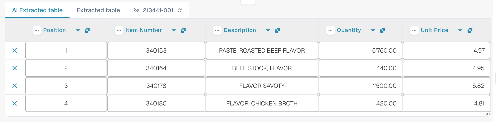

# AI Table

使用 AI Table 检查提取的行项目、修正列，并为某个供应商版式保存适用的指令。请按任务选择下方指南。Structured Output 另有配置指南，涵盖 Default/Yes/No、覆盖、预览和一个完整示例。

* [设置与覆盖](configuration.md)
* [表格的 Structured Output](structured-output.md)
* [列与修正](columns-and-corrections.md)
* [AI 指令](ai-instructions.md)
* [AI Table 标签](ai-table-tags.md)
* [提取说明与故障排查](explain-extraction.md)
* [助手与权限](assistant-and-permissions.md)
* [视频](videos.md)

<figure><figcaption>
AI 读取表格并返回各列。每个返回的列都会映射到一个已配置的表格列（没有映射的返回列保持隐藏），每个已配置的列都有自己的 Use AI 设置（Default、Yes 或 No），而 AI 指令和 <strong>Save as training</strong> 决定该供应商版式的后续文档如何被读取。
</figcaption></figure>

## 何时会看到 AI 表格

* 管理员已开启 **AI Table extraction**（Settings → Document Processing → Classification and Extraction，参见[管理员设置](./#settings-for-admins)）。如果该功能已关闭，表格区域会显示 _AI Table will display here. Enable in …_。
* 检查可识别的文本或所选的 Vision 输入。已保存的传统表格规则仍可能决定实际的表格路径；请核对[实际使用的是哪条提取路径](../../../overview-and-basics/faq/document-processing/which-extraction-path-was-used.md)。
* 各列有独立的三态 Use AI 选择。请同时检查实际生效的来源规则和供应商规则，而不只看这个选择；启用 Structured Output 并不会取代所有基于规则的表格。

由哪个 AI 层级（Fast、Full、Nexus）读取表格，按组织设置，并可按供应商覆盖，参见[供应商专属 AI 模型](../validation-screen/supplier-specific-ai-model-for-field-and-table-extraction.md)。

## AI 表格一览

<figure><figcaption>
两个选项卡、AI Extracted 表格及其列标题。
</figcaption></figure>

* **选项卡。** _AI Extracted table_ 是 AI 读取的内容。_Extracted table_ 是根据已训练规则生成的传统表格。文档存在 AI 表格时，默认打开 AI 选项卡。
* **列标题。** 每一列都显示列名、一个小的**来源**符号（将鼠标悬停其上会显示 _AI · mapping_、_AI · synonym_ 等，说明 AI 是如何匹配该列的）、一个**三点**菜单，以及（对已映射的列）一个**名称按钮**，点击即可更改该列对应到哪个列。
* **行按钮。** 行首的 **x** 会删除该行。右键单击某行可选择 _Select as additional cost_ / _Remove as additional cost_。
* **页脚工具栏。** 屏幕底部的图标用于添加或隐藏列和行，参见[页脚工具栏](./#footer-toolbar)。
* 表格下方的 **AI instructions** 卡片：提示词、额外列、**Test change**、**Apply**、**Save as training**、**Delete**、**Export**，参见[向 AI 提供指令](./#give-the-ai-instructions)。


只有在您可以编辑文档时，列控件才可用。如果它们显示为灰色，说明文档为只读，或已在另一个会话中被锁定。当红色横幅提示文档已被您自己的用户在另一个会话中锁定时，**Unlock** 会接管该锁定。


## 管理员设置 

继续阅读：[设置与覆盖](configuration.md)。

### 按列使用 AI

继续阅读：[表格的 Structured Output](structured-output.md)。

## 更改列

继续阅读：[列与修正](columns-and-corrections.md)。

## 向 AI 提供指令 

继续阅读：[AI 指令](ai-instructions.md)。

## 查看 AI 做了什么

继续阅读：[提取说明与故障排查](explain-extraction.md)。

## 实际示例

继续阅读：[提取说明与故障排查](explain-extraction.md)。

## 助手与 AI 表格

继续阅读：[助手与权限](assistant-and-permissions.md)。

## 谁可以做什么

继续阅读：[助手与权限](assistant-and-permissions.md)。

## 视频系列

继续阅读：[视频](videos.md)。

## 管理员视频：更改列

继续阅读：[视频](videos.md)。

## 相关页面

* [AI Table 标签与指令](ai-table-tags.md)
* [训练行字段 / 表格训练](../../../administration-and-setup/setup/document-training/training-line-fields-table-training/)
* [供应商专属 AI 模型](../validation-screen/supplier-specific-ai-model-for-field-and-table-extraction.md)
* [使用了哪条提取路径？](../../../overview-and-basics/faq/document-processing/which-extraction-path-was-used.md)
* [Touchless Intelligence](../../../administration-and-setup/analytics-dashboard/touchless-intelligence/)
