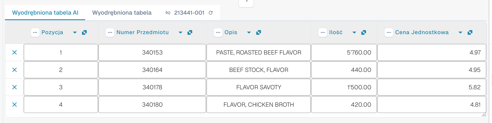

# AI Table

Używaj AI Table do przeglądania odczytanych pozycji, poprawiania kolumn i zapisywania odpowiednich instrukcji dla układu dostawcy. Wybierz poniżej przewodnik dla swojego zadania. Structured Output ma własny przewodnik konfiguracji, z opcjami Default/Yes/No, nadpisaniami, podglądem i pełnym przykładem.

* [Ustawienia i nadpisania](configuration.md)
* [Structured Output dla tabel](structured-output.md)
* [Kolumny i poprawki](columns-and-corrections.md)
* [Instrukcje AI](ai-instructions.md)
* [Tagi AI Table](ai-table-tags.md)
* [Wyjaśnianie odczytu i rozwiązywanie problemów](explain-extraction.md)
* [Asystent i uprawnienia](assistant-and-permissions.md)
* [Filmy](videos.md)

<figure><figcaption>
AI czyta tabelę i zwraca kolumny. Każda zwrócona kolumna jest mapowana na skonfigurowaną kolumnę tabeli (zwrócona kolumna bez mapowania pozostaje ukryta), każda skonfigurowana kolumna ma własne ustawienie Use AI (Default, Yes lub No), a instrukcje AI i <strong>Save as training</strong> kształtują sposób odczytu kolejnych dokumentów o układzie tego dostawcy.
</figcaption></figure>

## Kiedy otrzymujesz tabelę AI

* Administrator włączył **AI Table extraction** (Settings &#8594; Document Processing &#8594; Classification and Extraction, patrz [Settings for admins](./#settings-for-admins)). Jeśli jest wyłączona, w obszarze tabeli wyświetla się _AI Table will display here. Enable in …_.
* Sprawdź czytelny tekst lub wybrane wejście Vision. Zapisane klasyczne reguły tabel mogą nadal określać efektywną ścieżkę odczytu tabeli; sprawdź [która ścieżka odczytu została faktycznie użyta](../../../overview-and-basics/faq/document-processing/which-extraction-path-was-used.md).
* Poszczególne kolumny mają własny, trójstanowy wybór Use AI. Sprawdź efektywne reguły źródła i dostawcy oraz ten wybór; włączenie Structured Output nie zastępuje każdej tabeli opartej na regułach.

Który poziom AI odczytuje tabelę (Fast, Full, Nexus) jest ustawiany dla organizacji i można go nadpisać dla dostawcy, patrz [Supplier-Specific AI Model](../validation-screen/supplier-specific-ai-model-for-field-and-table-extraction.md).

## Tabela AI w skrócie

<figure><figcaption>
Dwie zakładki, tabela AI Extracted i jej nagłówki kolumn.
</figcaption></figure>

* **Zakładki.** _AI Extracted table_ to to, co odczytała AI. _Extracted table_ to klasyczna tabela z wytrenowanych reguł. Zakładka AI otwiera się domyślnie, gdy dokument ma tabelę AI.
* **Nagłówek kolumny.** Każda kolumna pokazuje swoją nazwę, mały symbol **origin** (najedź na niego kursorem: _AI · mapping_, _AI · synonym_ itd. informują, jak AI dopasowała kolumnę), menu **three-dots** oraz, dla kolumny zmapowanej, **name button**, który możesz kliknąć, aby zmienić, którą kolumną jest.
* **Przyciski wierszy.** **x** na początku wiersza usuwa ten wiersz. Kliknij wiersz prawym przyciskiem myszy, aby wybrać _Select as additional cost_ / _Remove as additional cost_.
* **Pasek narzędzi w stopce.** Ikony na dole ekranu dodają lub ukrywają kolumny i wiersze, patrz [Footer toolbar](./#footer-toolbar).
* **Karta AI instructions** pod tabelą: prompt, dodatkowe kolumny, **Test change**, **Apply**, **Save as training**, **Delete**, **Export**, patrz [Give the AI instructions](./#give-the-ai-instructions).


Elementy sterowania kolumnami działają tylko wtedy, gdy możesz edytować dokument. Jeśli są wyszarzone, dokument jest tylko do odczytu lub zablokowany w innej sesji. Gdy czerwony baner informuje, że dokument jest zablokowany przez Twojego użytkownika w innej sesji, **Unlock** przejmuje blokadę.


## Ustawienia dla administratorów 

Czytaj dalej: [Ustawienia i nadpisania](configuration.md).

### Użyj AI dla poszczególnych kolumn

Czytaj dalej: [Structured Output dla tabel](structured-output.md).

## Zmiana kolumny

Czytaj dalej: [Kolumny i poprawki](columns-and-corrections.md).

## Podaj instrukcje dla AI 

Czytaj dalej: [Instrukcje AI](ai-instructions.md).

## Sprawdź, co zrobiła AI

Czytaj dalej: [Wyjaśnianie odczytu i rozwiązywanie problemów](explain-extraction.md).

## Praktyczne przykłady

Czytaj dalej: [Wyjaśnianie odczytu i rozwiązywanie problemów](explain-extraction.md).

## Asystent a tabela AI

Czytaj dalej: [Asystent i uprawnienia](assistant-and-permissions.md).

## Kto co może

Czytaj dalej: [Asystent i uprawnienia](assistant-and-permissions.md).

## Seria filmów

Czytaj dalej: [Filmy](videos.md).

## Film dla administratorów: zmiana kolumny

Czytaj dalej: [Filmy](videos.md).

## Powiązane strony

* [Tagi i instrukcje AI Table](ai-table-tags.md)
* [Training Line Fields / Table Training](../../../administration-and-setup/setup/document-training/training-line-fields-table-training/)
* [Supplier-Specific AI Model](../validation-screen/supplier-specific-ai-model-for-field-and-table-extraction.md)
* [Which Extraction Path Was Used?](../../../overview-and-basics/faq/document-processing/which-extraction-path-was-used.md)
* [Touchless Intelligence](../../../administration-and-setup/analytics-dashboard/touchless-intelligence/)
