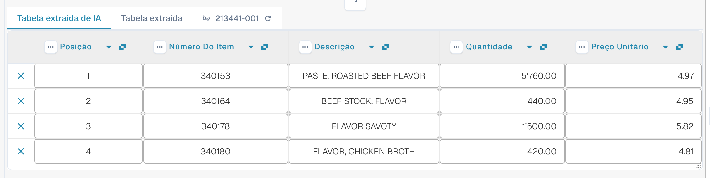

# AI Table

Use o AI Table para revisar itens de linha extraídos, corrigir colunas e salvar instruções adequadas para um layout de fornecedor. Escolha abaixo o guia para a sua tarefa. O Structured Output tem o seu próprio guia de configuração, com Default/Yes/No, substituições, a pré-visualização e um exemplo prático.

* [Settings e substituições](configuration.md)
* [Structured Output para tabelas](structured-output.md)
* [Colunas e correções](columns-and-corrections.md)
* [Instruções de IA](ai-instructions.md)
* [Tags do AI Table](ai-table-tags.md)
* [Explicar a extração e diagnosticar](explain-extraction.md)
* [Assistente e permissões](assistant-and-permissions.md)
* [Vídeos](videos.md)

<figure><figcaption>
A IA lê a tabela e retorna colunas. Cada coluna retornada é mapeada para uma coluna de tabela configurada (uma coluna retornada sem mapeamento permanece oculta), cada coluna configurada tem a sua própria configuração Use AI (Default, Yes ou No), e as instruções de IA e <strong>Save as training</strong> definem como os próximos documentos do layout do fornecedor são lidos.
</figcaption></figure>

## Quando você obtém a tabela de IA

* Um administrador ativou a **AI Table extraction** (Settings > Document Processing > Classification and Extraction, veja [Configurações para administradores](./#settings-for-admins)). Se estiver desativada, a área da tabela mostra _AI Table will display here. Enable in …_.
* Verifique o texto legível ou a entrada Vision selecionada. Regras de tabela clássicas salvas ainda podem determinar o caminho efetivo da tabela; verifique [qual caminho de extração foi realmente usado](../../../overview-and-basics/faq/document-processing/which-extraction-path-was-used.md).
* As colunas individuais têm a sua própria seleção Use AI de três estados. Verifique a origem efetiva e as regras do fornecedor, além desta seleção; ativar o Structured Output não substitui todas as tabelas baseadas em regras.

Qual nível de IA lê a tabela (Fast, Full, Nexus) é definido por organização e pode ser substituído por fornecedor, veja [Modelo de IA específico do fornecedor para extração de campos e tabelas](../validation-screen/supplier-specific-ai-model-for-field-and-table-extraction.md).

## A tabela de IA em resumo

<figure><figcaption>
As duas abas, a tabela AI Extracted e os seus cabeçalhos de coluna.
</figcaption></figure>

* **Abas.** _AI Extracted table_ é o que a IA leu. _Extracted table_ é a tabela clássica, vinda de regras treinadas. A aba de IA abre por padrão quando o documento tem uma tabela de IA.
* **Cabeçalho da coluna.** Cada coluna mostra o seu nome, um pequeno símbolo de **origem** (passe o mouse sobre ele: _AI · mapping_, _AI · synonym_ e assim por diante indicam como a IA correspondeu a coluna), um menu de **três pontos** e, para uma coluna mapeada, um **botão de nome** em que você pode clicar para mudar qual coluna é.
* **Botões de linha.** O **x** no início de uma linha remove essa linha. Clique com o botão direito em uma linha para _Select as additional cost_ / _Remove as additional cost_.
* **Barra de ferramentas do rodapé.** Os ícones na parte inferior da tela adicionam ou ocultam colunas e linhas, veja [Barra de ferramentas do rodapé](./#footer-toolbar).
* **Cartão de instruções de IA** abaixo da tabela: prompt, colunas adicionais, **Test change**, **Apply**, **Save as training**, **Delete**, **Export**, veja [Dar instruções à IA](./#give-the-ai-instructions).


Os controles de coluna só funcionam quando você pode editar o documento. Se estiverem acinzentados, o documento é somente leitura ou está bloqueado em outra sessão. Quando o banner vermelho informa que o documento está bloqueado pelo seu próprio usuário em outra sessão, **Unlock** assume o bloqueio.


## Configurações para administradores 

Continue aqui: [Settings e substituições](configuration.md).

### Usar IA por coluna

Continue aqui: [Structured Output para tabelas](structured-output.md).

## Alterar uma coluna

Continue aqui: [Colunas e correções](columns-and-corrections.md).

## Dar instruções à IA 

Continue aqui: [Instruções de IA](ai-instructions.md).

## Ver o que a IA fez

Continue aqui: [Explicar a extração e diagnosticar](explain-extraction.md).

## Exemplos práticos

Continue aqui: [Explicar a extração e diagnosticar](explain-extraction.md).

## O Assistente e a tabela de IA

Continue aqui: [Assistente e permissões](assistant-and-permissions.md).

## Quem pode fazer o quê

Continue aqui: [Assistente e permissões](assistant-and-permissions.md).

## Série de vídeos

Continue aqui: [Vídeos](videos.md).

## Vídeo para administradores: alterar uma coluna

Continue aqui: [Vídeos](videos.md).

## Páginas relacionadas

* [Tags e instruções do AI Table](ai-table-tags.md)
* [Campos de linha de treinamento / Treinamento de tabelas](../../../administration-and-setup/setup/document-training/training-line-fields-table-training/)
* [Modelo de IA específico do fornecedor](../validation-screen/supplier-specific-ai-model-for-field-and-table-extraction.md)
* [Qual caminho de extração foi usado?](../../../overview-and-basics/faq/document-processing/which-extraction-path-was-used.md)
* [Touchless Intelligence](../../../administration-and-setup/analytics-dashboard/touchless-intelligence/)
