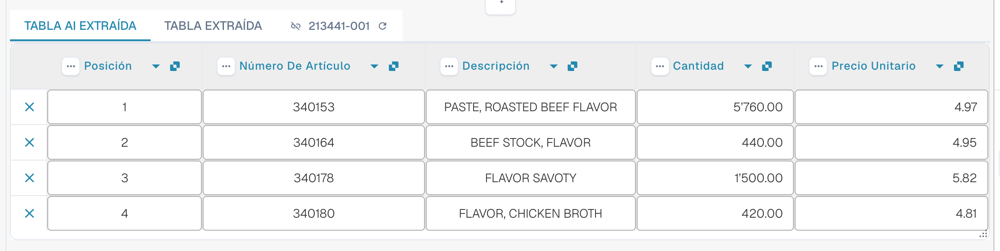

# AI Table

Con AI Table puede revisar las posiciones extraídas, corregir columnas y guardar instrucciones adecuadas para el diseño de un proveedor. Elija la guía para su tarea. Structured Output tiene su propia guía de configuración, con Default/Yes/No, anulaciones, la vista previa y un ejemplo completo.

* [Ajustes y anulaciones](configuration.md)
* [Structured Output para tablas](structured-output.md)
* [Columnas y correcciones](columns-and-corrections.md)
* [Instrucciones de IA](ai-instructions.md)
* [Etiquetas de la tabla AI](ai-table-tags.md)
* [Explicar la extracción y diagnosticar](explain-extraction.md)
* [Asistente y permisos](assistant-and-permissions.md)
* [Vídeos](videos.md)

<figure><figcaption>
La IA lee la tabla y devuelve columnas. Cada columna devuelta se asigna a una columna de tabla configurada (una columna devuelta sin asignación permanece oculta), cada columna configurada tiene su propio ajuste Use AI (Default, Yes o No), y las instrucciones de IA y <strong>Save as training</strong> determinan cómo se leen los siguientes documentos del diseño del proveedor.
</figcaption></figure>

## Cuándo aparece la tabla AI

* Un administrador ha activado **AI Table extraction** (Settings → Document Processing → Classification and Extraction; consulte [Ajustes para administradores](./#settings-for-admins)). Si está desactivada, el área de la tabla muestra _AI Table will display here. Enable in …_.
* Compruebe el texto legible o la entrada Vision seleccionada. Las reglas de tabla clásicas guardadas todavía pueden determinar la ruta efectiva de la tabla; verifique [qué ruta de extracción se usó realmente](../../../overview-and-basics/faq/document-processing/which-extraction-path-was-used.md).
* Cada columna tiene su propia selección Use AI de tres estados. Compruebe también el origen efectivo y las reglas del proveedor; activar Structured Output no sustituye todas las tablas basadas en reglas.

El nivel de IA que lee la tabla (Fast, Full, Nexus) se define por organización y puede sobrescribirse por proveedor; consulte [Modelo de IA específico del proveedor](../validation-screen/supplier-specific-ai-model-for-field-and-table-extraction.md).

## La tabla AI de un vistazo

<figure><figcaption>
Las dos pestañas, la tabla AI extraída y sus encabezados de columna.
</figcaption></figure>

* **Pestañas.** _AI Extracted table_ es lo que ha leído la IA. _Extracted table_ es la tabla clásica de las reglas entrenadas. La pestaña AI se abre por defecto cuando el documento tiene una tabla AI.
* **Encabezado de columna.** Cada columna muestra su nombre, un pequeño símbolo de **origen** (pase el cursor por encima: _AI · mapping_, _AI · synonym_, etc. indican cómo ha emparejado la IA la columna), un menú de **tres puntos** y, en una columna asignada, un **botón con el nombre** en el que puede hacer clic para cambiar de qué columna se trata.
* **Botones de fila.** La **x** al inicio de una fila elimina esa fila. Haga clic con el botón derecho en una fila para _Select as additional cost_ / _Remove as additional cost_.
* **Barra de herramientas del pie.** Los iconos de la parte inferior de la pantalla añaden u ocultan columnas y filas; consulte [Barra de herramientas del pie](./#footer-toolbar).
* **Tarjeta de instrucciones de IA** debajo de la tabla: prompt, columnas adicionales, **Test change**, **Apply**, **Save as training**, **Delete**, **Export**; consulte [Dar instrucciones a la IA](./#give-the-ai-instructions).


Los controles de columna solo funcionan cuando puede editar el documento. Si aparecen en gris, el documento es de solo lectura o está bloqueado en otra sesión. Cuando el banner rojo indica que el documento está bloqueado por su propio usuario en otra sesión, **Unlock** toma el bloqueo.


## Ajustes para administradores 

Continúe aquí: [Ajustes y anulaciones](configuration.md).

### Usar IA por columna

Continúe aquí: [Structured Output para tablas](structured-output.md).

## Cambiar una columna

Continúe aquí: [Columnas y correcciones](columns-and-corrections.md).

## Dar instrucciones a la IA 

Continúe aquí: [Instrucciones de IA](ai-instructions.md).

## Ver qué ha hecho la IA

Continúe aquí: [Explicar la extracción y diagnosticar](explain-extraction.md).

## Ejemplos prácticos

Continúe aquí: [Explicar la extracción y diagnosticar](explain-extraction.md).

## El Asistente y la tabla AI

Continúe aquí: [Asistente y permisos](assistant-and-permissions.md).

## Quién puede hacer qué

Continúe aquí: [Asistente y permisos](assistant-and-permissions.md).

## Serie de vídeos

Continúe aquí: [Vídeos](videos.md).

## Vídeo para administradores: cambiar una columna

Continúe aquí: [Vídeos](videos.md).

## Páginas relacionadas

* [Etiquetas de la tabla AI](ai-table-tags.md)
* [Entrenamiento de líneas de campo / Entrenamiento de tablas](../../../administration-and-setup/setup/document-training/training-line-fields-table-training/)
* [Modelo de IA específico del proveedor](../validation-screen/supplier-specific-ai-model-for-field-and-table-extraction.md)
* [¿Qué ruta de extracción se usó?](../../../overview-and-basics/faq/document-processing/which-extraction-path-was-used.md)
* [Touchless Intelligence](../../../administration-and-setup/analytics-dashboard/touchless-intelligence/)
