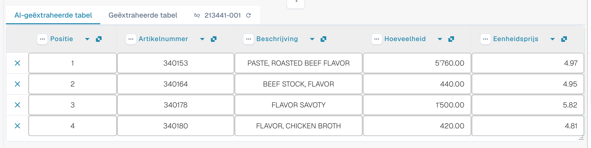

# AI Table

Met AI Table controleert u geëxtraheerde regelitems, corrigeert u kolommen en bewaart u geschikte instructies voor een leveranciersindeling. Kies hieronder de handleiding voor uw taak. Structured Output heeft een eigen configuratiehandleiding, met Default/Yes/No, afwijkingen, de voorbeeldweergave en een uitgewerkt voorbeeld.

* [Instellingen en afwijkingen](configuration.md)
* [Structured Output voor tabellen](structured-output.md)
* [Kolommen en correcties](columns-and-corrections.md)
* [AI-instructies](ai-instructions.md)
* [AI Table Tags](ai-table-tags.md)
* [Extractie uitleggen en problemen onderzoeken](explain-extraction.md)
* [Assistent en rechten](assistant-and-permissions.md)
* [Video's](videos.md)

<figure><figcaption>
De AI leest de tabel en geeft kolommen terug. Elke teruggegeven kolom wordt aan een geconfigureerde tabelkolom gekoppeld (een teruggegeven kolom zonder koppeling blijft verborgen), elke geconfigureerde kolom heeft een eigen Use AI-instelling (Default, Yes of No), en de AI-instructies en <strong>Save as training</strong> bepalen hoe de volgende documenten van de leveranciersindeling worden gelezen.
</figcaption></figure>

## Wanneer u de AI-tabel krijgt

* Een beheerder heeft **AI Table extraction** ingeschakeld (Settings → Document Processing → Classification and Extraction, zie [Instellingen voor beheerders](./#settings-for-admins)). Staat die uit, dan toont het tabelgebied _AI Table will display here. Enable in …_.
* Controleer leesbare tekst of de gekozen Vision-invoer. Opgeslagen klassieke tabelregels kunnen nog steeds het effectieve tabelpad bepalen; controleer [welk extractiepad werkelijk is gebruikt](../../../overview-and-basics/faq/document-processing/which-extraction-path-was-used.md).
* Afzonderlijke kolommen hebben een eigen Use AI-keuze met drie standen. Controleer ook de effectieve bron- en leveranciersregels naast deze keuze; het inschakelen van Structured Output vervangt niet elke tabel op basis van regels.

Welke AI-tier de tabel leest (Fast, Full, Nexus) wordt per organisatie ingesteld en kan per leverancier worden overschreven, zie [Leverancierspecifiek AI-model](../validation-screen/supplier-specific-ai-model-for-field-and-table-extraction.md).

## De AI-tabel in één oogopslag

<figure><figcaption>
De twee tabbladen, de AI-geëxtraheerde tabel en de bijbehorende kolomkoppen.
</figcaption></figure>

* **Tabs.** _AI Extracted table_ is wat de AI heeft gelezen. _Extracted table_ is de klassieke tabel uit getrainde regels. Het AI-tabblad opent standaard wanneer het document een AI-tabel heeft.
* **Column header.** Elke kolom toont de naam, een klein **origin**-symbool (houd de muisaanwijzer erop: _AI · mapping_, _AI · synonym_ enzovoort vertellen u hoe de AI de kolom heeft gematcht), een **three-dots**-menu en, voor een gekoppelde kolom, een **name button** waarop u kunt klikken om te wijzigen om welke kolom het gaat.
* **Row buttons.** De **x** aan het begin van een rij verwijdert die rij. Klik met de rechtermuisknop op een rij voor _Select as additional cost_ / _Remove as additional cost_.
* **Footer toolbar.** De pictogrammen onderaan het scherm voegen kolommen en rijen toe of verbergen ze, zie [Werkbalk onderaan](./#footer-toolbar).
* **AI instructions card** onder de tabel: prompt, extra kolommen, **Test change**, **Apply**, **Save as training**, **Delete**, **Export**, zie [Geef de AI instructies](./#give-the-ai-instructions).


De kolombediening werkt alleen wanneer u het document kunt bewerken. Zijn de bedieningselementen grijs, dan is het document alleen-lezen of in een andere sessie vergrendeld. Meldt de rode banner dat het document door uw eigen gebruiker in een andere sessie is vergrendeld, dan neemt **Unlock** de vergrendeling over.


## Instellingen voor beheerders 

Lees hier verder: [Instellingen en afwijkingen](configuration.md).

### AI gebruiken per kolom

Lees hier verder: [Structured Output voor tabellen](structured-output.md).

## Een kolom wijzigen

Lees hier verder: [Kolommen en correcties](columns-and-corrections.md).

## Geef de AI instructies 

Lees hier verder: [AI-instructies](ai-instructions.md).

## Zien wat de AI heeft gedaan

Lees hier verder: [Extractie uitleggen en problemen onderzoeken](explain-extraction.md).

## Praktische voorbeelden

Lees hier verder: [Extractie uitleggen en problemen onderzoeken](explain-extraction.md).

## De Assistent en de AI-tabel

Lees hier verder: [Assistent en rechten](assistant-and-permissions.md).

## Wie kan wat doen

Lees hier verder: [Assistent en rechten](assistant-and-permissions.md).

## Videoserie

Lees hier verder: [Video's](videos.md).

## Beheerdersvideo: een kolom wijzigen

Lees hier verder: [Video's](videos.md).

## Gerelateerde pagina's

* [AI Table Tags en instructies](ai-table-tags.md)
* [Training Line Fields / Table Training](../../../administration-and-setup/setup/document-training/training-line-fields-table-training/)
* [Leverancierspecifiek AI-model](../validation-screen/supplier-specific-ai-model-for-field-and-table-extraction.md)
* [Welk extractiepad is gebruikt?](../../../overview-and-basics/faq/document-processing/which-extraction-path-was-used.md)
* [Touchless Intelligence](../../../administration-and-setup/analytics-dashboard/touchless-intelligence/)
