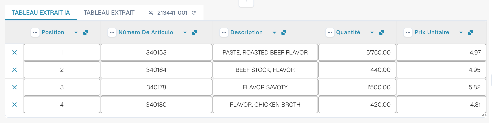

# AI Table

Utilisez AI Table pour vérifier les lignes extraites, corriger les colonnes et enregistrer des instructions adaptées à une mise en page fournisseur. Choisissez ci-dessous le guide correspondant à votre tâche. Structured Output dispose de son propre guide de configuration, avec Default/Yes/No, des dérogations, l'aperçu et un exemple complet.

* [Paramètres et dérogations](configuration.md)
* [Structured Output pour les tableaux](structured-output.md)
* [Colonnes et corrections](columns-and-corrections.md)
* [Instructions IA](ai-instructions.md)
* [Étiquettes de tableau AI](ai-table-tags.md)
* [Expliquer l'extraction et diagnostiquer](explain-extraction.md)
* [Assistant et droits](assistant-and-permissions.md)
* [Vidéos](videos.md)

<figure><figcaption>
L'IA lit le tableau et renvoie des colonnes. Chaque colonne renvoyée est associée à une colonne de tableau configurée (une colonne renvoyée sans association reste masquée), chaque colonne configurée a son propre réglage Use AI (Default, Yes ou No), et les instructions IA ainsi que <strong>Save as training</strong> déterminent la façon dont les documents suivants de la mise en page fournisseur sont lus.
</figcaption></figure>

## Quand obtenez-vous le tableau AI

* **Settings →
  Document Processing →
  Classification and Extraction** : un administrateur y a activé **AI Table extraction** (voir [Paramètres pour les administrateurs](./#settings-for-admins)). Si l'option est désactivée, la zone du tableau affiche _AI Table will display here. Enable in …_.
* Vérifiez le texte lisible ou l'entrée Vision sélectionnée. Des règles de tableau classiques enregistrées peuvent encore déterminer le chemin de tableau effectif ; vérifiez [quel chemin d'extraction a réellement été utilisé](../../../overview-and-basics/faq/document-processing/which-extraction-path-was-used.md).
* Chaque colonne dispose de sa propre sélection Use AI à trois états. Vérifiez la source effective et les règles fournisseur ainsi que cette sélection ; activer Structured Output ne remplace pas tous les tableaux issus de règles.

Le niveau d'IA qui lit le tableau (Fast, Full, Nexus) est défini par organisation et peut être remplacé par fournisseur, voir [Modèle d'IA spécifique au fournisseur](../validation-screen/supplier-specific-ai-model-for-field-and-table-extraction.md).

## Le tableau AI en un coup d'œil

<figure><figcaption>
Les deux onglets, le tableau AI Extracted et ses en-têtes de colonnes.
</figcaption></figure>

* **Onglets.** _AI Extracted table_ est ce que l'IA a lu. _Extracted table_ est le tableau classique issu des règles entraînées. L'onglet IA s'ouvre par défaut lorsque le document possède un tableau AI.
* **En-tête de colonne.** Chaque colonne affiche son nom, un petit symbole d'**origine** (survolez-le : _AI · mapping_, _AI · synonym_, etc. indiquent comment l'IA a associé la colonne), un menu **trois points** et, pour une colonne associée, un **bouton de nom** sur lequel vous pouvez cliquer pour changer la colonne concernée.
* **Boutons de ligne.** Le **x** au début d'une ligne supprime cette ligne. Un clic droit sur une ligne ouvre _Select as additional cost_ / _Remove as additional cost_.
* **Barre d'outils du bas.** Les icônes en bas de l'écran ajoutent ou masquent des colonnes et des lignes, voir [Footer toolbar](./#footer-toolbar).
* **Carte d'instructions IA** sous le tableau : prompt, colonnes supplémentaires, **Test change**, **Apply**, **Save as training**, **Delete**, **Export**, voir [Donner des instructions à l'IA](./#give-the-ai-instructions).


Les commandes de colonne ne fonctionnent que si vous pouvez modifier le document. Si elles sont grisées, le document est en lecture seule ou verrouillé dans une autre session. Lorsque le bandeau rouge indique que le document est verrouillé par votre propre utilisateur dans une autre session, **Unlock** reprend le verrou.


## Paramètres pour les administrateurs 

Continuez ici : [Paramètres et dérogations](configuration.md).

### Utiliser l'IA par colonne

Continuez ici : [Structured Output pour les tableaux](structured-output.md).

## Modifier une colonne

Continuez ici : [Colonnes et corrections](columns-and-corrections.md).

## Donner des instructions à l'IA 

Continuez ici : [Instructions IA](ai-instructions.md).

## Voir ce que l'IA a fait

Continuez ici : [Expliquer l'extraction et diagnostiquer](explain-extraction.md).

## Exemples pratiques

Continuez ici : [Expliquer l'extraction et diagnostiquer](explain-extraction.md).

## L'Assistant et le tableau AI

Continuez ici : [Assistant et droits](assistant-and-permissions.md).

## Qui peut faire quoi

Continuez ici : [Assistant et droits](assistant-and-permissions.md).

## Série de vidéos

Continuez ici : [Vidéos](videos.md).

## Vidéo administrateur : modifier une colonne

Continuez ici : [Vidéos](videos.md).

## Pages associées

* [Étiquettes et instructions de tableau AI](ai-table-tags.md)
* [Formation des champs de ligne / formation des tableaux](../../../administration-and-setup/setup/document-training/training-line-fields-table-training/)
* [Modèle d'IA spécifique au fournisseur](../validation-screen/supplier-specific-ai-model-for-field-and-table-extraction.md)
* [Quel chemin d'extraction a été utilisé ?](../../../overview-and-basics/faq/document-processing/which-extraction-path-was-used.md)
* [Touchless Intelligence](../../../administration-and-setup/analytics-dashboard/touchless-intelligence/)
