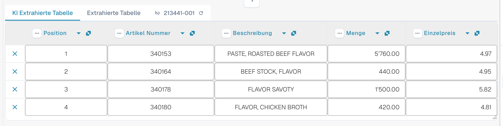

# AI Table

Mit AI Table prüfen Sie extrahierte Positionen, korrigieren Spalten und speichern passende Anweisungen für ein Lieferantenlayout. Wählen Sie unten die Anleitung für Ihre Aufgabe. Structured Output hat eine eigene Konfigurationsanleitung mit Default/Yes/No, Überschreibungen, der Vorschau und einem durchgängigen Beispiel.

* [Einstellungen und Überschreibungen](configuration.md)
* [Structured Output für Tabellen](structured-output.md)
* [Spalten und Korrekturen](columns-and-corrections.md)
* [KI-Anweisungen](ai-instructions.md)
* [AI-Tabellen-Tags](ai-table-tags.md)
* [Extraktion erklären und Fehler eingrenzen](explain-extraction.md)
* [Assistent und Berechtigungen](assistant-and-permissions.md)
* [Videos](videos.md)

<figure><figcaption>
Die KI liest die Tabelle und liefert Spalten zurück. Jede zurückgegebene Spalte wird einer konfigurierten Tabellenspalte zugeordnet (eine zurückgegebene Spalte ohne Zuordnung bleibt ausgeblendet), jede konfigurierte Spalte hat ihre eigene Use AI-Einstellung (Default, Yes oder No), und die KI-Anweisungen sowie <strong>Save as training</strong> bestimmen, wie die nächsten Dokumente desselben Lieferantenlayouts gelesen werden.
</figcaption></figure>

## Wann Sie die AI Table erhalten

* Ein Administrator hat **AI Table extraction** eingeschaltet (Settings → Document Processing → Classification and Extraction, siehe [Einstellungen für Administratoren](./#settings-for-admins)). Ist sie ausgeschaltet, zeigt der Tabellenbereich _AI Table will display here. Enable in …_.
* Prüfen Sie lesbaren Text beziehungsweise die gewählte Vision-Eingabe. Gespeicherte klassische Tabellenregeln können weiterhin den wirksamen Tabellenpfad bestimmen; prüfen Sie [welcher Extraktionspfad tatsächlich verwendet wurde](../../../overview-and-basics/faq/document-processing/which-extraction-path-was-used.md).
* Einzelne Spalten haben ihre eigene dreistufige Use AI-Auswahl. Prüfen Sie neben dieser Auswahl auch die wirksame Quelle und die Lieferantenregeln; das Aktivieren von Structured Output ersetzt nicht jede regelbasierte Tabelle.

Welche KI-Stufe die Tabelle liest (Fast, Full, Nexus), wird pro Organisation festgelegt und kann pro Lieferant überschrieben werden, siehe [Lieferantenspezifisches KI-Modell](../validation-screen/supplier-specific-ai-model-for-field-and-table-extraction.md).

## Die AI Table im Überblick

<figure><figcaption>
Die zwei Tabs, die AI Extracted table und ihre Spaltenüberschriften.
</figcaption></figure>

* **Tabs.** _AI Extracted table_ zeigt, was die KI gelesen hat. _Extracted table_ ist die klassische Tabelle aus trainierten Regeln. Der AI-Tab öffnet sich standardmäßig, wenn das Dokument eine AI Table hat.
* **Spaltenüberschrift.** Jede Spalte zeigt ihren Namen, ein kleines **origin**-Symbol (beim Darüberfahren zeigen _AI · mapping_, _AI · synonym_ und so weiter, wie die KI die Spalte zugeordnet hat), ein **three-dots**-Menü und, bei einer zugeordneten Spalte, eine **name button**, mit der Sie ändern können, um welche Spalte es sich handelt.
* **Zeilenschaltflächen.** Das **x** am Zeilenanfang entfernt die Zeile. Ein Rechtsklick auf eine Zeile öffnet _Select as additional cost_ / _Remove as additional cost_.
* **Footer toolbar.** Die Symbole am unteren Bildschirmrand fügen Spalten und Zeilen hinzu oder blenden sie aus, siehe [Footer toolbar](./#footer-toolbar).
* **KI-Anweisungskarte** unter der Tabelle: Prompt, zusätzliche Spalten, **Test change**, **Apply**, **Save as training**, **Delete**, **Export**, siehe [KI-Anweisungen geben](./#give-the-ai-instructions).


Die Spaltenfunktionen arbeiten nur, wenn Sie das Dokument bearbeiten können. Sind sie ausgegraut, ist das Dokument schreibgeschützt oder in einer anderen Sitzung gesperrt. Meldet das rote Banner, dass das Dokument von Ihrem eigenen Benutzer in einer anderen Sitzung gesperrt ist, übernimmt **Unlock** die Sperre.


## Einstellungen für Administratoren

Hier weiterlesen: [Einstellungen und Überschreibungen](configuration.md).

### Use AI pro Spalte

Hier weiterlesen: [Structured Output für Tabellen](structured-output.md).

## Eine Spalte ändern

Hier weiterlesen: [Spalten und Korrekturen](columns-and-corrections.md).

## KI-Anweisungen geben

Hier weiterlesen: [KI-Anweisungen](ai-instructions.md).

## Sehen, was die KI getan hat

Hier weiterlesen: [Extraktion erklären und Fehler eingrenzen](explain-extraction.md).

## Praktische Beispiele

Hier weiterlesen: [Extraktion erklären und Fehler eingrenzen](explain-extraction.md).

## Der Assistant und die AI Table

Hier weiterlesen: [Assistent und Berechtigungen](assistant-and-permissions.md).

## Wer darf was

Hier weiterlesen: [Assistent und Berechtigungen](assistant-and-permissions.md).

## Videoserie

Hier weiterlesen: [Videos](videos.md).

## Administrator-Video: eine Spalte ändern

Hier weiterlesen: [Videos](videos.md).

## Verwandte Seiten

* [AI-Tabellen-Tags und Anweisungen](ai-table-tags.md)
* [Positionsfelder und Tabellen trainieren](../../../administration-and-setup/setup/document-training/training-line-fields-table-training/)
* [Lieferantenspezifisches KI-Modell](../validation-screen/supplier-specific-ai-model-for-field-and-table-extraction.md)
* [Welcher Extraktionspfad wurde verwendet?](../../../overview-and-basics/faq/document-processing/which-extraction-path-was-used.md)
* [Touchless Intelligence](../../../administration-and-setup/analytics-dashboard/touchless-intelligence/)
