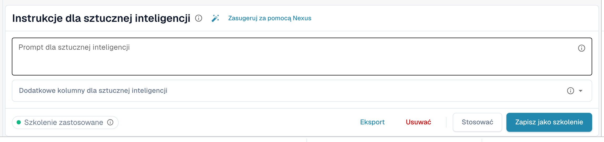
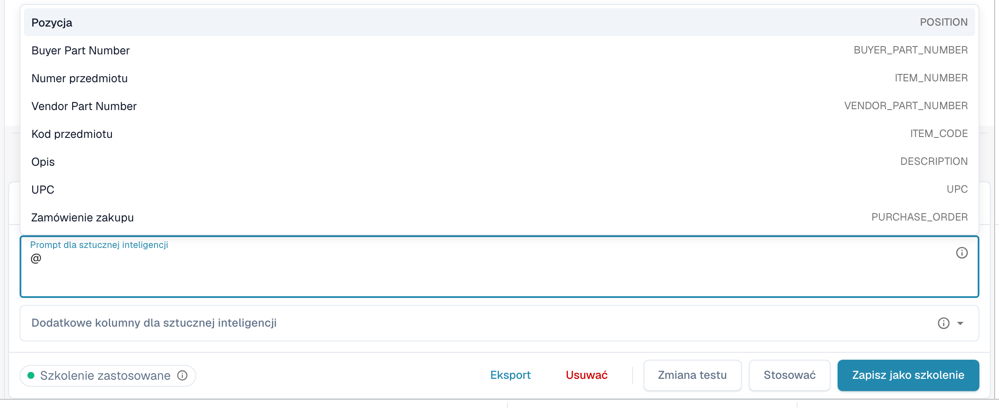
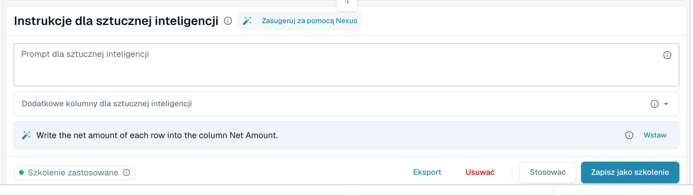
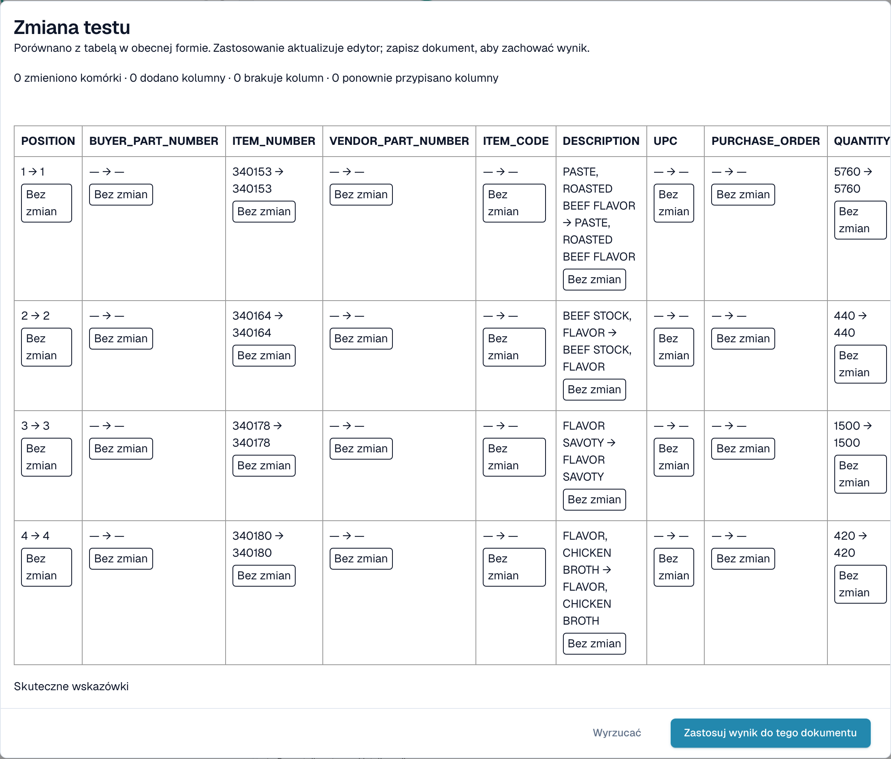

# Instrukcje AI

[AI Table](README.md) · [Structured Output dla tabel](structured-output.md)

## Podaj instrukcje dla AI

Pod tabelą karta **Instrukcje dla sztucznej inteligencji** mówi AI, co ma zrobić inaczej. Ma dwa pola i cztery przyciski, z których będziesz korzystać cały czas.

<figure><figcaption>
Karta Instrukcje dla sztucznej inteligencji.
</figcaption></figure>

* **Prompt dla sztucznej inteligencji.** Napisz po jednej instrukcji w wierszu, zwykłym językiem. Wpisz **@**, aby wstawić nazwę kolumny, dzięki czemu AI dokładnie wie, o którą kolumnę chodzi.
* **Dodatkowe kolumny dla sztucznej inteligencji.** Wybierz kolumny, które AI ma zwrócić oprócz zwykłych.
* **Status szkolenia.** Chip pokazuje **Szkolenie zastosowane**, gdy w ostatnim uruchomieniu użyto zapisanego szkolenia, albo informację, że żadne szkolenie nie zostało zastosowane.

<figure><figcaption>
Wpisz <strong>@</strong> w prompcie, aby wybrać kolumnę. Gdy tylko coś się zmieni, obok przycisku <strong>Stosować</strong> pojawia się <strong>Zmiana testu</strong>.
</figcaption></figure>


Zmieniony prompt sprawia, że AI odczytuje tabelę ponownie i może zmienić każdą kolumnę, nie tylko tę, o którą Ci chodziło. Sprawdź potem całą tabelę.


### Zasugeruj za pomocą Nexus

Nie wiesz, co napisać? Kliknij **Zasugeruj za pomocą Nexus**. DocBits analizuje ekstrakcję tego dokumentu i proponuje instrukcje lub dodatkowe kolumny. Nic nie jest stosowane, dopóki nie klikniesz **Wstaw** (dodaje wiersz do promptu) lub **Dodaj kolumnę**.

<figure><figcaption>
Sugestia z Nexus. <strong>Wstaw</strong> kopiuje ją do promptu.
</figcaption></figure>

Jeśli Twoja organizacja wyłączyła doradcę AI, DocBits informuje o tym zamiast składać sugestie.

### Test, zastosowanie, zapis: co robi każdy przycisk

| Przycisk | Co się dzieje | Zapisane dla kolejnych dokumentów? |
| --- | --- | --- |
| **Zmiana testu** | Uruchamia Twoją zmianę i pokazuje porównanie. **Nic nie jest zapisywane**, ani w dokumencie, ani jako reguła. | Nie |
| **Stosować** | Odczytuje tabelę ponownie z Twoimi zmianami i umieszcza wynik w tym dokumencie w edytorze. Staje się trwały dopiero po zapisaniu dokumentu. | Nie |
| **Zapisz jako szkolenie** (podpowiedź *Zapisz zasady*) | Zapisuje prompt, dodatkowe kolumny, mapowanie kolumn, ukryte kolumny, formaty kwot i ustawienia **Extract From** dla tego układu dostawcy. Kolejne dokumenty o tym układzie są odczytywane w ten sam sposób. | Tak |
| **Usuwać** (podpowiedź *Usuń zasady*) | Usuwa zapisane reguły tabeli tego układu dostawcy, bez dodatkowego potwierdzenia, i ponownie uruchamia AI bez nich. Usuwa także klasyczne szkolenie tabeli zapisane dla tego samego układu. | Usuwa je |
| **Eksport** | Pobiera tabelę jako plik CSV. | Nie |


Zmiany mapowania nagłówków, **Usuń kolumnę**, **Formatowanie kwoty**, **Extract From** i **Przywróć kolumnę tabeli** działają jak **Stosować**: od razu odbudowują tabelę dla tego dokumentu i są zapisywane razem z dokumentem, a nie jako reguła. Tylko **Zapisz jako szkolenie** uczy DocBits na potrzeby kolejnych dokumentów.


Jeśli dokument ma już pozycje dopasowane do zamówienia zakupu, Stosować i zapis ostrzegają, że **możesz utracić połączenia z zamówieniem**. Wybierz **Zrobione**, aby kontynuować, i dopasuj ponownie później.

<figure><figcaption>
Okno <strong>Zmiana testu</strong> porównuje nowy wynik z tabelą, którą widzisz teraz.
</figcaption></figure>

Okno **Zmiana testu** zlicza, co by się zmieniło: zmienione komórki, dodane kolumny, brakujące kolumny i ponownie przypisane kolumny. Każda komórka jest oznaczona jako **W dodatku**, **Zmieniono**, **Zaginiony**, **Ponownie przypisany** lub **Bez zmian**. Na dole okno wymienia dowody dla uruchomienia: *Skuteczne wskazówki*, *Wybrane szkolenie*, *Polityka kolumnowa* i *Użyto nadpisań żądań*. Wybierz **Zastosuj wynik do tego dokumentu**, aby go przejąć (a następnie zapisz dokument), albo **Wyrzucać**, aby go odrzucić. Jeśli po teście zmienisz prompt, wynik jest oznaczany jako nieaktualny i musisz przetestować ponownie.

Po **Zapisz jako szkolenie** DocBits informuje, że szkolenie zostanie użyte przy następnym ponownym przetwarzaniu; bieżące uruchomienie jeszcze go nie użyło. Sprawdź przy następnym dokumencie dostawcy, czy chip pokazuje **Szkolenie zastosowane**.
