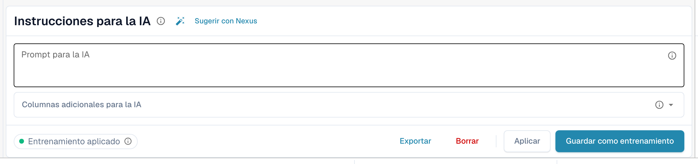
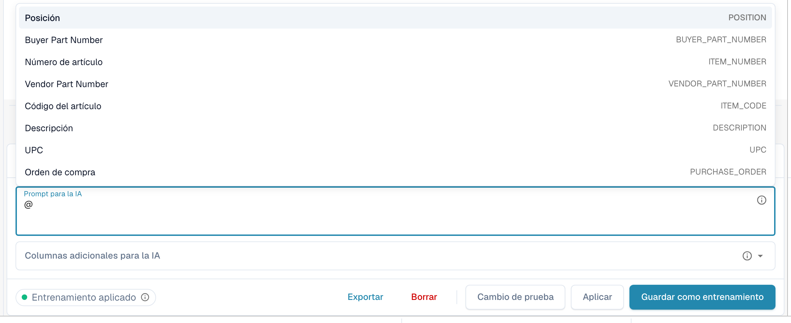
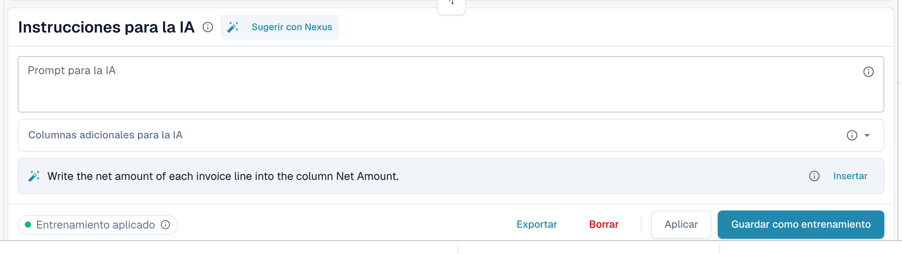
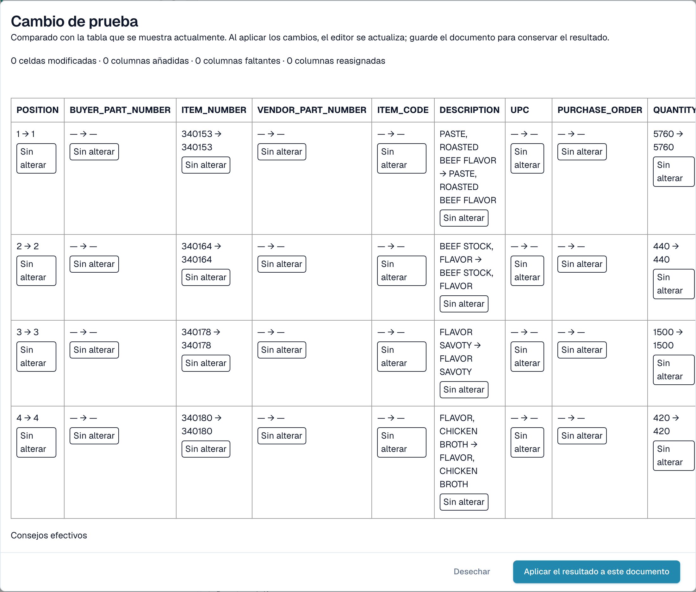

# Instrucciones de IA

[AI Table](README.md) · [Structured Output para tablas](structured-output.md)

## Dar instrucciones a la IA

Debajo de la tabla, la tarjeta **Instrucciones para la IA** indica a la IA qué debe hacer de otra manera. Tiene dos campos y varios botones que usarás constantemente.

<figure><figcaption>
La tarjeta Instrucciones para la IA.
</figcaption></figure>

* **Prompt para la IA.** Escribe una instrucción por línea, en lenguaje sencillo. Escribe **@** para insertar el nombre de una columna, de modo que la IA sepa exactamente a qué columna te refieres.
* **Columnas adicionales para la IA.** Elige las columnas que la IA debe devolver además de las habituales.
* **Estado del entrenamiento.** El chip muestra **Entrenamiento aplicado** cuando se usó un entrenamiento guardado en la última ejecución, o el estado sin entrenamiento aplicado.

<figure><figcaption>
Escribe <strong>@</strong> en el prompt para elegir una columna. En cuanto algo cambia, <strong>Cambio de prueba</strong> aparece junto a <strong>Aplicar</strong>.
</figcaption></figure>


Un prompt modificado hace que la IA lea la tabla de nuevo y puede cambiar todas las columnas, no solo la que tenías en mente. Revisa después toda la tabla.


### Sugerir con Nexus

¿No sabes qué escribir? Haz clic en **Sugerir con Nexus**. DocBits analiza la extracción de este documento y propone instrucciones o columnas adicionales. No se aplica nada hasta que hagas clic en **Insertar** (añade la línea a tu prompt) o en **Add column**.

<figure><figcaption>
Una sugerencia de Nexus. <strong>Insertar</strong> la copia en el prompt.
</figcaption></figure>

Si tu organización ha desactivado el asesor de IA, DocBits te lo indica en lugar de sugerir.

### Probar, aplicar, guardar: qué hace cada botón

| Botón | Qué ocurre | ¿Se guarda para los próximos documentos? |
| --- | --- | --- |
| **Cambio de prueba** | Ejecuta tu cambio y muestra una comparación. **No se escribe nada**, ni en el documento ni como regla. | No |
| **Aplicar** | Vuelve a leer la tabla con tus cambios y pone el resultado en este documento en el editor. Solo es permanente cuando guardas el documento. | No |
| **Guardar como entrenamiento** (tooltip *Guardar reglas*) | Almacena el prompt, las columnas adicionales, la asignación de columnas, las columnas ocultas, los formatos de importe y los ajustes de **Extract From** para este diseño de proveedor. Los siguientes documentos con este diseño se leen de la misma manera. | Sí |
| **Borrar** (tooltip *Eliminar reglas*) | Elimina las reglas de tabla guardadas de este diseño de proveedor, sin confirmación adicional, y vuelve a ejecutar la IA sin ellas. También elimina el entrenamiento de tabla clásico guardado para el mismo diseño. | Las elimina |
| **Exportar** | Descarga la tabla como archivo CSV. | No |


Las reasignaciones de encabezado, **Eliminar columna**, **Formato de cantidad**, **Extract From** y **Restaurar columna de tabla** se comportan como **Aplicar**: reconstruyen la tabla de este documento de inmediato y se guardan con el documento, no como regla. Solo **Guardar como entrenamiento** enseña a DocBits para los próximos documentos.


Si el documento ya tiene líneas emparejadas con una orden de compra, Aplicar y Guardar avisan de que **podrías perder las conexiones con la OC**. Elige **Hecho** para continuar y vuelve a emparejar después.

<figure><figcaption>
El diálogo <strong>Cambio de prueba</strong> compara el nuevo resultado con la tabla que ves ahora.
</figcaption></figure>

El diálogo **Cambio de prueba** cuenta lo que cambiaría: celdas modificadas, columnas añadidas, columnas faltantes y columnas reasignadas. Cada celda se marca como **Agregado**, **Cambió**, **Desaparecido**, **Reasignado** o **Sin alterar**. En la parte inferior, el diálogo enumera las pruebas de la ejecución: *Consejos efectivos*, *Formación seleccionada*, *Política de columnas* y *Anulaciones de solicitud utilizadas*. Elige **Aplicar el resultado a este documento** para adoptarlo (guarda después el documento) o **Desechar** para descartarlo. Si cambias el prompt después de probar, el resultado se marca como obsoleto y debes volver a probar.

Después de **Guardar como entrenamiento**, DocBits te indica que el entrenamiento se usará en el próximo reprocesamiento; la ejecución actual todavía no lo usó. Comprueba en el siguiente documento del proveedor que el chip indica **Entrenamiento aplicado**.
