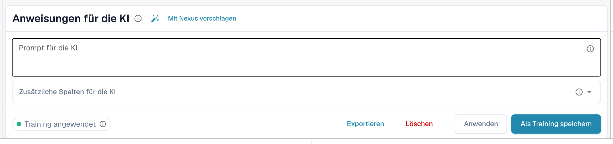
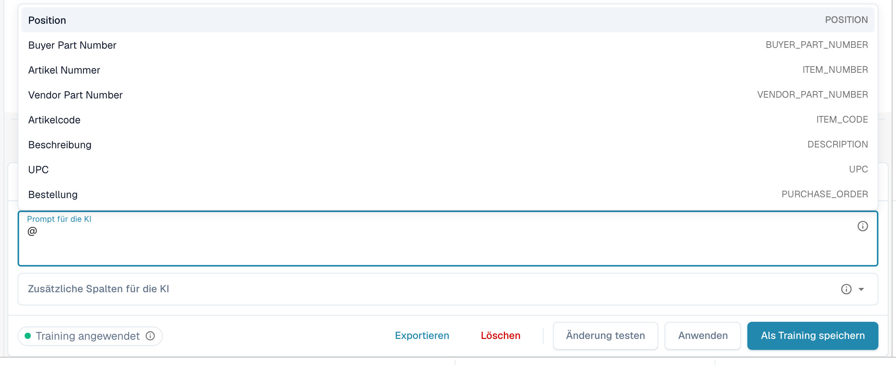
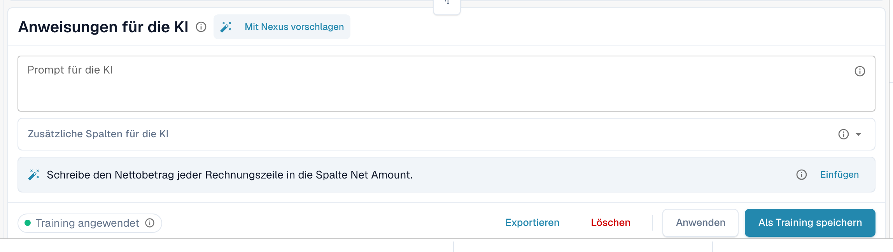
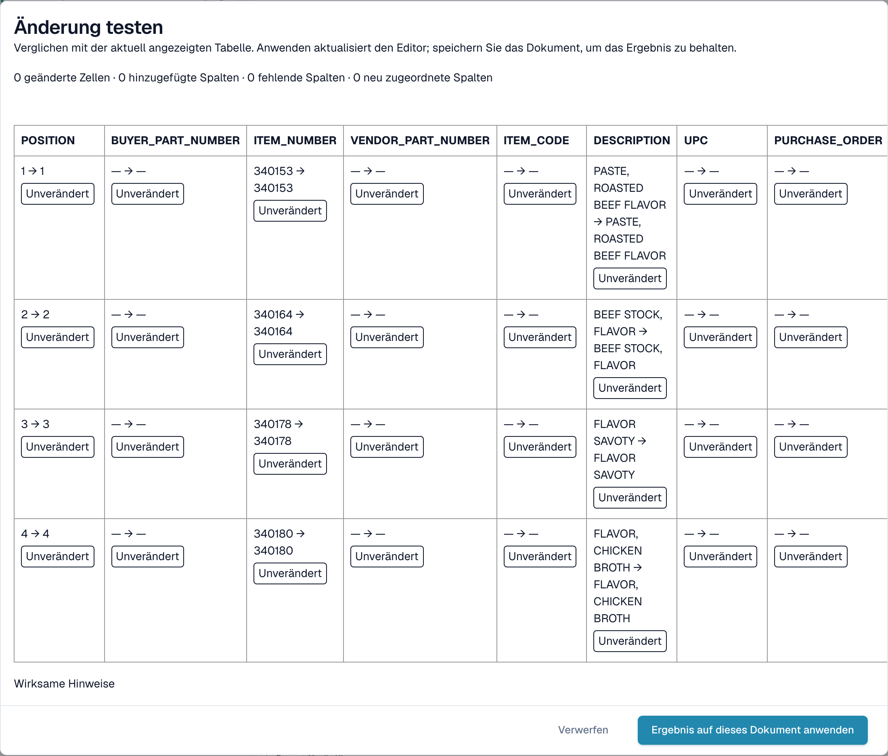

# KI-Anweisungen

[AI Table](README.md) · [Structured Output für Tabellen](structured-output.md)

## KI-Anweisungen geben

Unter der Tabelle sagt die Karte **Anweisungen für die KI**, was die KI anders machen soll. Sie hat zwei Eingabefelder und vier Schaltflächen, die Sie ständig benutzen.

<figure><figcaption>
Die Karte Anweisungen für die KI.
</figcaption></figure>

* **Prompt für die KI.** Schreiben Sie eine Anweisung pro Zeile, in einfacher Sprache. Tippen Sie **@**, um einen Spaltennamen einzufügen, damit die KI genau weiß, welche Spalte Sie meinen.
* **Zusätzliche Spalten für die KI.** Wählen Sie Spalten, die die KI zusätzlich zu den üblichen liefern muss.
* **Trainingsstatus.** Der Chip zeigt **Training angewendet**, wenn im letzten Lauf ein gespeichertes Training verwendet wurde, andernfalls **Kein Training angewendet**.

<figure><figcaption>
Tippen Sie im Prompt <strong>@</strong>, um eine Spalte zu wählen. Sobald sich etwas geändert hat, erscheint <strong>Änderung testen</strong> neben <strong>Anwenden</strong>.
</figcaption></figure>


Ein geänderter Prompt lässt die KI die Tabelle erneut lesen, und das kann jede Spalte verändern, nicht nur die, an die Sie gedacht haben. Prüfen Sie anschließend die gesamte Tabelle.


### Mit Nexus vorschlagen

Sie wissen nicht, was Sie schreiben sollen? Klicken Sie auf **Mit Nexus vorschlagen**. DocBits sieht sich die Extraktion dieses Dokuments an und schlägt Anweisungen oder zusätzliche Spalten vor. Nichts wird angewendet, bis Sie auf **Einfügen** (fügt die Zeile Ihrem Prompt hinzu) oder **Add column** klicken.

<figure><figcaption>
Ein Vorschlag von Nexus. <strong>Einfügen</strong> kopiert ihn in den Prompt.
</figcaption></figure>

Hat Ihre Organisation den KI-Berater ausgeschaltet, teilt DocBits Ihnen das mit, statt Vorschläge zu machen.

### Testen, anwenden, speichern: was jede Schaltfläche bewirkt

| Schaltfläche | Was passiert | Für die nächsten Dokumente gespeichert? |
| --- | --- | --- |
| **Änderung testen** | Führt Ihre Änderung aus und zeigt einen Vergleich. **Es wird nichts geschrieben**, weder in das Dokument noch als Regel. | Nein |
| **Anwenden** | Liest die Tabelle mit Ihren Änderungen erneut und übernimmt das Ergebnis in dieses Dokument im Editor. Dauerhaft wird es erst, wenn Sie das Dokument speichern. | Nein |
| **Als Training speichern** (Tooltip *Regeln speichern*) | Speichert Prompt, zusätzliche Spalten, Spaltenzuordnung, ausgeblendete Spalten, Betragsformate und **Extract From**-Einstellungen für dieses Lieferantenlayout. Die nächsten Dokumente dieses Layouts werden auf dieselbe Weise gelesen. | Ja |
| **Löschen** (Tooltip *Regeln löschen*) | Löscht die gespeicherten Tabellenregeln dieses Lieferantenlayouts ohne zusätzliche Bestätigung und führt die KI erneut ohne sie aus. Entfernt auch klassisches Tabellentraining, das für dasselbe Layout gespeichert wurde. | Entfernt sie |
| **Exportieren** | Lädt die Tabelle als CSV-Datei herunter. | Nein |


Überschriften-Zuordnungen, **Spalte löschen**, **Betragsformatierung**, **Extract From** und **Tabellenspalte wiederherstellen** verhalten sich wie **Anwenden**: Sie bauen die Tabelle für dieses Dokument sofort neu auf und werden mit dem Dokument gespeichert, nicht als Regel. Nur **Als Training speichern** bringt DocBits etwas für die nächsten Dokumente bei.


Hat das Dokument bereits Zeilen, die einer Bestellung zugeordnet sind, warnen Anwenden und Speichern, dass **Bestellzuordnungen verloren gehen können**. Wählen Sie **Fertig**, um fortzufahren, und gleichen Sie anschließend erneut ab.

<figure><figcaption>
Der Dialog <strong>Änderung testen</strong> vergleicht das neue Ergebnis mit der Tabelle, die Sie gerade sehen.
</figcaption></figure>

Der Dialog **Änderung testen** zählt, was sich ändern würde: geänderte Zellen, hinzugefügte Spalten, fehlende Spalten und neu zugeordnete Spalten. Jede Zelle ist als **Hinzugefügt**, **Geändert**, **Fehlend**, **Neu zugeordnet** oder **Unverändert** markiert. Unten listet der Dialog die Nachweise für den Lauf auf: *Wirksame Hinweise*, *Ausgewähltes Training*, *Spaltenrichtlinie* und *Überschreibungen aus der Anfrage verwendet*. Wählen Sie **Ergebnis auf dieses Dokument anwenden**, um es zu übernehmen (speichern Sie dann das Dokument), oder **Verwerfen**, um es zu verwerfen. Ändern Sie den Prompt nach dem Testen, gilt das Ergebnis als veraltet, und Sie müssen erneut testen.

Nach **Als Training speichern** meldet DocBits, dass das Training bei der nächsten Neuverarbeitung verwendet wird; der aktuelle Lauf hat es noch nicht verwendet. Prüfen Sie beim nächsten Dokument des Lieferanten, dass der Chip **Training angewendet** anzeigt.
