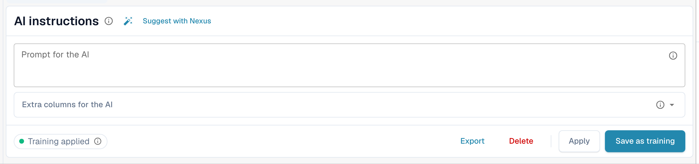
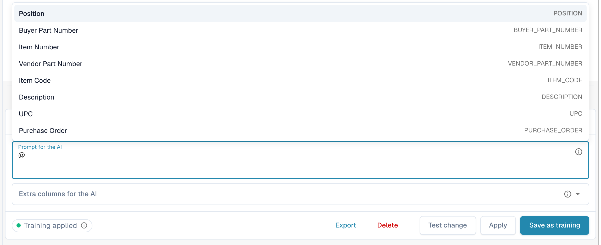
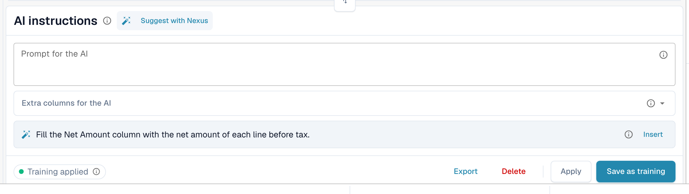
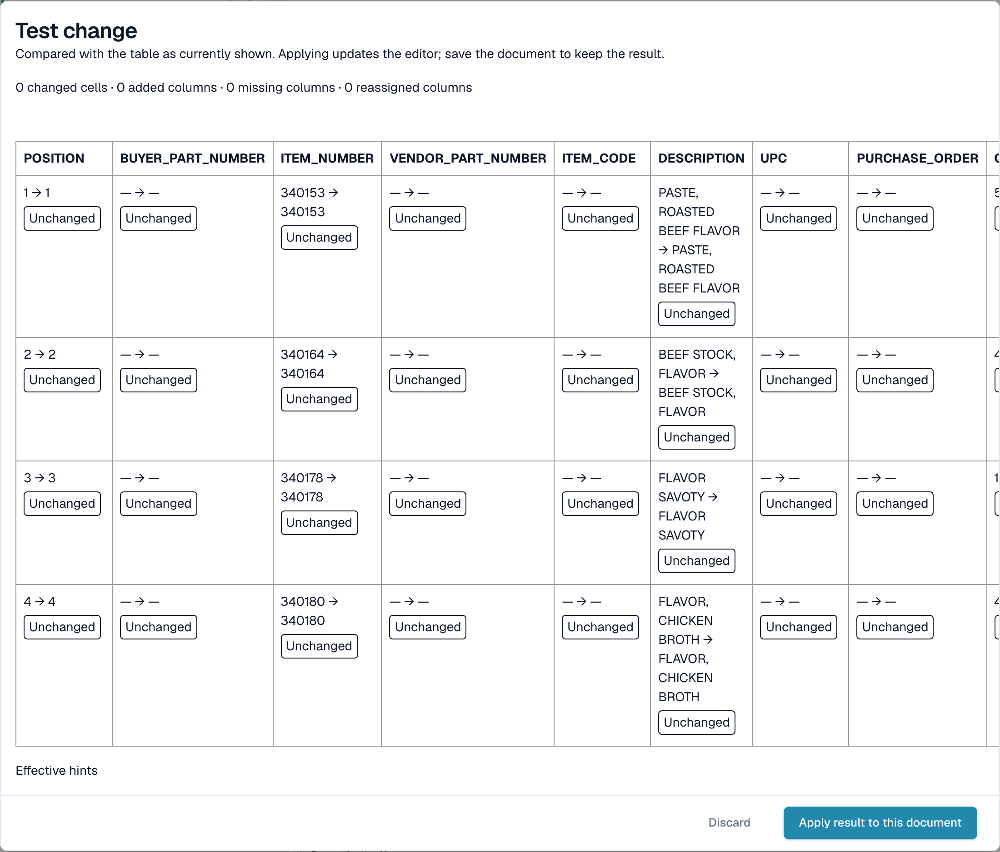

# AI instructions

[AI Table](README.md) · [Structured Output for Tables](structured-output.md)

## Give the AI instructions

Under the table the **AI instructions** card tells the AI what to do differently. It has two inputs and four buttons you will use all the time.

<figure><figcaption>
The AI instructions card.
</figcaption></figure>

* **Prompt for the AI.** Write one instruction per line, in plain language. Type **@** to insert a column name, so the AI knows exactly which column you mean.
* **Extra columns for the AI.** Pick columns the AI must return in addition to the usual ones.
* **Training status.** The chip shows **Training applied** when a saved training was used in the last run, or **No training applied**.

<figure><figcaption>
Type <strong>@</strong> in the prompt to pick a column. As soon as something changed, <strong>Test change</strong> appears next to <strong>Apply</strong>.
</figcaption></figure>


A changed prompt makes the AI read the table again, and it can change every column, not only the one you had in mind. Check the whole table afterwards.


### Suggest with Nexus

Not sure what to write? Click **Suggest with Nexus**. DocBits looks at this document's extraction and proposes instructions or extra columns. Nothing is applied until you click **Insert** (adds the line to your prompt) or **Add column**.

<figure><figcaption>
A suggestion from Nexus. <strong>Insert</strong> copies it into the prompt.
</figcaption></figure>

If your organization has switched the AI advisor off, DocBits tells you so instead of suggesting.

### Test, apply, save: what each button does

| Button                                      | What happens                                                                                                                                                                                      | Stored for the next documents? |
| ------------------------------------------- | ------------------------------------------------------------------------------------------------------------------------------------------------------------------------------------------------- | ------------------------------ |
| **Test change**                             | Runs your change and shows a comparison. **Nothing is written**, not to the document and not as a rule.                                                                                           | No                             |
| **Apply**                                   | Re-reads the table with your changes and puts the result into this document in the editor. It becomes permanent only when you save the document.                                                  | No                             |
| **Save as training** (tooltip _Save Rules_) | Stores the prompt, extra columns, column mapping, hidden columns, amount formats and **Extract From** settings for this supplier layout. The next documents of this layout are read the same way. | Yes                            |
| **Delete** (tooltip _Delete Rules_)         | Deletes the saved table rules of this supplier layout, with no extra confirmation, and runs the AI again without them. It also removes classic table training saved for the same layout.          | Removes them                   |
| **Export**                                  | Downloads the table as a CSV file.                                                                                                                                                                | No                             |


Header remaps, **Delete column**, **Amount Formatting**, **Extract From** and **Restore Table Column** behave like **Apply**: they rebuild the table for this document right away and are saved with the document, not as a rule. Only **Save as training** teaches DocBits for the next documents.


If the document already has lines matched to a purchase order, Apply and Save warn that **you may lose PO connections**. Choose **Done** to continue and match again afterwards.

<figure><figcaption>
The <strong>Test change</strong> dialog compares the new result with the table you see now.
</figcaption></figure>

The **Test change** dialog counts what would change: changed cells, added columns, missing columns and reassigned columns. Each cell is marked **Added**, **Changed**, **Missing**, **Reassigned** or **Unchanged**. At the bottom the dialog lists the evidence for the run: _Effective hints_, _Selected training_, _Column policy_ and _Request overrides used_. Choose **Apply result to this document** to take it over (then save the document), or **Discard** to throw it away. If you change the prompt after testing, the result is marked stale and you must test again.

After **Save as training** DocBits tells you the training is used on the next reprocessing; the current run did not use it yet. Check on the next document of the supplier that the chip says **Training applied**.
