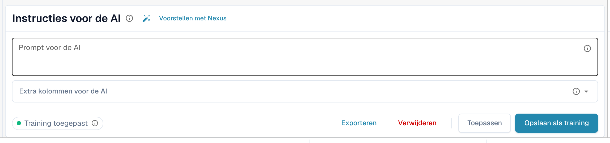
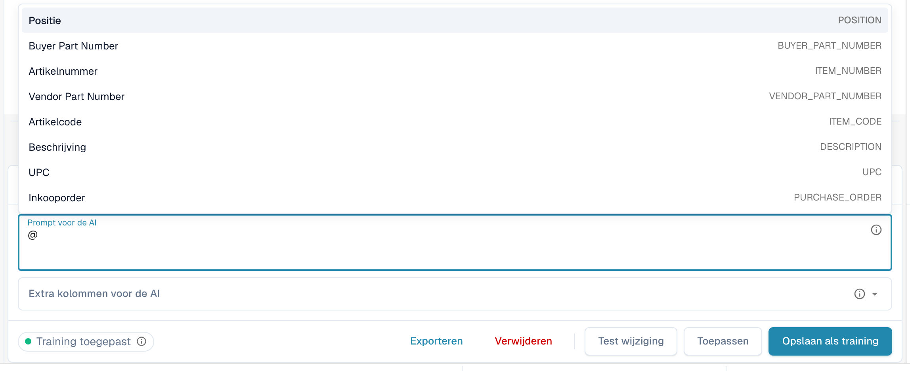
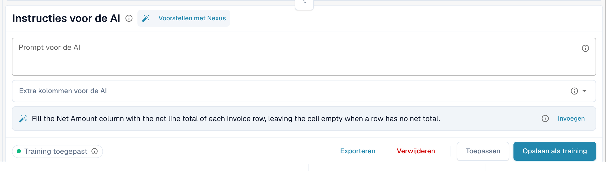
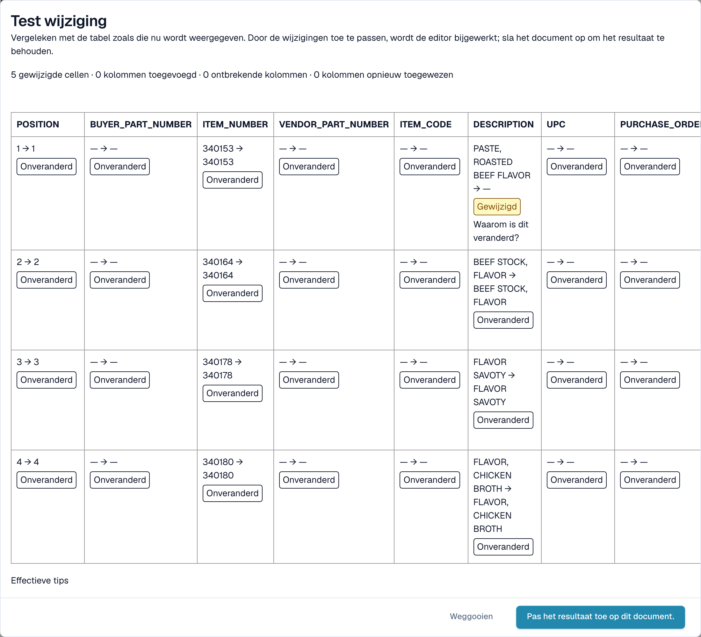

# AI-instructies

[AI Table](README.md) · [Structured Output voor tabellen](structured-output.md)

## Geef de AI instructies

Onder de tabel vertelt de kaart **Instructies voor de AI** de AI wat die anders moet doen. De kaart heeft twee invoervelden en vier knoppen die u voortdurend gebruikt.

<figure><figcaption>
De kaart Instructies voor de AI.
</figcaption></figure>

* **Prompt voor de AI.** Schrijf één instructie per regel, in gewone taal. Typ **@** om een kolomnaam in te voegen, zodat de AI precies weet welke kolom u bedoelt.
* **Extra kolommen voor de AI.** Kies kolommen die de AI naast de gebruikelijke moet teruggeven.
* **Trainingsstatus.** De chip toont **Training toegepast** wanneer bij de laatste run een opgeslagen training is gebruikt, of **Geen training toegepast**.

<figure><figcaption>
Typ <strong>@</strong> in de prompt om een kolom te kiezen. Zodra er iets is gewijzigd, verschijnt <strong>Test wijziging</strong> naast <strong>Toepassen</strong>.
</figcaption></figure>


Een gewijzigde prompt laat de AI de tabel opnieuw lezen en kan elke kolom veranderen, niet alleen de kolom die u in gedachten had. Controleer daarna de hele tabel.


### Voorstellen met Nexus

Weet u niet wat u moet schrijven? Klik op **Voorstellen met Nexus**. DocBits bekijkt de extractie van dit document en stelt instructies of extra kolommen voor. Er wordt niets toegepast totdat u op **Invoegen** klikt (voegt de regel toe aan uw prompt) of op **Add column** (kolom toevoegen).

<figure><figcaption>
Een voorstel van Nexus. <strong>Invoegen</strong> kopieert het naar de prompt.
</figcaption></figure>

Als uw organisatie de AI-adviseur heeft uitgeschakeld, meldt DocBits dat in plaats van een voorstel te doen.

### Testen, toepassen, opslaan: wat elke knop doet

| Knop | Wat er gebeurt | Opgeslagen voor volgende documenten? |
| --- | --- | --- |
| **Test wijziging** | Voert uw wijziging uit en toont een vergelijking. **Er wordt niets geschreven**, niet naar het document en niet als regel. | Nee |
| **Toepassen** | Leest de tabel opnieuw met uw wijzigingen en zet het resultaat in dit document in de editor. Het wordt pas permanent wanneer u het document opslaat. | Nee |
| **Opslaan als training** (tooltip *Regels opslaan*) | Slaat de prompt, extra kolommen, kolomkoppeling, verborgen kolommen, bedragnotaties en **Extract From**-instellingen op voor deze leveranciersindeling. De volgende documenten met deze indeling worden op dezelfde manier gelezen. | Ja |
| **Verwijderen** (tooltip *Regels verwijderen*) | Verwijdert de opgeslagen tabelregels van deze leveranciersindeling, zonder extra bevestiging, en voert de AI opnieuw uit zonder die regels. Ook klassieke tabeltraining die voor dezelfde indeling is opgeslagen, wordt verwijderd. | Verwijdert ze |
| **Exporteren** | Downloadt de tabel als CSV-bestand. | Nee |


Koptekst-herkoppelingen, **Kolom verwijderen**, **Bedrag opmaak**, **Extract From** en **Tabelkolom herstellen** gedragen zich als **Toepassen**: ze bouwen de tabel direct opnieuw op voor dit document en worden met het document opgeslagen, niet als regel. Alleen **Opslaan als training** leert DocBits iets voor de volgende documenten.


Als het document al regels heeft die aan een inkooporder zijn gekoppeld, waarschuwen Toepassen en Opslaan dat **u PO-verbindingen kunt verliezen**. Kies **Klaar** om door te gaan en koppel daarna opnieuw.

<figure><figcaption>
Het dialoogvenster <strong>Test wijziging</strong> vergelijkt het nieuwe resultaat met de tabel die u nu ziet.
</figcaption></figure>

Het dialoogvenster **Test wijziging** telt wat er zou veranderen: gewijzigde cellen, toegevoegde kolommen, ontbrekende kolommen en opnieuw toegewezen kolommen. Elke cel is gemarkeerd als **Toegevoegd**, **Gewijzigd**, **Vermist**, **Herplaatst** of **Onveranderd**. Onderaan toont het dialoogvenster het bewijs voor de run: *Effectieve tips*, *Geselecteerde training*, *Kolombeleid* en *Verzoekoverrides gebruikt*. Kies **Pas het resultaat toe op dit document.** om het over te nemen (sla daarna het document op) of **Weggooien** om het te verwerpen. Als u de prompt na het testen wijzigt, wordt het resultaat als verouderd gemarkeerd en moet u opnieuw testen.

Na **Opslaan als training** meldt DocBits dat de training bij de volgende verwerking wordt gebruikt; de huidige run heeft die nog niet gebruikt. Controleer bij het volgende document van de leverancier of de chip **Training toegepast** toont.
