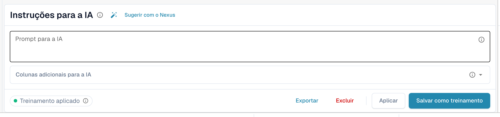
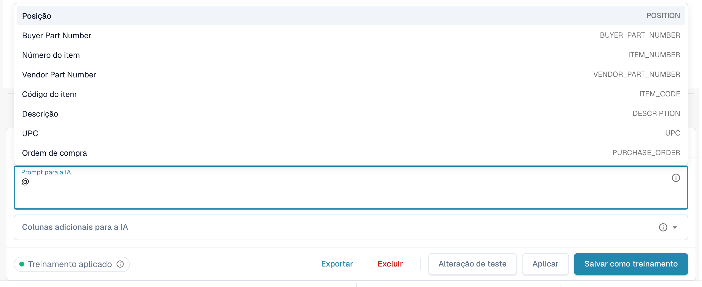
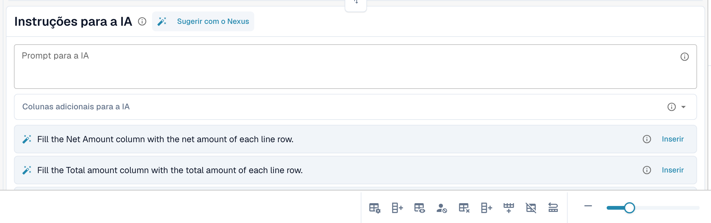
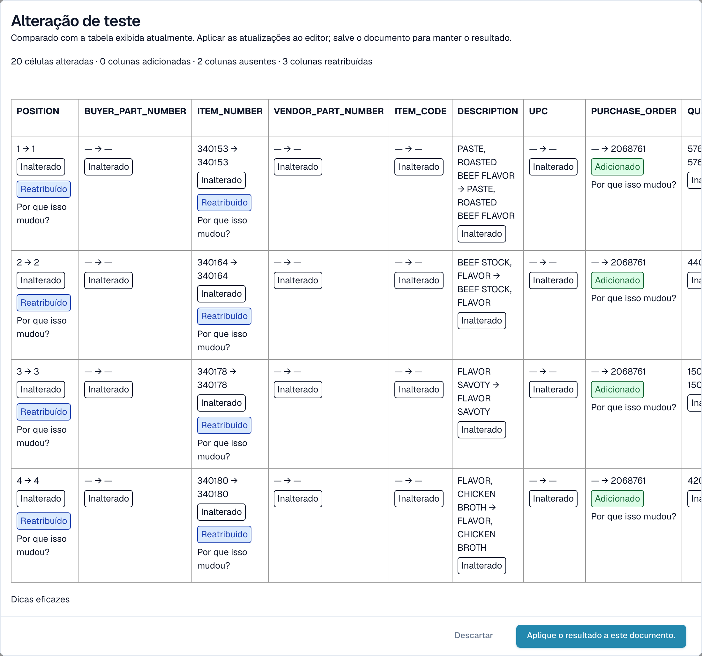

# Instruções de IA

[AI Table](README.md) · [Structured Output para tabelas](structured-output.md)

## Dar instruções à IA

Abaixo da tabela, o cartão **Instruções para a IA** diz à IA o que fazer de forma diferente. Ele tem duas entradas e quatro botões que você usará o tempo todo.

<figure><figcaption>
O cartão Instruções para a IA.
</figcaption></figure>

* **Prompt para a IA.** Escreva uma instrução por linha, em linguagem simples. Digite **@** para inserir o nome de uma coluna, para que a IA saiba exatamente a qual coluna você se refere.
* **Colunas adicionais para a IA.** Escolha colunas que a IA deve retornar além das habituais.
* **Status do treinamento.** O chip mostra **Treinamento aplicado** quando um treinamento salvo foi usado na última execução, ou **Nenhum treinamento aplicado**.

<figure><figcaption>
Digite <strong>@</strong> no prompt para escolher uma coluna. Assim que algo muda, <strong>Alteração de teste</strong> aparece ao lado de <strong>Aplicar</strong>.
</figcaption></figure>


Um prompt alterado faz a IA ler a tabela novamente, e isso pode mudar todas as colunas, não apenas a que você tinha em mente. Verifique a tabela inteira depois.


### Sugerir com o Nexus

Não sabe o que escrever? Clique em **Sugerir com o Nexus**. O DocBits analisa a extração deste documento e propõe instruções ou colunas adicionais. Nada é aplicado até você clicar em **Inserir** (adiciona a linha ao seu prompt) ou **Add column**.

<figure><figcaption>
Uma sugestão do Nexus. <strong>Inserir</strong> a copia para o prompt.
</figcaption></figure>

Se a sua organização desativou o consultor de IA, o DocBits informa isso em vez de sugerir.

### Testar, aplicar, salvar: o que cada botão faz

| Botão | O que acontece | Armazenado para os próximos documentos? |
| --- | --- | --- |
| **Alteração de teste** | Executa a sua alteração e mostra uma comparação. **Nada é gravado**, nem no documento nem como regra. | Não |
| **Aplicar** | Lê a tabela novamente com as suas alterações e coloca o resultado neste documento no editor. Ele só se torna permanente quando você salva o documento. | Não |
| **Salvar como treinamento** (dica *Salvar regras*) | Armazena o prompt, as colunas adicionais, o mapeamento de colunas, as colunas ocultas, os formatos de valores e as configurações de **Extract From** para este layout de fornecedor. Os próximos documentos desse layout são lidos da mesma forma. | Sim |
| **Excluir** (dica *Excluir regras*) | Exclui as regras de tabela salvas deste layout de fornecedor, sem confirmação adicional, e executa a IA novamente sem elas. Também remove o treinamento clássico de tabela salvo para o mesmo layout. | Remove-as |
| **Exportar** | Baixa a tabela como um arquivo CSV. | Não |


Remapeamentos de cabeçalho, **Excluir coluna**, **Formatação de Quantidade**, **Extract From** e **Restaurar coluna da tabela** se comportam como **Aplicar**: reconstroem a tabela para este documento imediatamente e são salvos com o documento, não como regra. Somente **Salvar como treinamento** ensina o DocBits para os próximos documentos.


Se o documento já tiver linhas associadas a um pedido de compra, Aplicar e Salvar avisam que **você pode ter perdido conexões de PO**. Escolha **Feito** para continuar e faça a correspondência novamente depois.

<figure><figcaption>
A caixa de diálogo <strong>Alteração de teste</strong> compara o novo resultado com a tabela que você vê agora.
</figcaption></figure>

A caixa de diálogo **Alteração de teste** conta o que mudaria: células alteradas, colunas adicionadas, colunas ausentes e colunas reatribuídas. Cada célula é marcada como **Adicionado**, **Mudado**, **Ausente**, **Reatribuído** ou **Inalterado**. Na parte inferior, a caixa de diálogo lista as evidências da execução: *Dicas eficazes*, *Treinamento selecionado*, *Política de colunas* e *Substituições de solicitações usadas*. Escolha **Aplique o resultado a este documento.** para assumi-lo (e depois salve o documento) ou **Descartar** para descartá-lo. Se você alterar o prompt depois de testar, o resultado é marcado como desatualizado e você precisa testar novamente.

Depois de **Salvar como treinamento**, o DocBits informa que o treinamento será usado no próximo reprocessamento; a execução atual ainda não o utilizou. Verifique, no próximo documento do fornecedor, se o chip indica **Treinamento aplicado**.
