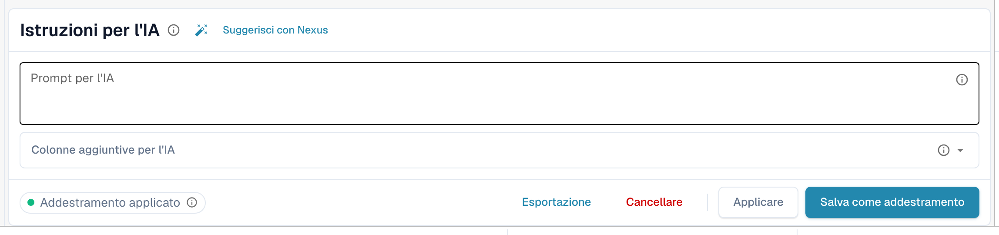
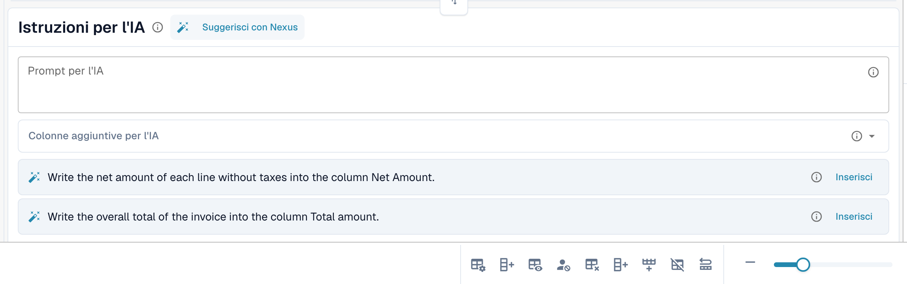
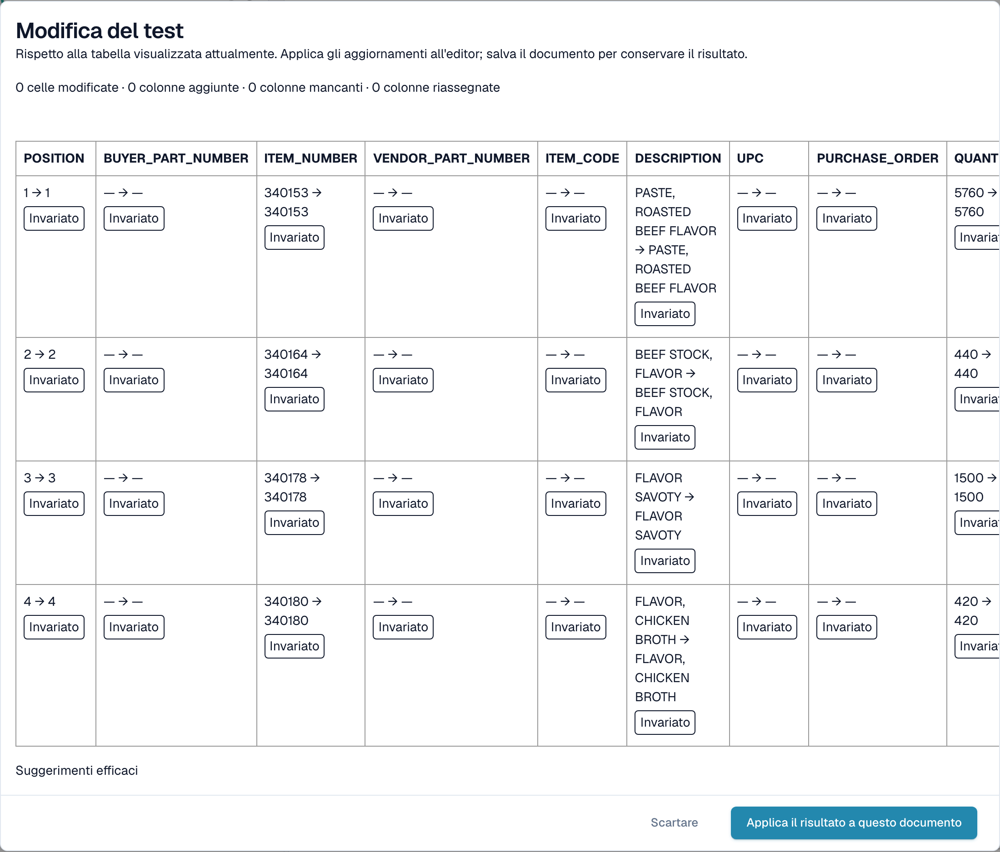

# Istruzioni AI

[AI Table](README.md) · [Structured Output per le tabelle](structured-output.md)

## Dai istruzioni all'AI

Sotto la tabella, la scheda **Istruzioni per l'IA** indica all'AI cosa fare in modo diverso. Ha due campi di input e quattro pulsanti che userai continuamente.

<figure><figcaption>
La scheda Istruzioni per l'IA.
</figcaption></figure>

* **Prompt per l'IA.** Scrivi un'istruzione per riga, in linguaggio semplice. Digita **@** per inserire il nome di una colonna, così l'AI sa esattamente a quale colonna ti riferisci.
* **Colonne aggiuntive per l'IA.** Scegli le colonne che l'AI deve restituire in aggiunta a quelle consuete.
* **Stato dell'addestramento.** Il chip mostra **Addestramento applicato** quando nell'ultima esecuzione è stato usato un addestramento salvato, oppure *Nessun addestramento selezionato*.

<figure><figcaption>
Digita <strong>@</strong> nel prompt per scegliere una colonna. Non appena qualcosa è cambiato, <strong>Modifica del test</strong> compare accanto a <strong>Applicare</strong>.
</figcaption></figure>


Un prompt modificato fa rileggere la tabella all'AI e può cambiare ogni colonna, non solo quella che avevi in mente. Controlla poi l'intera tabella.


### Suggerisci con Nexus

Non sai cosa scrivere? Fai clic su **Suggerisci con Nexus**. DocBits esamina l'estrazione di questo documento e propone istruzioni o colonne aggiuntive. Non viene applicato nulla finché non fai clic su **Inserisci** (aggiunge la riga al tuo prompt) oppure su **Aggiungi colonna**.

<figure><figcaption>
Un suggerimento di Nexus. <strong>Inserisci</strong> lo copia nel prompt.
</figcaption></figure>

Se la tua organizzazione ha disattivato il consulente AI, DocBits te lo comunica invece di fare suggerimenti.

### Testare, applicare, salvare: cosa fa ogni pulsante

| Pulsante | Cosa succede | Memorizzato per i documenti successivi? |
| --- | --- | --- |
| **Modifica del test** | Esegue la tua modifica e mostra un confronto. **Non viene scritto nulla**, né nel documento né come regola. | No |
| **Applicare** | Rilegge la tabella con le tue modifiche e inserisce il risultato in questo documento nell'editor. Diventa permanente solo quando salvi il documento. | No |
| **Salva come addestramento** (tooltip *Salva regole*) | Memorizza il prompt, le colonne aggiuntive, la mappatura delle colonne, le colonne nascoste, i formati degli importi e le impostazioni **Extract From** per questo layout del fornitore. I documenti successivi con questo layout vengono letti allo stesso modo. | Sì |
| **Cancellare** (tooltip *Elimina regole*) | Elimina le regole di tabella salvate di questo layout del fornitore, senza ulteriore conferma, ed esegue di nuovo l'AI senza di esse. Rimuove anche l'addestramento classico della tabella salvato per lo stesso layout. | Le rimuove |
| **Esportazione** | Scarica la tabella come file CSV. | No |


Le rimappature dell'intestazione, **Cancellare la colonna**, **Formattazione degli importi**, **Extract From** e **Ripristino della colonna della tabella** si comportano come **Applicare**: ricostruiscono subito la tabella per questo documento e vengono salvate con il documento, non come regola. Solo **Salva come addestramento** insegna a DocBits per i documenti successivi.


Se il documento ha già righe abbinate a un ordine di acquisto, Applicare e Salva avvisano che **potresti perdere le connessioni all'Ordine di acquisto**. Scegli **Fatto** per continuare e abbinare di nuovo in seguito.

<figure><figcaption>
La finestra <strong>Modifica del test</strong> confronta il nuovo risultato con la tabella che vedi ora.
</figcaption></figure>

La finestra **Modifica del test** conta cosa cambierebbe: celle modificate, colonne aggiunte, colonne mancanti e colonne riassegnate. Ogni cella è contrassegnata come **Aggiunto**, **Modificato**, **Mancante**, **Riassegnato** o **Invariato**. In fondo, la finestra elenca le evidenze dell'esecuzione: *Suggerimenti efficaci*, *Formazione selezionata*, *Politica della rubrica* e *Sovrascritture della richiesta utilizzate*. Scegli **Applica il risultato a questo documento** per recepirlo (poi salva il documento) oppure **Scartare** per eliminarlo. Se modifichi il prompt dopo il test, il risultato viene contrassegnato come obsoleto e devi testare di nuovo.

Dopo **Salva come addestramento** DocBits ti informa che l'addestramento verrà usato alla successiva rielaborazione; l'esecuzione corrente non lo ha ancora usato. Verifica sul documento successivo del fornitore che il chip indichi **Addestramento applicato**.
