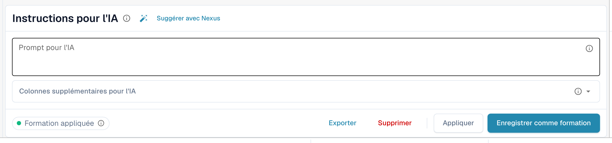
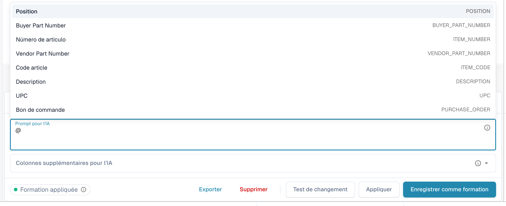
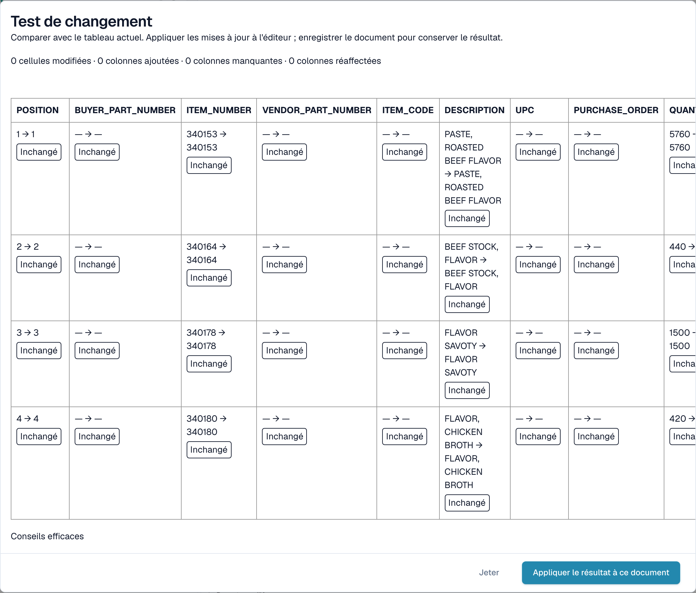

# Instructions IA

[AI Table](README.md) · [Structured Output pour les tableaux](structured-output.md)

## Donner des instructions à l'IA

Sous le tableau, la carte **Instructions pour l'IA** indique à l'IA ce qu'elle doit faire autrement. Elle comporte deux champs de saisie et quatre boutons que vous utiliserez en permanence.

<figure><figcaption>
La carte Instructions pour l'IA.
</figcaption></figure>

* **Prompt pour l'IA.** Écrivez une instruction par ligne, en langage courant. Tapez **@** pour insérer un nom de colonne, afin que l'IA sache exactement de quelle colonne vous parlez.
* **Colonnes supplémentaires pour l'IA.** Choisissez les colonnes que l'IA doit renvoyer en plus des colonnes habituelles.
* **État de la formation.** La pastille affiche **Formation appliquée** lorsqu'une formation enregistrée a été utilisée lors de la dernière exécution, ou **No training applied** dans le cas contraire.

<figure><figcaption>
Tapez <strong>@</strong> dans le prompt pour choisir une colonne. Dès que quelque chose a changé, <strong>Test de changement</strong> apparaît à côté de <strong>Appliquer</strong>.
</figcaption></figure>


Un prompt modifié oblige l'IA à relire le tableau, et elle peut modifier toutes les colonnes, pas seulement celle à laquelle vous pensiez. Vérifiez ensuite l'ensemble du tableau.


### Suggérer avec Nexus

Vous ne savez pas quoi écrire ? Cliquez sur **Suggérer avec Nexus**. DocBits examine l'extraction de ce document et propose des instructions ou des colonnes supplémentaires. Rien n'est appliqué tant que vous ne cliquez pas sur **Insérer** (ajoute la ligne à votre prompt) ou sur **Add column**.

<figure><figcaption>
Une suggestion de Nexus. <strong>Insérer</strong> la copie dans le prompt.
</figcaption></figure>

Si votre organisation a désactivé le conseiller IA, DocBits vous l'indique au lieu de faire une suggestion.

### Tester, appliquer, enregistrer : ce que fait chaque bouton

| Bouton | Ce qui se passe | Conservé pour les documents suivants ? |
| --- | --- | --- |
| **Test de changement** | Exécute votre modification et affiche une comparaison. **Rien n'est écrit**, ni dans le document ni sous forme de règle. | Non |
| **Appliquer** | Relit le tableau avec vos modifications et place le résultat dans ce document dans l'éditeur. Il ne devient définitif que lorsque vous enregistrez le document. | Non |
| **Enregistrer comme formation** (info-bulle *Enregistrer les règles*) | Enregistre le prompt, les colonnes supplémentaires, le mappage des colonnes, les colonnes masquées, les formats de montant et les réglages **Extract From** pour cette mise en page de fournisseur. Les documents suivants de cette mise en page sont lus de la même manière. | Oui |
| **Supprimer** (info-bulle *Supprimer les règles*) | Supprime les règles de tableau enregistrées pour cette mise en page de fournisseur, sans confirmation supplémentaire, et relance l'IA sans elles. Cela supprime aussi l'entraînement de tableau classique enregistré pour la même mise en page. | Les supprime |
| **Exporter** | Télécharge le tableau sous forme de fichier CSV. | Non |


Les remappages d'en-tête, **Supprimer la colonne**, **Formatage du montant**, **Extract From** et **Restaurer colonne du tableau** se comportent comme **Appliquer** : ils reconstruisent aussitôt le tableau pour ce document et sont enregistrés avec le document, pas comme règle. Seul **Enregistrer comme formation** apprend quelque chose à DocBits pour les documents suivants.


Si le document contient déjà des lignes rapprochées d'un bon de commande, Appliquer et Enregistrer avertissent que **vous risquez de perdre les connexions au bon de commande**. Choisissez **Terminé** pour continuer et refaites ensuite le rapprochement.

<figure><figcaption>
La boîte de dialogue <strong>Test de changement</strong> compare le nouveau résultat au tableau que vous voyez actuellement.
</figcaption></figure>

La boîte de dialogue **Test de changement** compte ce qui changerait : cellules modifiées, colonnes ajoutées, colonnes manquantes et colonnes réaffectées. Chaque cellule est marquée **Ajouté**, **Modifié**, **Manquant**, **Réaffecté** ou **Inchangé**. En bas, la boîte de dialogue liste les éléments de preuve de l'exécution : *Conseils efficaces*, *Formation sélectionnée*, *Politique de la colonne* et *Les substitutions de requêtes utilisées*. Choisissez **Appliquer le résultat à ce document** pour le reprendre (puis enregistrez le document), ou **Jeter** pour l'abandonner. Si vous modifiez le prompt après le test, le résultat est marqué comme périmé et vous devez tester à nouveau.

Après **Enregistrer comme formation**, DocBits indique que la formation sera utilisée lors du prochain retraitement ; l'exécution en cours ne l'a pas encore utilisée. Vérifiez sur le prochain document du fournisseur que la pastille indique **Formation appliquée**.
