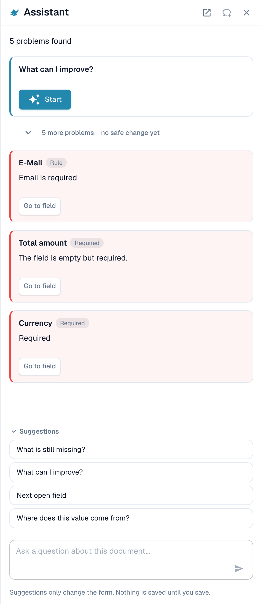
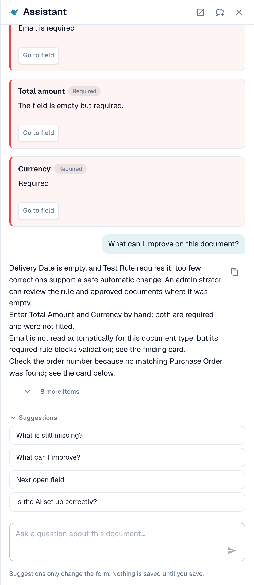
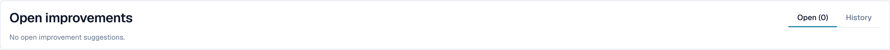

# Assistant and permissions

[AI Table](README.md) · [Structured Output for Tables](structured-output.md)

## The Assistant and the AI table

Click the **Assistant** (lamp icon next to Save on the validation screen) to ask questions about the document.

<figure><figcaption>
The Assistant lists the open problems and offers questions to ask.
</figcaption></figure>

**What the Assistant does for tables.** It can take you to a table cell, and, if you may edit the document, set a table cell value or add a table row. This works in the AI Extracted table as well as in the Extracted table. It also answers questions such as _What is still missing?_ and _What can I improve?_.

<figure><figcaption>
Ask <em>What can I improve?</em> to get a short list of what to fix next.
</figcaption></figure>

**What it does not do.** The Assistant does **not** change AI instructions, extra columns, column mapping or training. For that use the **AI instructions** card (**Suggest with Nexus**, **Test change**, **Apply**, **Save as training**). Admins can ask _Is the AI set up correctly?_ to see settings advice, for example about combining AI table reading with saved table rules.

### Suggest a rule to your admin

Many problems come from a **field**, not from the table: an email that is always required but empty, a date in the wrong format, a supplier ID that needs a lookup. For those, anyone who can open the document can send a proposal through the Assistant:

1. Ask _What can I improve?_ or open a finding card in the Assistant.
2. If you are an admin, the card offers **Apply**. If you are not, it says _An administrator can review this proposal._ and shows **Suggest improvement**. Click it.
3. DocBits shows _Your suggestion was sent to the administrators._ If someone sent the same suggestion before, your request is counted on it instead of creating a second one.
4. The card then shows **Requested**, later **Implemented** or **Declined** (with the reason, if the admin gave one).

The proposal can be a **transformation rule**, a **validation rule** or a **lookup**. You send it from the document, and the server builds the rule draft itself from the problem it found, so you do not write anything. The number of suggestions is limited to 20 per user and hour.


You cannot propose **AI table instructions, column mapping or training** this way. If a table needs a fix, correct it on the document and tell an admin, or ask your admin to **Save as training** on a document of that supplier. Admins can save rules; see [Who can do what](assistant-and-permissions.md#who-can-do-what).


**What the admin sees.** Admins are notified with a task and an email. They open **Touchless Intelligence** and find the proposal under **Open improvements** (tab _Open_, history in _History_). A click opens the drawer _Improvement suggestion_ with example documents and a preview. The admin can **Approve** or **Reject**. When approving, **Switch on right away** decides whether the new rule is active at once; without it the rule is created inactive and the admin switches it on in the rule list. Rejecting asks for a reason and an optional note for the requesters. See [Touchless Intelligence](../../../administration-and-setup/analytics-dashboard/touchless-intelligence/).

<figure><figcaption>
Admins find proposals under <strong>Open improvements</strong>.
</figcaption></figure>

## Who can do what

| Action                                                                                                            | Who                                                                                                                                                                             |
| ----------------------------------------------------------------------------------------------------------------- | ------------------------------------------------------------------------------------------------------------------------------------------------------------------------------- |
| Remap a column, **Delete column**, **Amount Formatting**, **Extract From**, **Test change**, **Apply**, edit rows | Everyone who can edit the document                                                                                                                                              |
| **Save as training**                                                                                              | Everyone who can edit, unless the organization setting **Save extraction rules (Admin only)** is on. Then only organization admins can save rules; others get an error message. |
| **Add new table column**                                                                                          | Admins                                                                                                                                                                          |
| Suggest a rule through the Assistant                                                                              | Everyone who can open the document                                                                                                                                              |
| Approve or reject a suggestion                                                                                    | Admins                                                                                                                                                                          |
| **Explain extraction**, **AI advice**                                                                             | Users whose role has access to the Analytics Dashboard module                                                                                                                   |
