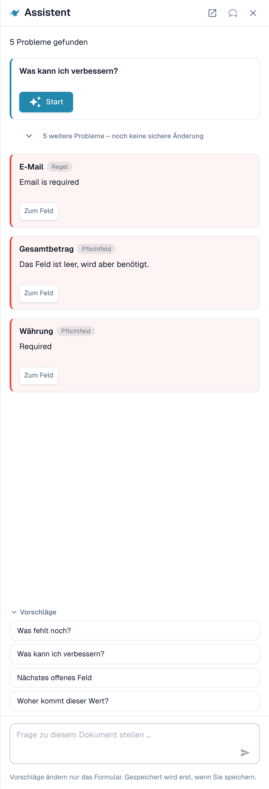
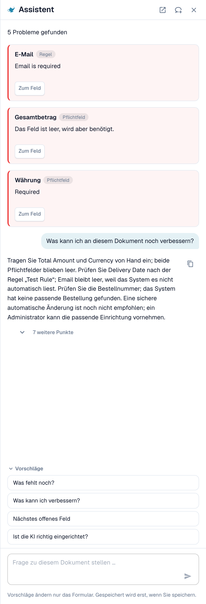
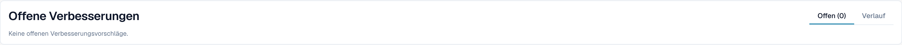

# Assistent und Berechtigungen

[AI Table](README.md) · [Structured Output für Tabellen](structured-output.md)

## Der Assistent und die KI-Tabelle

Klicken Sie auf den **Assistenten** (Lampen-Symbol neben Speichern im Validierungsbildschirm), um Fragen zum Dokument zu stellen.

<figure><figcaption>
Der Assistent listet die offenen Probleme auf und bietet Fragen an.
</figcaption></figure>

**Was der Assistent für Tabellen tut.** Er kann Sie zu einer Tabellenzelle führen und, wenn Sie das Dokument bearbeiten dürfen, einen Zellenwert setzen oder eine Tabellenzeile hinzufügen. Das funktioniert in der KI Extrahierten Tabelle ebenso wie in der Extrahierten Tabelle. Er beantwortet auch Fragen wie *Was fehlt noch?* und *Was kann ich verbessern?*.

<figure><figcaption>
Fragen Sie <em>Was kann ich verbessern?</em>, um eine kurze Liste zu erhalten, was Sie als Nächstes beheben sollten.
</figcaption></figure>

**Was er nicht tut.** Der Assistent ändert **keine** KI-Anweisungen, zusätzlichen Spalten, Spaltenzuordnung oder Trainings. Verwenden Sie dafür die Karte **Anweisungen für die KI** (**Mit Nexus vorschlagen**, **Änderung testen**, **Anwenden**, **Als Training speichern**). Administratoren können fragen *Ist die KI richtig eingerichtet?*, um Hinweise zu den Einstellungen zu sehen, zum Beispiel zur Kombination von KI-Tabellenlesung mit gespeicherten Tabellenregeln.

### Einem Administrator eine Regel vorschlagen

Viele Probleme kommen von einem **Feld**, nicht von der Tabelle: eine E-Mail, die immer erforderlich, aber leer ist, ein Datum im falschen Format, eine Lieferanten-ID, die eine Nachschlageregel braucht. Dafür kann jeder, der das Dokument öffnen kann, über den Assistenten einen Vorschlag senden:

1. Fragen Sie *Was kann ich verbessern?* oder öffnen Sie im Assistenten eine Befundkarte.
2. Sind Sie Administrator, bietet die Karte **Anwenden**. Sind Sie es nicht, weist sie darauf hin, dass ein Administrator diesen Vorschlag prüfen kann, und zeigt **Suggest improvement**. Klicken Sie darauf.
3. DocBits meldet, dass Ihr Vorschlag an die Administratoren gesendet wurde. Hat jemand denselben Vorschlag schon früher gesendet, wird Ihre Anfrage darauf mitgezählt, statt einen zweiten zu erzeugen.
4. Die Karte zeigt dann den Status „angefragt“, später „umgesetzt“ oder **Abgelehnt** (mit der Begründung, falls der Administrator eine angegeben hat).

Der Vorschlag kann eine **Transformationsregel**, eine **Validierungsregel** oder ein **Lookup** sein. Sie senden ihn aus dem Dokument, und der Server erstellt den Regelentwurf selbst aus dem gefundenen Problem, Sie müssen also nichts schreiben. Die Zahl der Vorschläge ist auf 20 pro Benutzer und Stunde begrenzt.


**KI-Tabellenanweisungen, Spaltenzuordnung oder Training** können Sie auf diesem Weg nicht vorschlagen. Braucht eine Tabelle eine Korrektur, korrigieren Sie sie im Dokument und informieren Sie einen Administrator, oder bitten Sie Ihren Administrator, bei einem Dokument dieses Lieferanten **Als Training speichern** zu wählen. Administratoren können Regeln speichern; siehe [Wer darf was](assistant-and-permissions.md#wer-darf-was).


**Was der Administrator sieht.** Administratoren werden per Aufgabe und E-Mail benachrichtigt. Sie öffnen **Touchless Intelligence** und finden den Vorschlag unter **Offene Verbesserungen** (Tab *Offen*, Verlauf unter *Verlauf*). Ein Klick öffnet ein Seitenpanel mit Beispieldokumenten und einer Vorschau. Der Administrator kann **Genehmigen** oder **Ablehnen**. Beim Genehmigen legt **Switch on right away** fest, ob die neue Regel sofort aktiv ist; ohne diese Option wird die Regel inaktiv angelegt, und der Administrator schaltet sie in der Regelliste ein. Beim Ablehnen wird nach einer Begründung und optional nach einer Notiz für die Anfragenden gefragt. Siehe [Touchless Intelligence](../../../administration-and-setup/touchless-intelligence.md).

<figure><figcaption>
Administratoren finden Vorschläge unter <strong>Offene Verbesserungen</strong>.
</figcaption></figure>

## Wer darf was

| Aktion | Wer |
| --- | --- |
| Eine Spalte neu zuordnen, **Spalte löschen**, **Betragsformatierung**, **Extract From**, **Änderung testen**, **Anwenden**, Zeilen bearbeiten | Jeder, der das Dokument bearbeiten kann |
| **Als Training speichern** | Jeder, der bearbeiten kann, es sei denn, die Organisationseinstellung **Extraktionsregeln speichern (nur für Administratoren)** ist eingeschaltet. Dann können nur Organisationsadministratoren Regeln speichern; andere erhalten eine Fehlermeldung. |
| **Neue Tabellenspalte hinzufügen** | Administratoren |
| Über den Assistenten eine Regel vorschlagen | Jeder, der das Dokument öffnen kann |
| Einen Vorschlag genehmigen oder ablehnen | Administratoren |
| **Extraktion erklären**, **KI-Empfehlung** | Benutzer, deren Rolle Zugriff auf das Modul Analytics Dashboard hat |
