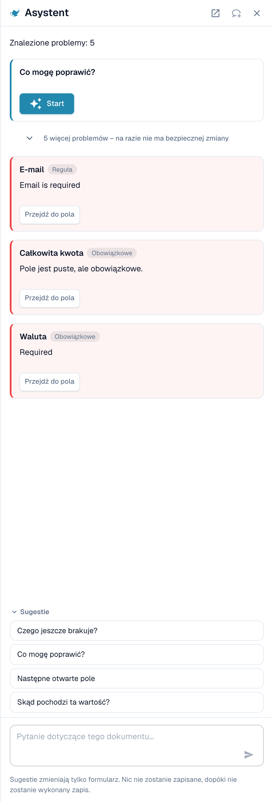
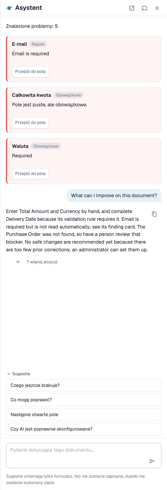
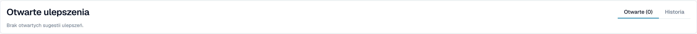

# Asystent i uprawnienia

[AI Table](README.md) · [Structured Output dla tabel](structured-output.md)

## Asystent a tabela AI

Kliknij **Asystent** (ikona lampy obok Zapisz na ekranie walidacji), aby zadawać pytania dotyczące dokumentu.

<figure><figcaption>
Asystent wylicza otwarte problemy i podpowiada pytania.
</figcaption></figure>

**Co Asystent robi dla tabel.** Może przenieść Cię do komórki tabeli, a jeśli możesz edytować dokument, ustawić wartość komórki tabeli lub dodać wiersz tabeli. Działa to zarówno w Wyodrębnionej tabeli AI, jak i w Wyodrębnionej tabeli. Odpowiada też na pytania takie jak *Czego jeszcze brakuje?* i *Co mogę poprawić?*.

<figure><figcaption>
Zapytaj <em>Co mogę poprawić?</em>, aby otrzymać krótką listę tego, co poprawić w następnej kolejności.
</figcaption></figure>

**Czego nie robi.** Asystent **nie** zmienia instrukcji AI, dodatkowych kolumn, mapowania kolumn ani szkolenia. Użyj do tego karty **Instrukcje dla sztucznej inteligencji** (**Zasugeruj za pomocą Nexus**, **Zmiana testu**, **Stosować**, **Zapisz jako szkolenie**). Administratorzy mogą zapytać *Czy AI jest poprawnie skonfigurowana?*, aby zobaczyć porady dotyczące ustawień, na przykład w sprawie łączenia odczytu tabeli przez AI z zapisanymi regułami tabeli.

### Zaproponuj regułę administratorowi

Wiele problemów wynika z **pola**, a nie z tabeli: adresu e-mail, który jest zawsze wymagany, ale pusty, daty w złym formacie, identyfikatora dostawcy, który wymaga wyszukiwania. W takich przypadkach każdy, kto może otworzyć dokument, może wysłać propozycję przez Asystenta:

1. Zapytaj *Co mogę poprawić?* lub otwórz kartę ustalenia w Asystencie.
2. Jeśli jesteś administratorem, karta oferuje **Stosować**. Jeśli nie, wyświetla *An administrator can review this proposal.* i przycisk **Suggest improvement**. Kliknij go.
3. DocBits pokazuje *Your suggestion was sent to the administrators.* Jeśli ktoś wysłał już taką samą sugestię, Twoje zgłoszenie jest doliczane do niej zamiast tworzyć drugą.
4. Karta pokazuje następnie **Requested**, później **Implemented** lub **Declined** (z uzasadnieniem, jeśli administrator je podał).

Propozycja może być **regułą transformacji**, **regułą walidacji** lub **wyszukiwaniem (lookup)**. Wysyłasz ją z dokumentu, a serwer sam buduje szkic reguły na podstawie znalezionego problemu, więc nie musisz niczego pisać. Liczba sugestii jest ograniczona do 20 na użytkownika na godzinę.


W ten sposób nie możesz zaproponować **instrukcji tabeli AI, mapowania kolumn ani szkolenia**. Jeśli tabela wymaga poprawki, popraw ją w dokumencie i poinformuj administratora albo poproś administratora o **Zapisz jako szkolenie** na dokumencie tego dostawcy. Administratorzy mogą zapisywać reguły; patrz [Kto co może](assistant-and-permissions.md#kto-co-moze).


**Co widzi administrator.** Administratorzy otrzymują powiadomienie w postaci zadania i e-maila. Otwierają **Inteligencja bezdotykowa** i znajdują propozycję w sekcji **Otwarte ulepszenia** (zakładka *Otwarte*, historia w *Historia*). Kliknięcie otwiera panel *Improvement suggestion* z przykładowymi dokumentami i podglądem. Administrator może **Approve** lub **Reject**. Przy zatwierdzaniu opcja **Switch on right away** decyduje, czy nowa reguła jest od razu aktywna; bez niej reguła jest tworzona jako nieaktywna, a administrator włącza ją na liście reguł. Odrzucenie wymaga podania powodu i opcjonalnej notatki dla zgłaszających. Zobacz [Touchless Intelligence](../../../administration-and-setup/touchless-intelligence.md).

<figure><figcaption>
Administratorzy znajdują propozycje w sekcji <strong>Otwarte ulepszenia</strong>.
</figcaption></figure>

## Kto co może

| Akcja | Kto |
| --- | --- |
| Ponowne mapowanie kolumny, **Usuń kolumnę**, **Formatowanie kwoty**, **Extract From**, **Zmiana testu**, **Stosować**, edycja wierszy | Każdy, kto może edytować dokument |
| **Zapisz jako szkolenie** | Każdy, kto może edytować, chyba że włączone jest ustawienie organizacji **Zapisz zasady ekstrakcji (tylko administrator)**. Wtedy reguły mogą zapisywać tylko administratorzy organizacji; pozostali otrzymują komunikat o błędzie. |
| **Dodaj nową kolumnę tabeli** | Administratorzy |
| Zaproponowanie reguły przez Asystenta | Każdy, kto może otworzyć dokument |
| Zatwierdzenie lub odrzucenie sugestii | Administratorzy |
| **Wyjaśnij ekstrakcję**, **Porady dotyczące sztucznej inteligencji** | Użytkownicy, których rola ma dostęp do modułu Panel analityczny |
