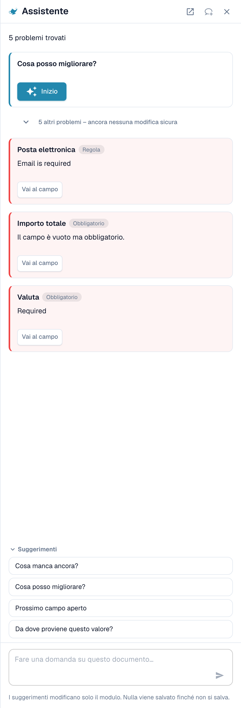
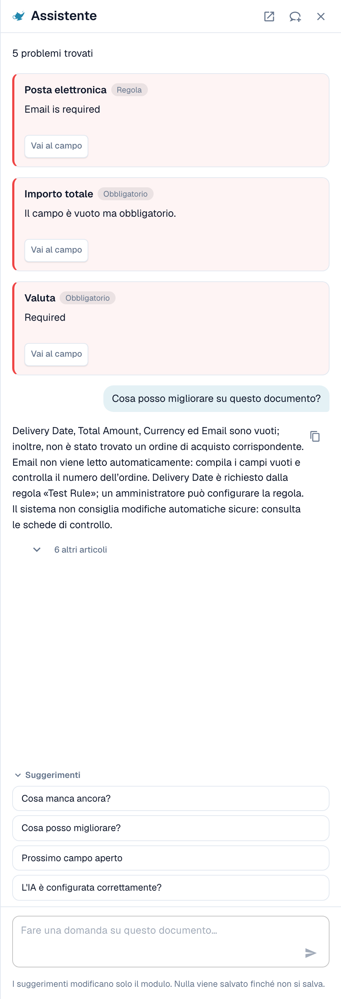
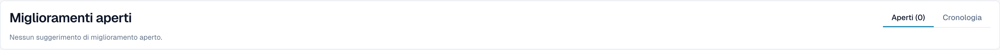

# Assistente e permessi

[AI Table](README.md) · [Structured Output per le tabelle](structured-output.md)

## L'Assistente e la tabella AI

Fai clic su **Assistente** (icona della lampadina accanto a **Salva** nella schermata di validazione) per porre domande sul documento.

<figure><figcaption>
L'Assistente elenca i problemi aperti e propone domande da porre.
</figcaption></figure>

**Cosa fa l'Assistente per le tabelle.** Può portarti a una cella della tabella e, se puoi modificare il documento, impostare il valore di una cella o aggiungere una riga di tabella. Funziona sia nella AI Tabella estratta sia nella Tabella estratta. Risponde inoltre a domande come *Cosa manca ancora?* e *Cosa posso migliorare?*.

<figure><figcaption>
Chiedi <em>Cosa posso migliorare?</em> per ottenere un breve elenco di ciò che correggere come passo successivo.
</figcaption></figure>

**Cosa non fa.** L'Assistente **non** modifica le istruzioni per l'AI, le colonne aggiuntive, la mappatura delle colonne né l'addestramento. Per questo usa la scheda **Istruzioni per l'IA** (**Suggerisci con Nexus**, **Modifica del test**, **Applicare**, **Salva come addestramento**). Gli amministratori possono chiedere *L'IA è configurata correttamente?* per vedere consigli sulle impostazioni, ad esempio sulla combinazione tra la lettura della tabella AI e le regole di tabella salvate.

### Suggerire una regola al tuo amministratore

Molti problemi derivano da un **campo**, non dalla tabella: un'e-mail sempre obbligatoria ma vuota, una data nel formato sbagliato, un ID fornitore che richiede una ricerca. In questi casi chiunque possa aprire il documento può inviare una proposta tramite l'Assistente:

1. Chiedi *Cosa posso migliorare?* oppure apri una scheda di segnalazione nell'Assistente.
2. Se sei un amministratore, la scheda offre **Applica**. Se non lo sei, indica *An administrator can review this proposal.* e mostra **Suggest improvement**. Fai clic su di esso.
3. DocBits mostra *Your suggestion was sent to the administrators.* Se qualcuno ha già inviato lo stesso suggerimento, la tua richiesta viene conteggiata su quello anziché crearne un secondo.
4. La scheda mostra quindi **Requested**, poi **Implemented** oppure **Declined** (con il motivo, se l'amministratore lo ha indicato).

La proposta può essere una **regola di trasformazione**, una **regola di validazione** o una **ricerca (lookup)**. La invii dal documento e il server costruisce da solo la bozza della regola a partire dal problema rilevato, quindi non devi scrivere nulla. Il numero di suggerimenti è limitato a 20 per utente e per ora.


In questo modo non puoi proporre **istruzioni per la tabella AI, mappatura delle colonne o addestramento**. Se una tabella richiede una correzione, correggila nel documento e informa un amministratore, oppure chiedi al tuo amministratore di usare **Salva come addestramento** su un documento di quel fornitore. Gli amministratori possono salvare le regole; vedi [Chi può fare cosa](assistant-and-permissions.md#chi-puo-fare-cosa).


**Cosa vede l'amministratore.** Gli amministratori ricevono una notifica con un task e un'e-mail. Aprono **Touchless Intelligence** e trovano la proposta sotto **Miglioramenti aperti** (scheda *Aperti*, cronologia in *Cronologia*). Un clic apre il pannello *Improvement suggestion* con documenti di esempio e un'anteprima. L'amministratore può **Approve** o **Reject**. Con l'approvazione, **Switch on right away** decide se la nuova regola è attiva subito; senza di esso la regola viene creata inattiva e l'amministratore la attiva nell'elenco delle regole. Il rifiuto richiede un motivo e una nota facoltativa per i richiedenti. Vedi [Touchless Intelligence](../../../administration-and-setup/touchless-intelligence.md).

<figure><figcaption>
Gli amministratori trovano le proposte sotto <strong>Miglioramenti aperti</strong>.
</figcaption></figure>

## Chi può fare cosa

| Azione | Chi |
| --- | --- |
| Rimappare una colonna, **Cancellare la colonna**, **Formattazione degli importi**, **Extract From**, **Modifica del test**, **Applicare**, modificare le righe | Tutti coloro che possono modificare il documento |
| **Salva come addestramento** | Tutti coloro che possono modificare, a meno che sia attiva l'impostazione dell'organizzazione **Salva le regole di estrazione (solo amministratore)**. In tal caso solo gli amministratori dell'organizzazione possono salvare le regole; gli altri ricevono un messaggio di errore. |
| **Aggiungere una nuova colonna alla tabella** | Amministratori |
| Suggerire una regola tramite l'Assistente | Tutti coloro che possono aprire il documento |
| Approvare o rifiutare un suggerimento | Amministratori |
| **Spiegazione dell'estrazione**, **Consigli basati sull'IA** | Utenti il cui ruolo ha accesso al modulo Dashboard di analisi |
