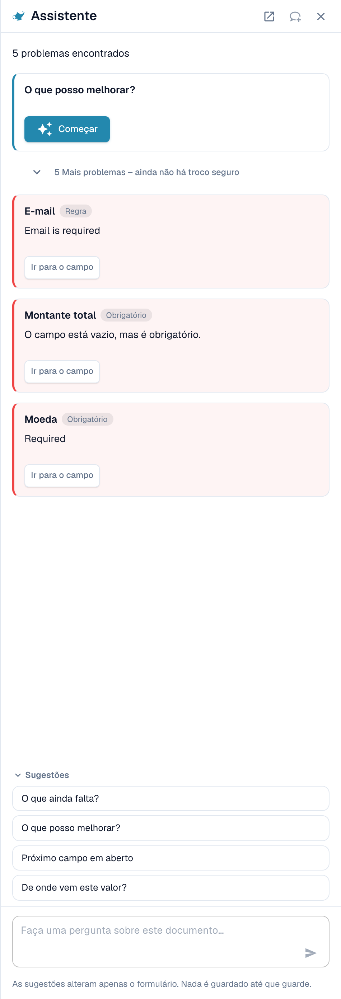
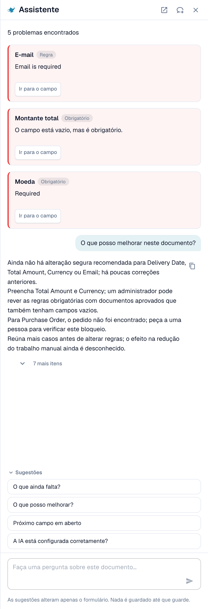
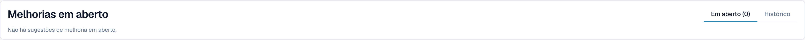

# Assistente e permissões

[AI Table](README.md) · [Structured Output para tabelas](structured-output.md)

## O Assistente e a tabela de IA

Clique no **Assistente** (ícone de lâmpada ao lado de Salvar na tela de validação) para fazer perguntas sobre o documento.

<figure><figcaption>
O Assistente lista os problemas em aberto e oferece perguntas para fazer.
</figcaption></figure>

**O que o Assistente faz com tabelas.** Ele pode levar você a uma célula da tabela e, se você puder editar o documento, definir o valor de uma célula ou adicionar uma linha à tabela. Isso funciona tanto na Tabela extraída de IA quanto na Tabela extraída. Ele também responde a perguntas como *O que ainda falta?* e *O que posso melhorar?*.

<figure><figcaption>
Pergunte <em>O que posso melhorar?</em> para obter uma lista curta do que corrigir em seguida.
</figcaption></figure>

**O que ele não faz.** O Assistente **não** altera instruções de IA, colunas adicionais, mapeamento de colunas nem treinamento. Para isso, use o cartão **Instruções para a IA** (**Sugerir com o Nexus**, **Alteração de teste**, **Aplicar**, **Salvar como treinamento**). Os administradores podem perguntar *A IA está configurada corretamente?* para ver conselhos de configuração, por exemplo, sobre combinar a leitura de tabela por IA com regras de tabela salvas.

### Sugerir uma regra ao seu administrador

Muitos problemas vêm de um **campo**, não da tabela: um e-mail sempre obrigatório mas vazio, uma data no formato errado, um ID de fornecedor que precisa de uma consulta. Para esses casos, qualquer pessoa que possa abrir o documento pode enviar uma proposta pelo Assistente:

1. Pergunte *O que posso melhorar?* ou abra um cartão de constatação no Assistente.
2. Se você for administrador, o cartão oferece **Aplicar**. Se não for, ele diz *An administrator can review this proposal.* e mostra **Suggest improvement**. Clique nele.
3. O DocBits mostra *Your suggestion was sent to the administrators.* Se alguém já tiver enviado a mesma sugestão, o seu pedido é contado nela, em vez de criar uma segunda.
4. O cartão passa então a mostrar **Requested** e, depois, **Implemented** ou **Declined** (com o motivo, se o administrador o tiver informado).

A proposta pode ser uma **regra de transformação**, uma **regra de validação** ou uma **consulta**. Você a envia a partir do documento, e o servidor monta o rascunho da regra a partir do problema encontrado, então você não precisa escrever nada. O número de sugestões é limitado a 20 por usuário e por hora.


Você não pode propor **instruções de tabela de IA, mapeamento de colunas ou treinamento** dessa forma. Se uma tabela precisar de correção, corrija-a no documento e avise um administrador, ou peça ao seu administrador para usar **Salvar como treinamento** em um documento desse fornecedor. Os administradores podem salvar regras; veja [Quem pode fazer o quê](assistant-and-permissions.md#quem-pode-fazer-o-que).


**O que o administrador vê.** Os administradores são notificados com uma tarefa e um e-mail. Eles abrem **Inteligência sem contato** e encontram a proposta em **Melhorias em aberto** (aba *Em aberto*, histórico em *Histórico*). Um clique abre o painel *Improvement suggestion* com documentos de exemplo e uma pré-visualização. O administrador pode **Aprovar** ou **Rejeitar**. Ao aprovar, **Switch on right away** decide se a nova regra fica ativa imediatamente; sem isso, a regra é criada inativa e o administrador a ativa na lista de regras. Ao rejeitar, é pedido um motivo e uma observação opcional para os solicitantes. Veja [Touchless Intelligence](../../../administration-and-setup/touchless-intelligence.md).

<figure><figcaption>
Os administradores encontram as propostas em <strong>Melhorias em aberto</strong>.
</figcaption></figure>

## Quem pode fazer o quê

| Ação | Quem |
| --- | --- |
| Remapear uma coluna, **Excluir coluna**, **Formatação de Quantidade**, **Extract From**, **Alteração de teste**, **Aplicar**, editar linhas | Todos que podem editar o documento |
| **Salvar como treinamento** | Todos que podem editar, a menos que a configuração da organização **Salvar regras de extração (somente administrador)** esteja ativada. Nesse caso, somente os administradores da organização podem salvar regras; os demais recebem uma mensagem de erro. |
| **Adicionar nova coluna de tabela** | Administradores |
| Sugerir uma regra pelo Assistente | Todos que podem abrir o documento |
| Aprovar ou rejeitar uma sugestão | Administradores |
| **Explique a extração.**, **conselhos de IA** | Usuários cuja função tem acesso ao módulo Painel de Análise |
