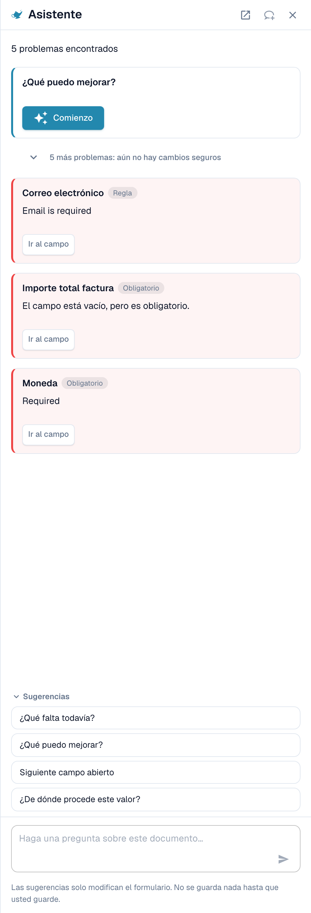
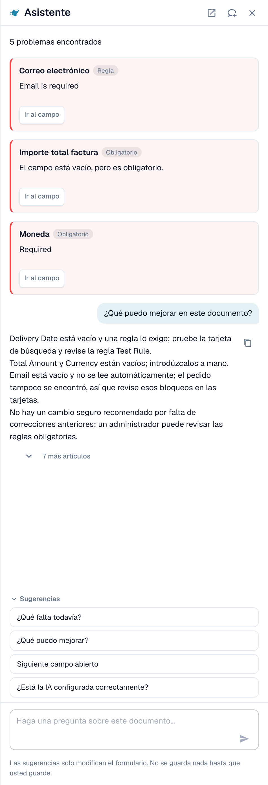
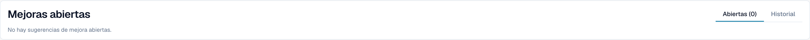

# Asistente y permisos

[AI Table](README.md) · [Structured Output para tablas](structured-output.md)

## El Asistente y la tabla AI

Haz clic en el **Asistente** (icono de bombilla junto a Guardar en la pantalla de validación) para hacer preguntas sobre el documento.

<figure><figcaption>
El Asistente enumera los problemas abiertos y ofrece preguntas que hacer.
</figcaption></figure>

**Qué hace el Asistente con las tablas.** Puede llevarte a una celda de la tabla y, si puedes editar el documento, establecer el valor de una celda o añadir una fila de tabla. Funciona tanto en la Tabla AI extraída como en la Tabla extraída. También responde a preguntas como *¿Qué falta todavía?* y *¿Qué puedo mejorar?*.

<figure><figcaption>
Pregunta <em>¿Qué puedo mejorar?</em> para obtener una lista breve de lo que corregir a continuación.
</figcaption></figure>

**Qué no hace.** El Asistente **no** cambia instrucciones de IA, columnas adicionales, asignación de columnas ni entrenamiento. Para eso usa la tarjeta **Instrucciones para la IA** (**Sugerir con Nexus**, **Cambio de prueba**, **Aplicar**, **Guardar como entrenamiento**). Los administradores pueden preguntar *¿Está la IA configurada correctamente?* para ver consejos de configuración, por ejemplo sobre combinar la lectura de tablas por IA con reglas de tabla guardadas.

### Sugerir una regla a tu administrador

Muchos problemas proceden de un **campo**, no de la tabla: un correo electrónico siempre obligatorio pero vacío, una fecha con formato incorrecto, un ID de proveedor que necesita una búsqueda. Para estos casos, cualquier persona que pueda abrir el documento puede enviar una propuesta a través del Asistente:

1. Pregunta *¿Qué puedo mejorar?* o abre una tarjeta de hallazgo en el Asistente.
2. Si eres administrador, la tarjeta ofrece **Aplicar**. Si no lo eres, indica *An administrator can review this proposal.* y muestra **Suggest improvement**. Haz clic en él.
3. DocBits muestra una confirmación de que tu sugerencia se envió a los administradores. Si alguien envió antes la misma sugerencia, tu solicitud se suma a ella en lugar de crear una segunda.
4. La tarjeta muestra entonces **Requested** y, más tarde, **Implemented** o **Declined** (con el motivo, si el administrador lo indicó).

La propuesta puede ser una **regla de transformación**, una **regla de validación** o una **búsqueda (lookup)**. La envías desde el documento y el servidor genera por sí mismo el borrador de la regla a partir del problema detectado, así que no tienes que escribir nada. El número de sugerencias está limitado a 20 por usuario y hora.


De esta manera no puedes proponer **instrucciones de tabla AI, asignación de columnas ni entrenamiento**. Si una tabla necesita una corrección, corrígela en el documento y avisa a un administrador, o pide a tu administrador que use **Guardar como entrenamiento** en un documento de ese proveedor. Los administradores pueden guardar reglas; consulta [Quién puede hacer qué](assistant-and-permissions.md#quien-puede-hacer-que).


**Lo que ve el administrador.** Los administradores reciben una notificación con una tarea y un correo electrónico. Abren **Touchless Intelligence** y encuentran la propuesta en **Mejoras abiertas** (pestaña *Abiertas*, historial en *Historial*). Al hacer clic se abre el panel *Improvement suggestion* con documentos de ejemplo y una vista previa. El administrador puede **Aprobar** o **Rechazar**. Al aprobar, **Switch on right away** decide si la nueva regla se activa de inmediato; sin esta opción, la regla se crea inactiva y el administrador la activa en la lista de reglas. Al rechazar se pide un motivo y una nota opcional para quienes la solicitaron. Consulta [Touchless Intelligence](../../../administration-and-setup/touchless-intelligence.md).

<figure><figcaption>
Los administradores encuentran las propuestas en <strong>Mejoras abiertas</strong>.
</figcaption></figure>

## Quién puede hacer qué

| Acción | Quién |
| --- | --- |
| Reasignar una columna, **Eliminar columna**, **Formato de cantidad**, **Extract From**, **Cambio de prueba**, **Aplicar**, editar filas | Cualquiera que pueda editar el documento |
| **Guardar como entrenamiento** | Cualquiera que pueda editar, salvo que esté activado el ajuste de organización **Guardar reglas de extracción (solo para administradores)**. En ese caso solo los administradores de la organización pueden guardar reglas; los demás reciben un mensaje de error. |
| **Agregar nueva columna de tabla** | Administradores |
| Sugerir una regla a través del Asistente | Cualquiera que pueda abrir el documento |
| Aprobar o rechazar una sugerencia | Administradores |
| **Explicar la extracción**, **asesoramiento de IA** | Usuarios cuyo rol tiene acceso al módulo Panel de análisis |
