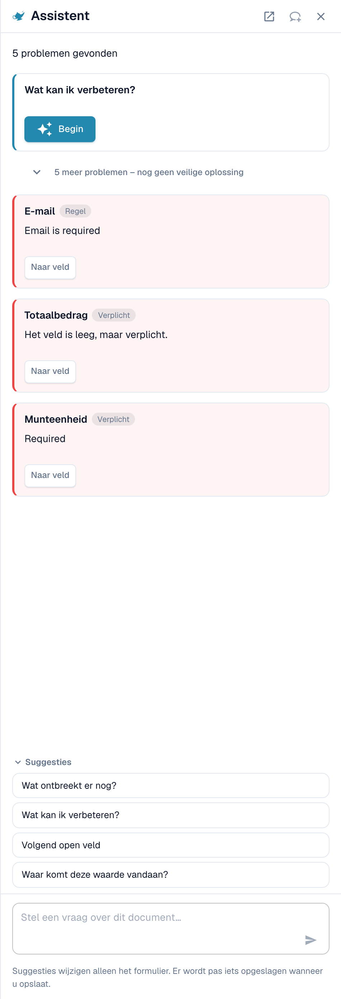
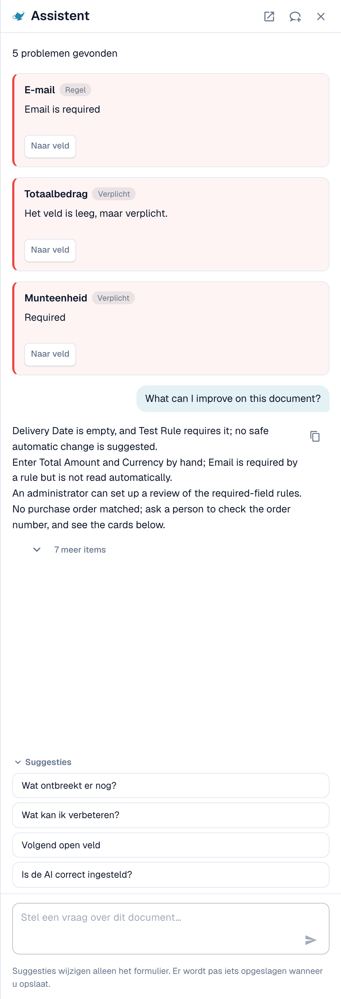
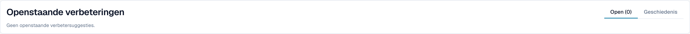

# Assistent en rechten

[AI Table](README.md) · [Structured Output voor tabellen](structured-output.md)

## De Assistent en de AI-tabel

Klik op de **Assistent** (lampje naast Opslaan op het validatiescherm) om vragen over het document te stellen.

<figure><figcaption>
De Assistent toont de openstaande problemen en biedt vragen aan.
</figcaption></figure>

**Wat de Assistent voor tabellen doet.** Hij kan u naar een tabelcel brengen en, als u het document mag bewerken, een tabelcelwaarde instellen of een tabelrij toevoegen. Dit werkt zowel in de AI-geëxtraheerde tabel als in de Geëxtraheerde tabel. Hij beantwoordt ook vragen als *Wat ontbreekt er nog?* en *Wat kan ik verbeteren?*.

<figure><figcaption>
Vraag <em>Wat kan ik verbeteren?</em> voor een korte lijst met wat u hierna kunt herstellen.
</figcaption></figure>

**Wat hij niet doet.** De Assistent wijzigt **geen** AI-instructies, extra kolommen, kolomkoppeling of training. Gebruik daarvoor de kaart **Instructies voor de AI** (**Voorstellen met Nexus**, **Test wijziging**, **Toepassen**, **Opslaan als training**). Beheerders kunnen *Is de AI correct ingesteld?* vragen om advies over instellingen te zien, bijvoorbeeld over het combineren van AI-tabellezing met opgeslagen tabelregels.

### Een regel voorstellen aan uw beheerder

Veel problemen komen van een **veld**, niet van de tabel: een e-mailadres dat altijd verplicht is maar leeg blijft, een datum in het verkeerde formaat, een leveranciers-ID dat een lookup nodig heeft. Daarvoor kan iedereen die het document kan openen via de Assistent een voorstel indienen:

1. Vraag *Wat kan ik verbeteren?* of open een bevindingenkaart in de Assistent.
2. Als u beheerder bent, biedt de kaart **Toepassen**. Zo niet, dan staat er *Een beheerder kan dit voorstel beoordelen.* met de knop **Verbetering voorstellen**. Klik erop.
3. DocBits toont *Uw suggestie is naar de beheerders verzonden.* Als iemand eerder dezelfde suggestie heeft gedaan, wordt uw verzoek daarbij geteld in plaats van een tweede aan te maken.
4. De kaart toont daarna **Aangevraagd**, later **Geïmplementeerd** of **Afgewezen** (met de reden, als de beheerder die heeft opgegeven).

Het voorstel kan een **transformatieregel**, een **validatieregel** of een **lookup** zijn. U verstuurt het vanuit het document en de server bouwt het regelconcept zelf op uit het probleem dat is gevonden, dus u hoeft niets te schrijven. Het aantal suggesties is beperkt tot 20 per gebruiker en uur.


**AI-tabelinstructies, kolomkoppeling of training** kunt u op deze manier niet voorstellen. Als een tabel moet worden hersteld, corrigeer het dan in het document en breng een beheerder op de hoogte, of vraag uw beheerder om **Opslaan als training** uit te voeren op een document van die leverancier. Beheerders kunnen regels opslaan; zie [Wie kan wat doen](assistant-and-permissions.md#wie-kan-wat-doen).


**Wat de beheerder ziet.** Beheerders worden met een taak en een e-mail op de hoogte gebracht. Ze openen **Touchless Intelligence** en vinden het voorstel onder **Openstaande verbeteringen** (tabblad *Open*, geschiedenis onder *Geschiedenis*). Een klik opent de zijbalk *Verbetersuggestie* met voorbeelddocumenten en een voorbeeldweergave. De beheerder kan **Goedkeuren** of **Afwijzen**. Bij goedkeuren bepaalt **Direct inschakelen** of de nieuwe regel meteen actief is; zonder deze optie wordt de regel inactief aangemaakt en schakelt de beheerder deze in de regellijst in. Bij afwijzen wordt om een reden en een optionele notitie voor de aanvragers gevraagd. Zie [Touchless Intelligence](../../../administration-and-setup/touchless-intelligence.md).

<figure><figcaption>
Beheerders vinden voorstellen onder <strong>Openstaande verbeteringen</strong>.
</figcaption></figure>

## Wie kan wat doen

| Actie | Wie |
| --- | --- |
| Een kolom herkoppelen, **Kolom verwijderen**, **Bedrag opmaak**, **Extract From**, **Test wijziging**, **Toepassen**, rijen bewerken | Iedereen die het document kan bewerken |
| **Opslaan als training** | Iedereen die kan bewerken, tenzij de organisatie-instelling **Extractieregels opslaan (alleen beheerders)** aanstaat. Dan kunnen alleen organisatiebeheerders regels opslaan; anderen krijgen een foutmelding. |
| **Nieuwe tabelkolom toevoegen** | Beheerders |
| Een regel voorstellen via de Assistent | Iedereen die het document kan openen |
| Een suggestie goedkeuren of afwijzen | Beheerders |
| **Leg extractie uit**, **AI-advies** | Gebruikers van wie de rol toegang heeft tot de module Analytics Dashboard |
