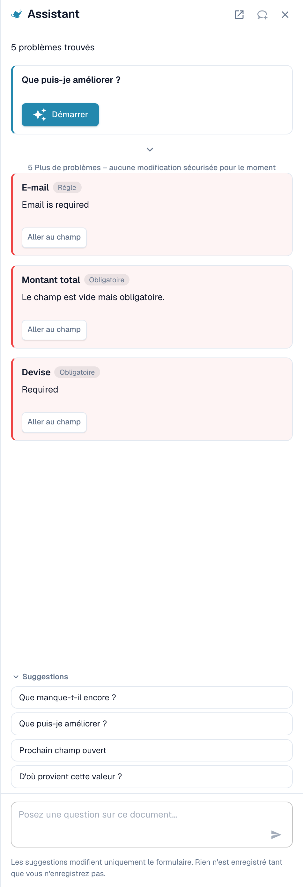
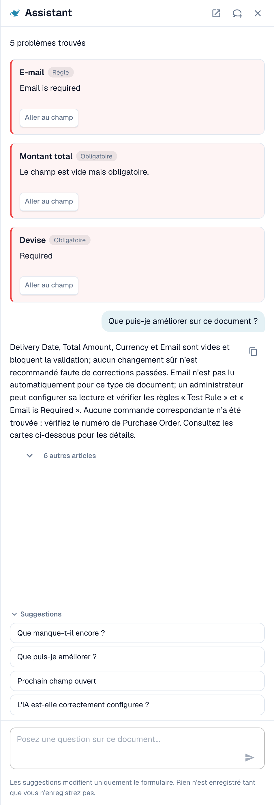

# Assistant et droits

[AI Table](README.md) · [Structured Output pour les tableaux](structured-output.md)

## L'Assistant et le tableau AI

Cliquez sur l'**Assistant** (icône d'ampoule à côté de Enregistrer sur l'écran de validation) pour poser des questions sur le document.

<figure><figcaption>
L'Assistant liste les problèmes ouverts et propose des questions à poser.
</figcaption></figure>

**Ce que l'Assistant fait pour les tableaux.** Il peut vous amener à une cellule du tableau et, si vous avez le droit de modifier le document, définir la valeur d'une cellule ou ajouter une ligne de tableau. Cela fonctionne aussi bien dans le Tableau extrait IA que dans le Tableau extrait. Il répond également à des questions comme *Que manque-t-il encore ?* et *Que puis-je améliorer ?*.

<figure><figcaption>
Demandez <em>Que puis-je améliorer ?</em> pour obtenir une courte liste de ce qu'il faut corriger ensuite.
</figcaption></figure>

**Ce qu'il ne fait pas.** L'Assistant ne modifie **pas** les instructions pour l'IA, les colonnes supplémentaires, le mappage des colonnes ni la formation. Pour cela, utilisez la carte **Instructions pour l'IA** (**Suggérer avec Nexus**, **Test de changement**, **Appliquer**, **Enregistrer comme formation**). Les administrateurs peuvent demander *L'IA est-elle correctement configurée ?* pour obtenir des conseils sur les paramètres, par exemple sur la combinaison de la lecture de tableau par IA avec des règles de tableau enregistrées.

### Suggérer une règle à votre administrateur

De nombreux problèmes viennent d'un **champ**, pas du tableau : un e-mail toujours obligatoire mais vide, une date au mauvais format, un ID fournisseur qui nécessite une recherche. Pour ces cas, toute personne pouvant ouvrir le document peut envoyer une proposition via l'Assistant :

1. Demandez *Que puis-je améliorer ?* ou ouvrez une carte de constat dans l'Assistant.
2. Si vous êtes administrateur, la carte propose **Appliquer**. Sinon, elle indique *An administrator can review this proposal.* et affiche **Suggest improvement**. Cliquez dessus.
3. DocBits affiche *Your suggestion was sent to the administrators.* Si quelqu'un a déjà envoyé la même suggestion, votre demande y est comptée au lieu d'en créer une seconde.
4. La carte affiche ensuite **Requested**, puis plus tard **Implemented** ou **Declined** (avec le motif, si l'administrateur en a donné un).

La proposition peut être une **règle de transformation**, une **règle de validation** ou une **recherche** (lookup). Vous l'envoyez depuis le document, et le serveur construit lui-même le brouillon de règle à partir du problème qu'il a trouvé : vous n'avez rien à écrire. Le nombre de suggestions est limité à 20 par utilisateur et par heure.


Vous ne pouvez pas proposer ainsi des **instructions pour le tableau AI, un mappage de colonnes ou une formation**. Si un tableau doit être corrigé, corrigez-le dans le document et prévenez un administrateur, ou demandez à votre administrateur d'utiliser **Enregistrer comme formation** sur un document de ce fournisseur. Les administrateurs peuvent enregistrer des règles ; voir [Qui peut faire quoi](assistant-and-permissions.md#qui-peut-faire-quoi).


**Ce que voit l'administrateur.** Les administrateurs sont avertis par une tâche et un e-mail. Ils ouvrent **Touchless Intelligence** et trouvent la proposition sous **Améliorations ouvertes** (onglet *Ouvertes*, historique dans *Historique*). Un clic ouvre le panneau *Improvement suggestion* avec des documents d'exemple et un aperçu. L'administrateur peut **Approuver** ou **Rejeter**. Lors de l'approbation, **Switch on right away** détermine si la nouvelle règle est active immédiatement ; sans cette option, la règle est créée inactive et l'administrateur l'active dans la liste des règles. Le rejet demande un motif et une note facultative pour les demandeurs. Voir [Touchless Intelligence](../../../administration-and-setup/touchless-intelligence.md).

<figure><figcaption>
Les administrateurs trouvent les propositions sous <strong>Améliorations ouvertes</strong>.
</figcaption></figure>

## Qui peut faire quoi

| Action | Qui |
| --- | --- |
| Remapper une colonne, **Supprimer la colonne**, **Formatage du montant**, **Extract From**, **Test de changement**, **Appliquer**, modifier des lignes | Toute personne pouvant modifier le document |
| **Enregistrer comme formation** | Toute personne pouvant modifier, sauf si le paramètre d'organisation **Règles d'extraction enregistrées (Administrateur uniquement)** est activé. Seuls les administrateurs de l'organisation peuvent alors enregistrer des règles ; les autres reçoivent un message d'erreur. |
| **Ajouter une nouvelle colonne de tableau** | Administrateurs |
| Suggérer une règle via l'Assistant | Toute personne pouvant ouvrir le document |
| Approuver ou rejeter une suggestion | Administrateurs |
| **Expliquer l'extraction**, **Conseils en IA** | Utilisateurs dont le rôle a accès au module Tableau de bord analytique |
