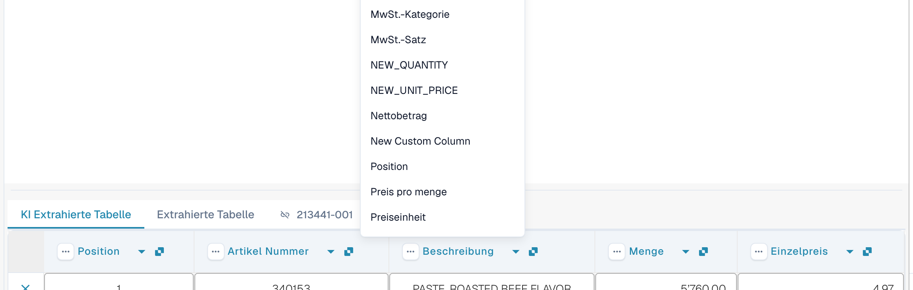
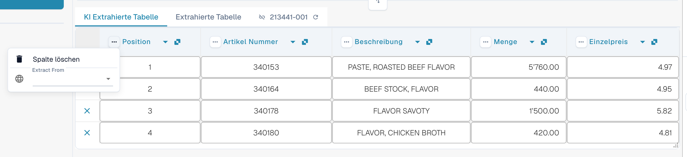
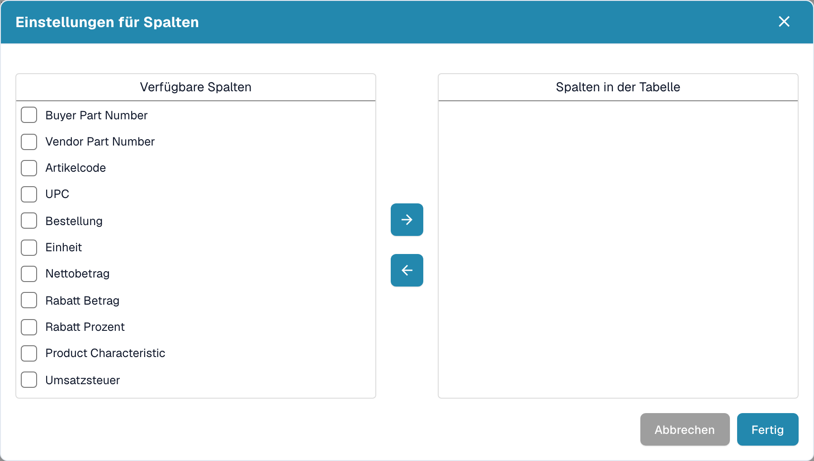

# Spalten und Korrekturen

[AI Table](README.md) · [Structured Output für Tabellen](structured-output.md)

## Eine Spalte ändern

### Die richtige Spalte wählen (neu zuordnen)

Verwenden Sie dies, wenn ein Wert in der falschen Spalte steht, zum Beispiel der Nettobetrag in *Gesamtbetrag* oder *Menge* leer ist, obwohl die Rechnung sie enthält.

1. Klicken Sie in der Überschrift auf den **Spaltennamen**.
2. Wählen Sie die konfigurierte Tabellenspalte, zu der die Werte tatsächlich gehören.

<figure><figcaption>
Klicken Sie auf den Spaltennamen und wählen Sie die gewünschte Spalte. Die Liste zeigt jede konfigurierte Tabellenspalte.
</figcaption></figure>

DocBits formatiert die Tabelle sofort neu, nur für dieses Dokument. Wird die gewählte Spalte bereits von einer anderen Spalte verwendet, warnt ein Dialog, dass die andere Spalte danach nicht mehr zugeordnet ist. Bestätigen Sie, um fortzufahren. Die andere Spalte zeigt dann das Fehlersymbol *Wählen Sie aus der Dropdown-Liste eine Spalte aus, die Sie zuordnen möchten.*, damit Sie auch für sie eine Spalte wählen können.

### Das Drei-Punkte-Menü

<figure><figcaption>
Das Drei-Punkte-Menü einer Spalte.
</figcaption></figure>

| Eintrag | Was er bewirkt |
| --- | --- |
| **Spalte löschen** | Blendet die Spalte aus. Eine Bestätigung meldet *Änderungen werden verworfen*; wählen Sie **Fertig**. Die Tabelle wird ohne die Spalte neu aufgebaut. Mit **Tabellenspalte wiederherstellen** in der Symbolleiste im Fußbereich holen Sie ausgeblendete Spalten zurück. |
| **Spalte deaktivieren** | Für eine Spalte, die Sie selbst hinzugefügt haben: blendet sie aus, ohne die KI erneut auszuführen. |
| **Betragsformatierung** | Nur für Betragsspalten. Legen Sie fest, wie Zahlen gelesen werden (Dezimal- und Tausendertrennzeichen). **Auto** lässt DocBits entscheiden. |
| **Extract From** | Weist die KI an, den Wert aus der Zeile **Above** (darüber) oder **Below** (darunter) der Spaltenbezeichnung zu übernehmen. Lassen Sie das Feld leer, wenn der Wert an der üblichen Stelle steht. |

### Symbolleiste im Fußbereich

<figure><figcaption>
Die Tabellensymbole im Fußbereich des Validierungsbildschirms, von links nach rechts.
</figcaption></figure>

| Symbol (Tooltip) | Was es bewirkt |
| --- | --- |
| **Zur Ansicht der Tabellenextraktion wechseln** | Öffnet das klassische Tabellentraining. Hat das Dokument eine KI-Tabelle, warnt DocBits: *Die Tabelle wurde bereits von der KI extrahiert. Möchten Sie manuell trainieren? In Zukunft wird die KI-Tabelle für diesen Lieferanten nicht mehr extrahiert* |
| **Leere gemappte Spalten hinzufügen** | Öffnet **Einstellungen für Spalten**, um konfigurierte Spalten hinzuzufügen, die die KI nicht gefüllt hat, damit Sie die Werte von Hand eintragen können. |
| **Nicht zugeordnete Spalten anzeigen** / **Nicht zugeordnete Spalten ausblenden** | Zeigt oder verbirgt die Spalten, die die KI geliefert hat und die keiner konfigurierten Spalte zugeordnet sind. Standardmäßig sind sie ausgeblendet. Das ändert nur die Ansicht dieses Dokuments. |
| **Tabelle für diesen Lieferanten blockieren** | Schaltet die Tabellenextraktion für den Lieferanten aus. |
| **Tabelle löschen** | Leert die Tabelle im Editor. |
| **Neue Tabellenspalte hinzufügen** | Fügt eine benutzerdefinierte Spalte hinzu. Nur für Administratoren. |
| **Neue Tabellenzeile hinzufügen** | Fügt eine leere Zeile hinzu. |
| **Tabellenvalidierung ignorieren** | Ignoriert die Tabellenvalidierung für dieses Dokument. |
| **Tabellenspalte wiederherstellen** | Holt jede Spalte zurück, die Sie gelöscht haben. |

<figure><figcaption>
Einstellungen für Spalten: Verschieben Sie Spalten mit den Pfeiltasten von <em>Verfügbare Spalten</em> nach <em>Spalten in der Tabelle</em> und wählen Sie dann <strong>Fertig</strong>.
</figcaption></figure>
