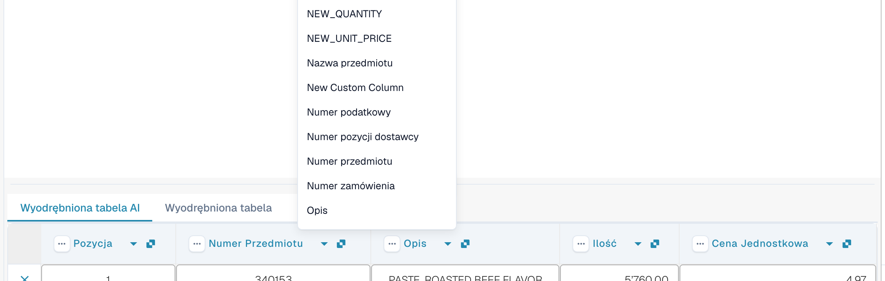
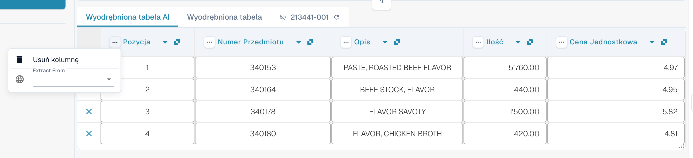
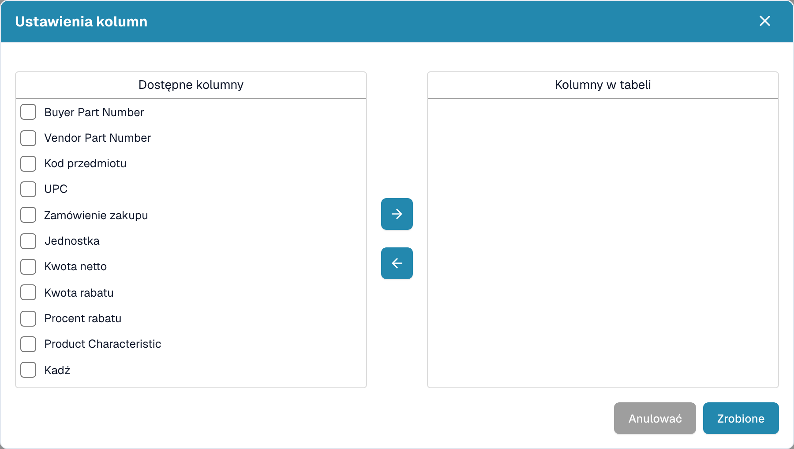

# Kolumny i poprawki

[AI Table](README.md) · [Structured Output dla tabel](structured-output.md)

## Zmiana kolumny

### Wybierz właściwą kolumnę (ponowne mapowanie)

Użyj tej funkcji, gdy wartość znajduje się w złej kolumnie, na przykład kwota netto jest w kolumnie *Całkowita kwota* albo *Ilość* jest pusta, chociaż faktura ją zawiera.

1. Kliknij **nazwę kolumny** w nagłówku.
2. Wybierz skonfigurowaną kolumnę tabeli, do której wartości naprawdę należą.

<figure><figcaption>
Kliknij nazwę kolumny i wybierz kolumnę, którą ma być. Lista pokazuje każdą skonfigurowaną kolumnę tabeli.
</figcaption></figure>

DocBits od razu formatuje tabelę na nowo, tylko dla tego dokumentu. Jeśli wybrana kolumna jest już używana przez inną kolumnę, okno dialogowe *Zmapować "…"?* ostrzega, że tamta kolumna stanie się niezmapowana. Potwierdź, aby kontynuować; tamta kolumna pokazuje wtedy ikonę błędu *Wybierz kolumnę do mapowania z listy rozwijanej*, abyś mógł wybrać kolumnę także dla niej.

### Menu trzech kropek

<figure><figcaption>
Menu trzech kropek kolumny.
</figcaption></figure>

| Pozycja | Co robi |
| --- | --- |
| **Usuń kolumnę** | Ukrywa kolumnę. Potwierdzenie informuje: *Zmiany zostaną odrzucone*; wybierz **Zrobione**. Tabela jest odbudowywana bez tej kolumny. Aby przywrócić ukryte kolumny, użyj **Przywróć kolumnę tabeli** na pasku narzędzi w stopce. |
| **Wyłącz kolumnę** | Dla kolumny dodanej przez Ciebie: ukrywa ją bez ponownego uruchamiania AI. |
| **Formatowanie kwoty** | Tylko dla kolumn z kwotami. Wybierz, jak odczytywać liczby (separatory dziesiętny i tysięcy). **Auto** pozwala DocBits zdecydować. |
| **Extract From** | Informuje AI, że wartość ma pochodzić z wiersza **Above** (powyżej) lub **Below** (poniżej) etykiety kolumny. Pozostaw puste, jeśli wartość znajduje się w zwykłym miejscu. |

### Pasek narzędzi w stopce

<figure><figcaption>
Ikony tabeli w stopce ekranu walidacji, od lewej do prawej.
</figcaption></figure>

| Ikona (podpowiedź) | Co robi |
| --- | --- |
| **Przejdź do widoku ekstrakcji tabeli** | Otwiera klasyczne szkolenie tabeli. Jeśli dokument ma tabelę AI, DocBits ostrzega: *Tabela jest już wyodrębniona przez AI. Czy chcesz trenować ręcznie? W przyszłości tabela AI nie będzie wyodrębniana dla tego dostawcy*. |
| **Dodaj puste kolumny mapowane** | Otwiera **Ustawienia kolumn**, aby dodać skonfigurowane kolumny, których AI nie wypełniła, i wpisać wartości ręcznie. |
| **Pokaż kolumny niemapowane** / **Ukryj kolumny niemapowane** | Pokazuje lub ukrywa kolumny zwrócone przez AI, które nie są zmapowane na skonfigurowaną kolumnę. Domyślnie są ukryte. Zmienia to tylko widok tego dokumentu. |
| **Ekstrakcja tabeli bloków dla tego dostawcy** | Wyłącza ekstrakcję tabeli dla dostawcy. |
| **Usuń tabelę** | Czyści tabelę w edytorze. |
| **Dodaj nową kolumnę tabeli** | Dodaje własną kolumnę. Tylko dla administratorów. |
| **Dodaj nowy wiersz tabeli** | Dodaje pusty wiersz. |
| **Ignoruj walidację tabeli** | Ignoruje walidację tabeli dla tego dokumentu. |
| **Przywróć kolumnę tabeli** | Przywraca każdą usuniętą kolumnę. |

<figure><figcaption>
Ustawienia kolumn: przenieś kolumny z listy <em>Dostępne kolumny</em> do <em>Kolumny w tabeli</em> za pomocą przycisków strzałek, a następnie wybierz <strong>Zrobione</strong>.
</figcaption></figure>
