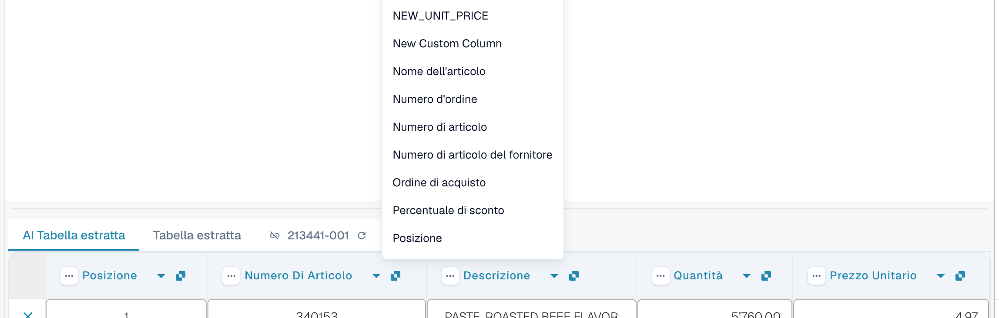
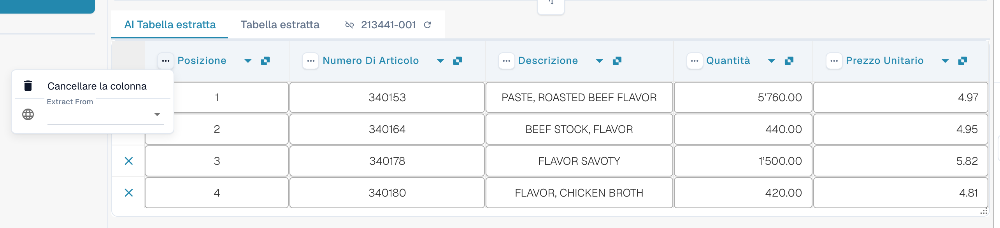
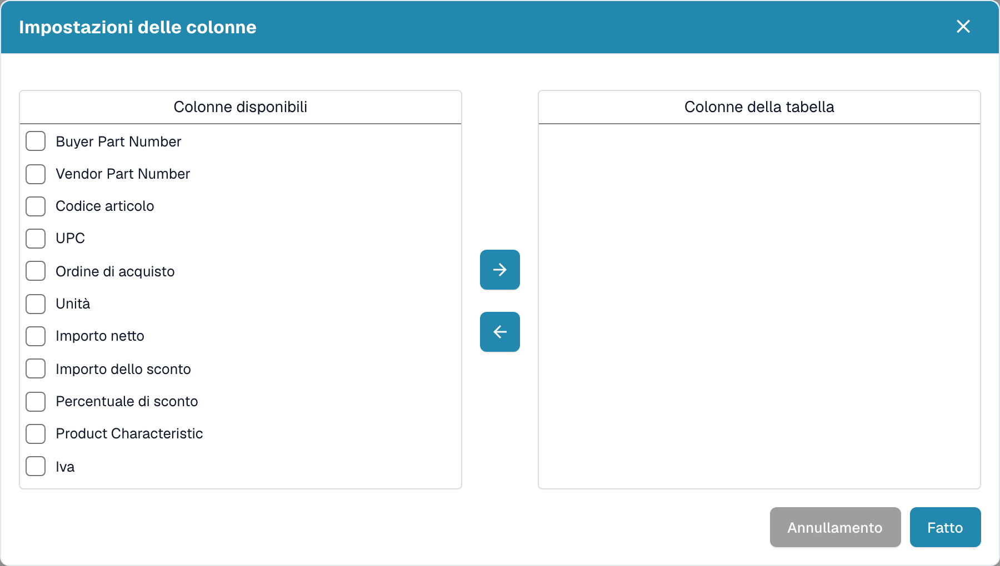

# Colonne e correzioni

[AI Table](README.md) · [Structured Output per le tabelle](structured-output.md)

## Modificare una colonna

### Scegliere la colonna giusta (rimappatura)

Usa questa funzione quando un valore si trova nella colonna sbagliata, ad esempio l'importo netto è in *Importo totale* oppure *Quantità* è vuota anche se la fattura la riporta.

1. Fai clic sul **nome della colonna** nell'intestazione.
2. Scegli la colonna della tabella configurata a cui i valori appartengono davvero.

<figure><figcaption>
Fai clic sul nome della colonna e scegli quale colonna deve essere. L'elenco mostra tutte le colonne della tabella configurate.
</figcaption></figure>

DocBits riformatta subito la tabella, solo per questo documento. Se la colonna scelta è già usata da un'altra colonna, una finestra di dialogo *Rimappare "…"?* avvisa che l'altra colonna diventerà non mappata. Conferma per continuare; l'altra colonna mostra allora l'icona di errore *Select a column to map from dropdown*, così puoi scegliere una colonna anche per essa.

### Il menu con i tre puntini

<figure><figcaption>
Il menu con i tre puntini di una colonna.
</figcaption></figure>

| Voce | Cosa fa |
| --- | --- |
| **Cancellare la colonna** | Nasconde la colonna. Una conferma indica *Le modifiche saranno scartate*; scegli **Fatto**. La tabella viene ricostruita senza la colonna. Usa **Ripristino della colonna della tabella** nella barra degli strumenti a piè di pagina per riportare le colonne nascoste. |
| **Disattivare la colonna** | Per una colonna che hai aggiunto tu: la nasconde senza rieseguire l'AI. |
| **Formattazione degli importi** | Solo per le colonne di importo. Scegli come vengono letti i numeri (separatori dei decimali e delle migliaia). **Auto** lascia decidere a DocBits. |
| **Extract From** | Indica all'AI di prendere il valore dalla riga **Above** (sopra) o **Below** (sotto) l'etichetta della colonna. Lascialo vuoto se il valore si trova nella posizione normale. |

### Barra degli strumenti a piè di pagina

<figure><figcaption>
Le icone della tabella nel piè di pagina della schermata di validazione, da sinistra a destra.
</figcaption></figure>

| Icona (tooltip) | Cosa fa |
| --- | --- |
| **Vai alla vista di estrazione della tabella** | Apre l'addestramento classico della tabella. Se il documento ha una tabella AI, DocBits avvisa: *La tabella è già stata estratta dall'intelligenza artificiale. Volete allenarvi manualmente? In futuro la tabella AI non verrà estratta per questo fornitore.* |
| **Aggiungere colonne mappate vuote** | Apre **Impostazioni delle colonne** per aggiungere le colonne configurate che l'AI non ha compilato, così puoi digitare i valori a mano. |
| **Mostra le colonne non mappate** / **Nascondere le colonne non mappate** | Mostra o nasconde le colonne restituite dall'AI che non sono mappate a una colonna configurata. Per impostazione predefinita sono nascoste. Questo modifica solo la vista di questo documento. |
| **Estrazione della tabella dei blocchi per questo fornitore** | Disattiva l'estrazione della tabella per il fornitore. |
| **Cancellare la tabella** | Svuota la tabella nell'editor. |
| **Aggiungere una nuova colonna alla tabella** | Aggiunge una colonna personalizzata. Solo amministratori. |
| **Aggiungere una nuova riga di tabella** | Aggiunge una riga vuota. |
| **Ignorare la convalida della tabella** | Ignora la convalida della tabella per questo documento. |
| **Ripristino della colonna della tabella** | Riporta tutte le colonne che hai eliminato. |

<figure><figcaption>
Impostazioni delle colonne: sposta le colonne da <em>Colonne disponibili</em> a <em>Colonne della tabella</em> con i pulsanti a freccia, poi scegli <strong>Fatto</strong>.
</figcaption></figure>
