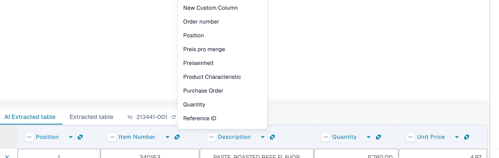
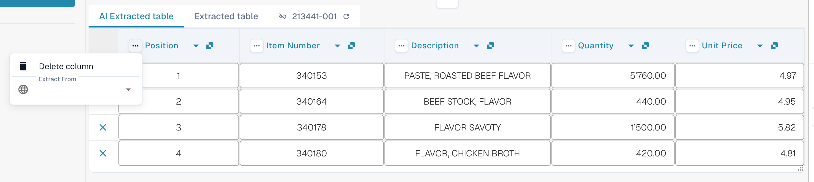
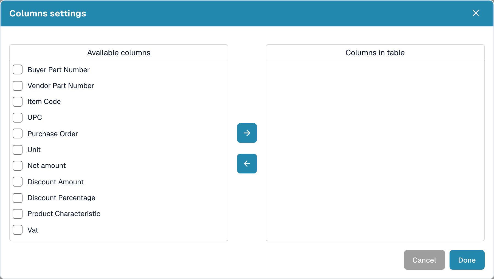

# Columns and corrections

[AI Table](README.md) · [Structured Output for Tables](structured-output.md)

## Change a column

### Pick the right column (remap)

Use this when a value sits in the wrong column, for example the net amount is in _Total amount_ or _Quantity_ is empty although the invoice has it.

1. Click the **column name** in the header.
2. Pick the configured table column the values really belong to.

<figure><figcaption>
Click the column name and pick the column it should be. The list shows every configured table column.
</figcaption></figure>

DocBits reformats the table at once, for this document only. If the column you picked is already used by another column, a dialog _Remap "…"?_ warns that the other column will become unmapped. Confirm to continue; the other column then shows the error icon _Select a column to map from dropdown_ so you can pick a column for it too.

### The three-dots menu

<figure><figcaption>
The three-dots menu of a column.
</figcaption></figure>

| Entry                 | What it does                                                                                                                                                                                                        |
| --------------------- | ------------------------------------------------------------------------------------------------------------------------------------------------------------------------------------------------------------------- |
| **Delete column**     | Hides the column. A confirmation says _Modifications will be discarded_; choose **Done**. The table is rebuilt without the column. Use **Restore Table Column** in the footer toolbar to bring hidden columns back. |
| **Disable column**    | For a column you added yourself: hides it without re-running the AI.                                                                                                                                                |
| **Amount Formatting** | Only for amount columns. Choose how numbers are read (decimal and thousand separators). **Auto** lets DocBits decide.                                                                                               |
| **Extract From**      | Tells the AI to take the value from the line **Above** or **Below** the column label. Leave it empty if the value is in the normal place.                                                                           |

### Footer toolbar

<figure><figcaption>
The table icons in the footer of the validation screen, left to right.
</figcaption></figure>

| Icon (tooltip)                                            | What it does                                                                                                                                                                                                  |
| --------------------------------------------------------- | ------------------------------------------------------------------------------------------------------------------------------------------------------------------------------------------------------------- |
| **Go to table extraction view**                           | Opens the classic table training. If the document has an AI table, DocBits warns: _Table is already extracted by AI. Do you want to train manually? In future AI table will not extracted for this supplier_. |
| **Add empty mapped columns**                              | Opens **Columns settings** to add configured columns that the AI did not fill, so you can type the values by hand.                                                                                            |
| **Show non mapped columns** / **Hide non mapped columns** | Shows or hides the columns the AI returned that are not mapped to a configured column. By default they are hidden. This only changes the view of this document.                                               |
| **Block table extraction for this supplier**              | Switches table extraction off for the supplier.                                                                                                                                                               |
| **Delete table**                                          | Clears the table in the editor.                                                                                                                                                                               |
| **Add new table column**                                  | Adds a custom column. Admins only.                                                                                                                                                                            |
| **Add new table row**                                     | Adds an empty row.                                                                                                                                                                                            |
| **Ignore table validation**                               | Ignores the table validation for this document.                                                                                                                                                               |
| **Restore Table Column**                                  | Brings back every column you deleted.                                                                                                                                                                         |

<figure><figcaption>
Columns settings: move columns from <em>Available columns</em> to <em>Columns in table</em> with the arrow buttons, then choose <strong>Done</strong>.
</figcaption></figure>
