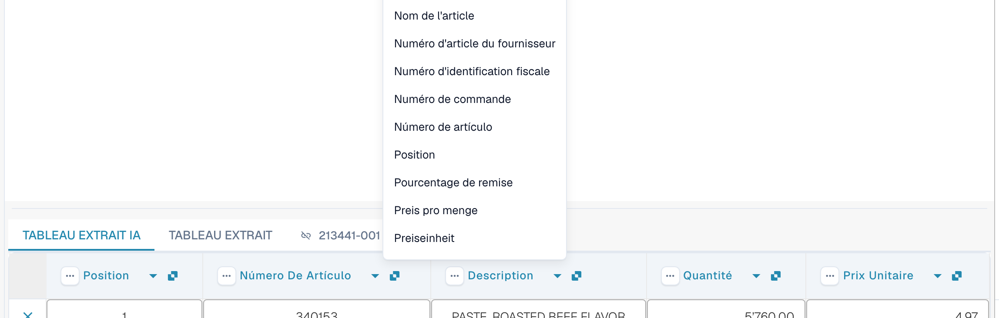
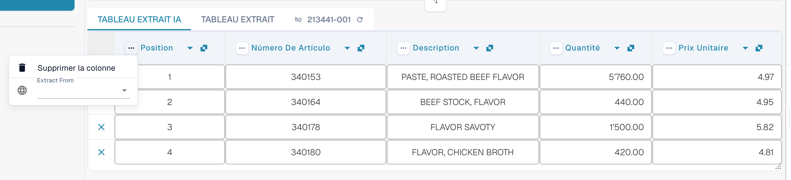
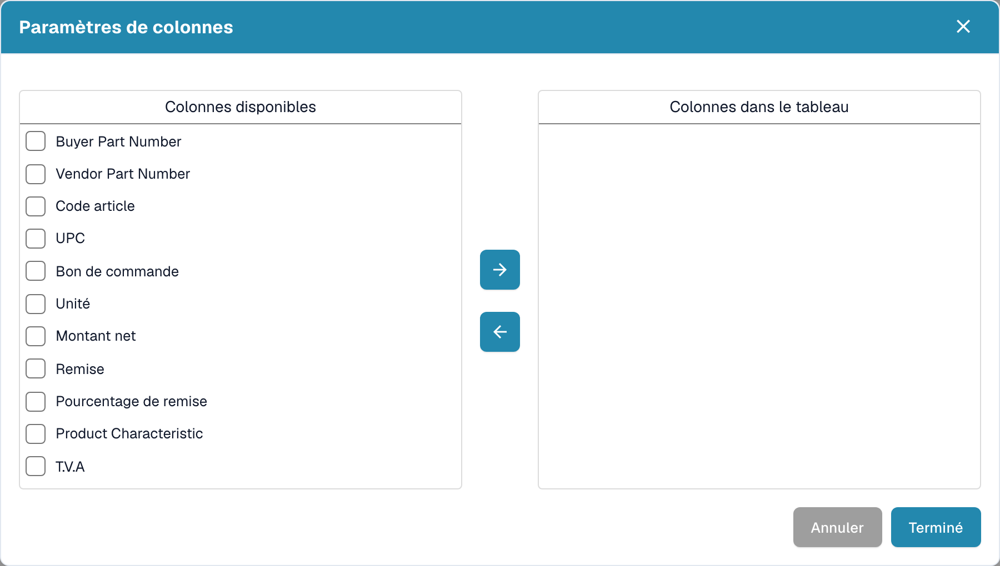

# Colonnes et corrections

[AI Table](README.md) · [Structured Output pour les tableaux](structured-output.md)

## Modifier une colonne

### Choisir la bonne colonne (remappage)

Utilisez cette option lorsqu'une valeur se trouve dans la mauvaise colonne, par exemple lorsque le montant net est dans *Montant total* ou que *Quantité* est vide alors que la facture l'indique.

1. Cliquez sur le **nom de la colonne** dans l'en-tête.
2. Choisissez la colonne de tableau configurée à laquelle les valeurs appartiennent réellement.

<figure><figcaption>
Cliquez sur le nom de la colonne et choisissez la colonne qu'elle doit être. La liste affiche toutes les colonnes de tableau configurées.
</figcaption></figure>

DocBits reformate aussitôt le tableau, pour ce document uniquement. Si la colonne choisie est déjà utilisée par une autre colonne, une boîte de dialogue *Remapper "…" ?* avertit que l'autre colonne ne sera plus mappée. Confirmez pour continuer ; l'autre colonne affiche alors l'icône d'erreur *Sélectionnez une colonne à mapper dans la liste déroulante.* afin que vous puissiez aussi lui choisir une colonne.

### Le menu trois points

<figure><figcaption>
Le menu trois points d'une colonne.
</figcaption></figure>

| Entrée | Ce qu'elle fait |
| --- | --- |
| **Supprimer la colonne** | Masque la colonne. Une confirmation indique *Les modifications ne seront pas prises en compte* ; choisissez **Terminé**. Le tableau est reconstruit sans la colonne. Utilisez **Restaurer colonne du tableau** dans la barre d'outils du pied de page pour récupérer les colonnes masquées. |
| **Désactiver la colonne** | Pour une colonne que vous avez ajoutée vous-même : la masque sans relancer l'IA. |
| **Formatage du montant** | Uniquement pour les colonnes de montant. Choisissez comment les nombres sont lus (séparateurs décimaux et de milliers). **Auto** laisse DocBits décider. |
| **Extract From** | Indique à l'IA de prendre la valeur sur la ligne située au-dessus (**Above**) ou en dessous (**Below**) du libellé de la colonne. Laissez le champ vide si la valeur se trouve à l'endroit habituel. |

### Barre d'outils du pied de page

<figure><figcaption>
Les icônes du tableau dans le pied de page de l'écran de validation, de gauche à droite.
</figcaption></figure>

| Icône (info-bulle) | Ce qu'elle fait |
| --- | --- |
| **Aller à la vue d'extraction de tableau** | Ouvre l'entraînement classique du tableau. Si le document a un tableau AI, DocBits avertit : *Le tableau est déjà extrait par l'IA. Voulez-vous l'entraîner manuellement ? A l'avenir, l'IA n'extraira pas de tableau pour ce fournisseur.* |
| **Ajouter des colonnes mappées vides** | Ouvre **Paramètres de colonnes** pour ajouter les colonnes configurées que l'IA n'a pas remplies, afin que vous puissiez saisir les valeurs à la main. |
| **Afficher les colonnes non mappées** / **Masquer les colonnes non mappées** | Affiche ou masque les colonnes renvoyées par l'IA qui ne sont pas mappées à une colonne configurée. Par défaut, elles sont masquées. Cela ne modifie que l'affichage de ce document. |
| **Blocage de l'extraction de table pour ce fournisseur** | Désactive l'extraction de table pour le fournisseur. |
| **Supprimer le tableau** | Vide le tableau dans l'éditeur. |
| **Ajouter une nouvelle colonne de tableau** | Ajoute une colonne personnalisée. Réservé aux administrateurs. |
| **Ajouter une nouvelle ligne de tableau** | Ajoute une ligne vide. |
| **Ignorer la validation du tableau** | Ignore la validation du tableau pour ce document. |
| **Restaurer colonne du tableau** | Récupère toutes les colonnes que vous avez supprimées. |

<figure><figcaption>
Paramètres de colonnes : déplacez les colonnes de <em>Colonnes disponibles</em> vers <em>Colonnes dans le tableau</em> avec les boutons fléchés, puis choisissez <strong>Terminé</strong>.
</figcaption></figure>
