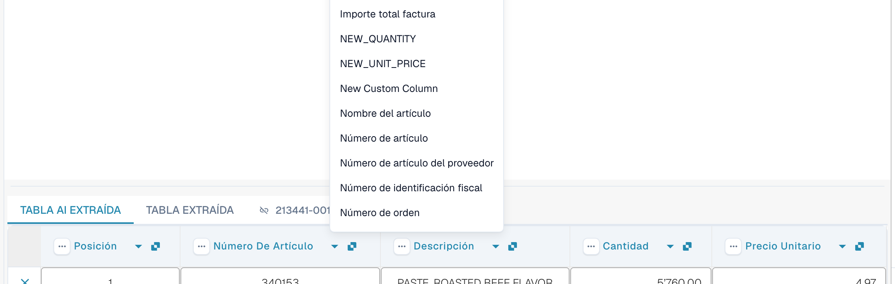
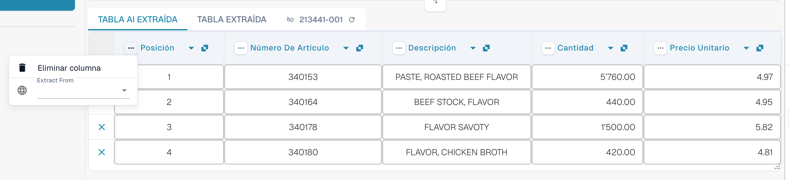

# Columnas y correcciones

[AI Table](README.md) · [Structured Output para tablas](structured-output.md)

## Cambiar una columna

### Elegir la columna correcta (reasignar)

Úsalo cuando un valor está en la columna equivocada, por ejemplo cuando el importe neto está en *Importe total factura* o *Cantidad* está vacía aunque la factura la tenga.

1. Haz clic en el **nombre de la columna** en el encabezado.
2. Elige la columna de tabla configurada a la que pertenecen realmente los valores.

<figure><figcaption>
Haz clic en el nombre de la columna y elige cuál debe ser. La lista muestra todas las columnas de tabla configuradas.
</figcaption></figure>

DocBits reformatea la tabla de inmediato, solo para este documento. Si la columna que has elegido ya la usa otra columna, un diálogo *¿Reasignar "…"?* avisa de que la otra columna quedará sin asignar. Confirma para continuar; la otra columna muestra entonces el icono de error *Seleccione una columna para mapear desde el menú desplegable* para que también puedas elegirle una columna.

### El menú de tres puntos

<figure><figcaption>
El menú de tres puntos de una columna.
</figcaption></figure>

| Entrada | Qué hace |
| --- | --- |
| **Eliminar columna** | Oculta la columna. Una confirmación indica *Las modificaciones se descartarán*; elige **Hecho**. La tabla se reconstruye sin la columna. Usa **Restaurar columna de tabla** en la barra de herramientas del pie para recuperar las columnas ocultas. |
| **Desactivar columna** | Para una columna que has añadido tú: la oculta sin volver a ejecutar la IA. |
| **Formato de cantidad** | Solo para columnas de importes. Elige cómo se leen los números (separadores de decimales y de miles). **Auto** deja que DocBits decida. |
| **Extract From** | Indica a la IA que tome el valor de la línea **Above** o **Below** de la etiqueta de la columna. Déjalo vacío si el valor está en el lugar habitual. |

### Barra de herramientas del pie

<figure><figcaption>
Los iconos de la tabla en el pie de la pantalla de validación, de izquierda a derecha.
</figcaption></figure>

| Icono (tooltip) | Qué hace |
| --- | --- |
| **Ir a la vista de extracción de tabla** | Abre el entrenamiento de tabla clásico. Si el documento tiene una tabla AI, DocBits avisa: *La tabla ya está extraída por la IA. ¿Quiere entrenar manualmente? En el futuro, la IA no extraerá la tabla de este proveedor.* |
| **Añadir columnas vacías** | Abre **Configuración de columnas** para añadir columnas configuradas que la IA no ha rellenado, de modo que puedas escribir los valores a mano. |
| **Mostrar columnas no asignadas** / **Ocultar columnas no asignadas** | Muestra u oculta las columnas que ha devuelto la IA y que no están asignadas a una columna configurada. Por defecto están ocultas. Esto solo cambia la vista de este documento. |
| **Extracción de la tabla de bloque para este proveedor** | Desactiva la extracción de tabla para el proveedor. |
| **Eliminar tabla** | Vacía la tabla en el editor. |
| **Agregar nueva columna de tabla** | Añade una columna personalizada. Solo administradores. |
| **Añadir nueva fila de tabla** | Añade una fila vacía. |
| **Ignorar validación de tabla** | Ignora la validación de tabla de este documento. |
| **Restaurar columna de tabla** | Recupera todas las columnas que has eliminado. |

<figure><figcaption>
Configuración de columnas: mueve columnas de <em>Columnas disponibles</em> a <em>Columnas en la tabla</em> con los botones de flecha y elige después <strong>Hecho</strong>.
</figcaption></figure>
