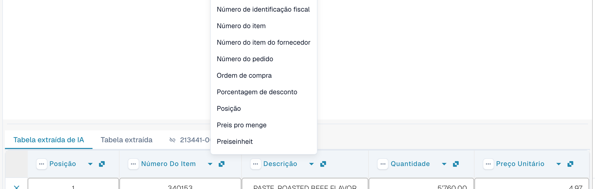
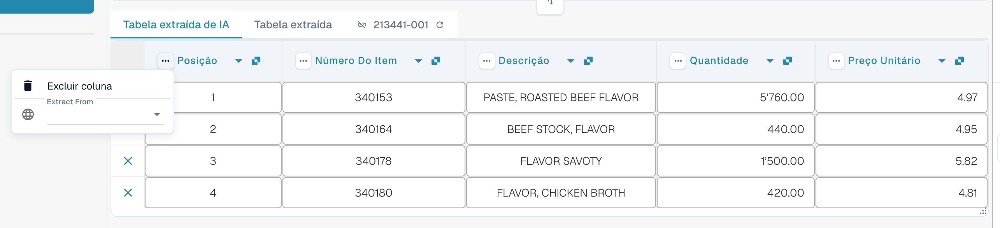
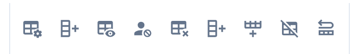
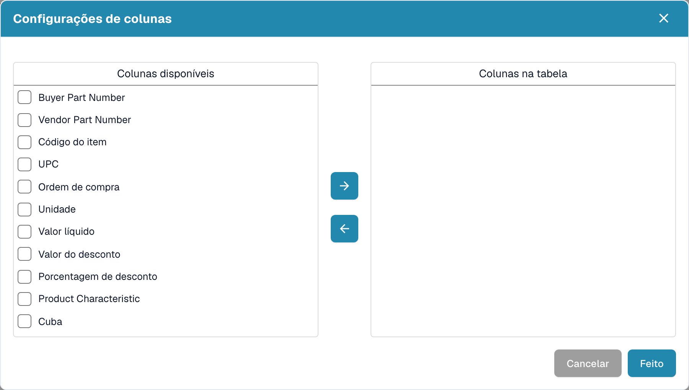

# Colunas e correções

[AI Table](README.md) · [Structured Output para tabelas](structured-output.md)

## Alterar uma coluna

### Escolher a coluna certa (remapear)

Use esta opção quando um valor está na coluna errada, por exemplo, o valor líquido está em *Montante total* ou *Quantidade* está vazia embora a fatura a tenha.

1. Clique no **nome da coluna** no cabeçalho.
2. Escolha a coluna da tabela configurada à qual os valores realmente pertencem.

<figure><figcaption>
Clique no nome da coluna e escolha qual coluna ela deve ser. A lista mostra todas as colunas de tabela configuradas.
</figcaption></figure>

O DocBits reformata a tabela imediatamente, somente para este documento. Se a coluna escolhida já for usada por outra coluna, uma caixa de diálogo *Remapear "…"?* avisa que a outra coluna ficará sem mapeamento. Confirme para continuar; a outra coluna passa então a mostrar o ícone de erro *Selecione uma coluna para mapear no menu suspenso*, para que você também escolha uma coluna para ela.

### O menu de três pontos

<figure><figcaption>
O menu de três pontos de uma coluna.
</figcaption></figure>

| Entrada | O que faz |
| --- | --- |
| **Excluir coluna** | Oculta a coluna. Uma confirmação diz *As modificações serão descartadas*; escolha **Feito**. A tabela é reconstruída sem a coluna. Use **Restaurar coluna da tabela** na barra de ferramentas do rodapé para trazer de volta as colunas ocultas. |
| **Desativar coluna** | Para uma coluna que você mesmo adicionou: oculta-a sem executar a IA novamente. |
| **Formatação de Quantidade** | Somente para colunas de valores. Escolha como os números são lidos (separadores decimais e de milhares). **Auto** deixa o DocBits decidir. |
| **Extract From** | Diz à IA para pegar o valor da linha **Acima** ou **Abaixo** do rótulo da coluna. Deixe vazio se o valor estiver no lugar normal. |

### Barra de ferramentas do rodapé

<figure><figcaption>
Os ícones da tabela no rodapé da tela de validação, da esquerda para a direita.
</figcaption></figure>

| Ícone (dica) | O que faz |
| --- | --- |
| **Ir para a visualização de extração da tabela** | Abre o treinamento clássico de tabela. Se o documento tiver uma tabela de IA, o DocBits avisa: *A tabela já foi extraída pela IA. Deseja treinar manualmente? No futuro, a tabela da IA não será extraída para este fornecedor.* |
| **Adicionar colunas mapeadas vazias** | Abre **Configurações de colunas** para adicionar colunas configuradas que a IA não preencheu, para que você digite os valores manualmente. |
| **Mostrar colunas não mapeadas** / **Ocultar colunas não mapeadas** | Mostra ou oculta as colunas que a IA retornou e que não estão mapeadas para uma coluna configurada. Por padrão, elas ficam ocultas. Isso só altera a exibição deste documento. |
| **Extração de tabela de blocos para este fornecedor** | Desativa a extração de tabela para o fornecedor. |
| **Excluir tabela** | Limpa a tabela no editor. |
| **Adicionar nova coluna de tabela** | Adiciona uma coluna personalizada. Somente administradores. |
| **Adicionar nova linha de tabela** | Adiciona uma linha vazia. |
| **Ignorar validação de tabela** | Ignora a validação da tabela para este documento. |
| **Restaurar coluna da tabela** | Traz de volta todas as colunas que você excluiu. |

<figure><figcaption>
Configurações de colunas: mova colunas de <em>Colunas disponíveis</em> para <em>Colunas na tabela</em> com os botões de seta e depois escolha <strong>Feito</strong>.
</figcaption></figure>
