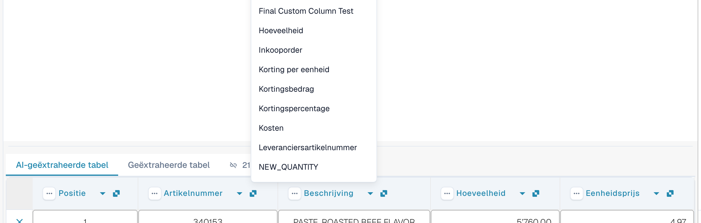
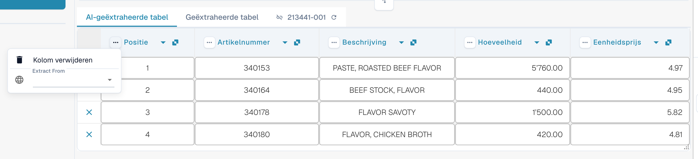
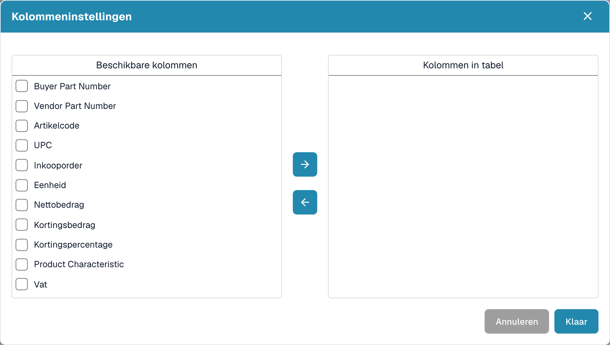

# Kolommen en correcties

[AI Table](README.md) · [Structured Output voor tabellen](structured-output.md)

## Een kolom wijzigen

### De juiste kolom kiezen (herkoppelen)

Gebruik dit wanneer een waarde in de verkeerde kolom staat, bijvoorbeeld wanneer het nettobedrag in *Totaalbedrag* staat of *Hoeveelheid* leeg is, terwijl de factuur de waarde wel heeft.

1. Klik op de **kolomnaam** in de kop.
2. Kies de geconfigureerde tabelkolom waartoe de waarden werkelijk behoren.

<figure><figcaption>
Klik op de kolomnaam en kies de kolom die het moet zijn. De lijst toont elke geconfigureerde tabelkolom.
</figcaption></figure>

DocBits maakt de tabel direct opnieuw op, alleen voor dit document. Als de gekozen kolom al door een andere kolom wordt gebruikt, waarschuwt een dialoogvenster *"…" opnieuw toewijzen?* dat de andere kolom niet meer gekoppeld zal zijn. Bevestig om door te gaan; de andere kolom toont dan het foutpictogram *Select a column to map from dropdown*, zodat u ook daarvoor een kolom kunt kiezen.

### Het menu met drie puntjes

<figure><figcaption>
Het menu met drie puntjes van een kolom.
</figcaption></figure>

| Optie | Wat het doet |
| --- | --- |
| **Kolom verwijderen** | Verbergt de kolom. Een bevestiging meldt *Modifications will be discarded*; kies **Klaar**. De tabel wordt zonder de kolom opnieuw opgebouwd. Gebruik **Tabelkolom herstellen** in de werkbalk onderaan om verborgen kolommen terug te halen. |
| **Kolom uitschakelen** | Voor een kolom die u zelf hebt toegevoegd: verbergt deze zonder de AI opnieuw uit te voeren. |
| **Bedrag opmaak** | Alleen voor bedragkolommen. Kies hoe getallen worden gelezen (decimaal- en duizendtalscheidingsteken). **Auto** laat DocBits beslissen. |
| **Extract From** | Vertelt de AI de waarde te nemen uit de regel **Above** (boven) of **Below** (onder) het kolomlabel. Laat het leeg als de waarde op de normale plek staat. |

### Werkbalk onderaan

<figure><figcaption>
De tabelpictogrammen onderaan het validatiescherm, van links naar rechts.
</figcaption></figure>

| Pictogram (tooltip) | Wat het doet |
| --- | --- |
| **Ga naar tabel-extractieweergave** | Opent de klassieke tabeltraining. Als het document een AI-tabel heeft, waarschuwt DocBits: *De tabel is al door AI geëxtraheerd. Wilt u handmatig trainen? In de toekomst wordt de AI-tabel voor deze leverancier niet meer geëxtraheerd.* |
| **Lege toegewezen kolommen toevoegen** | Opent **Kolommeninstellingen** om geconfigureerde kolommen toe te voegen die de AI niet heeft gevuld, zodat u de waarden met de hand kunt invoeren. |
| **Niet-toegewezen kolommen weergeven** / **Niet-toegewezen kolommen verbergen** | Toont of verbergt de kolommen die de AI heeft teruggegeven en die niet aan een geconfigureerde kolom zijn gekoppeld. Standaard zijn ze verborgen. Dit wijzigt alleen de weergave van dit document. |
| **Bloktabelextractie voor deze leverancier** | Schakelt de tabelextractie voor de leverancier uit. |
| **Tabel verwijderen** | Wist de tabel in de editor. |
| **Nieuwe tabelkolom toevoegen** | Voegt een eigen kolom toe. Alleen voor beheerders. |
| **Nieuwe tabelrij toevoegen** | Voegt een lege rij toe. |
| **Negeer tabelvalidatie** | Negeert de tabelvalidatie voor dit document. |
| **Tabelkolom herstellen** | Haalt elke kolom terug die u hebt verwijderd. |

<figure><figcaption>
Kolommeninstellingen: verplaats kolommen met de pijlknoppen van <em>Beschikbare kolommen</em> naar <em>Kolommen in tabel</em> en kies daarna <strong>Klaar</strong>.
</figcaption></figure>
