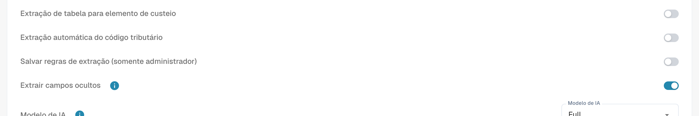

# Configurações e valores específicos

[AI Table](README.md) · [Structured Output para tabelas](structured-output.md)

## Configurações para administradores

Abra **Configurações → Processamento de documentos → Tipos de documentos → Classificação e Extração**, aba **Em geral**, seção **Extração**.

<figure><figcaption>
Controles atuais de extração. Structured Output está desativado nesta configuração existente, portanto não aparece a prévia do esquema. Nenhuma configuração de extração foi alterada.
</figcaption></figure>

* **Extração de tabela** ativa a tabela clássica.
* **Extração de tabela de IA** ativa ou desativa a tabela de IA para a organização.
* **Utilizar Extração Estruturada (IA)**: O interruptor define o padrão da organização para saída estruturada. As colunas solicitadas dependem de Padrão/Sim/Não em Use AI, dos valores específicos do modelo de extração e do treinamento. O guia completo explica configuração, prévia e exemplo. [Structured Output para tabelas](structured-output.md).
* **Salvar regras de extração (somente administrador)**: quando ativada, somente os administradores da organização podem salvar e exportar regras de extração.

<figure><figcaption>
<strong>Salvar regras de extração (somente administrador)</strong> controla quem pode usar <strong>Salvar como treinamento</strong>.
</figcaption></figure>

### Usar IA por coluna

Escolha de três estados: Padrão herda a seleção de IA do tipo de documento, Sim solicita a coluna explicitamente e Não a exclui do esquema base. É independente de Obrigatória, Somente leitura e Oculta. [Structured Output para tabelas](structured-output.md).

Structured Output tem sua própria configuração de organização/modelo de extração, separada do nível de IA. Altere em Mais opções do documento; confirmar salva o valor específico e reinicia esse documento. Os indicadores da lista são somente leitura. Excluir uma entrada pode remover vários valores específicos juntos. [Structured Output para tabelas](structured-output.md).
